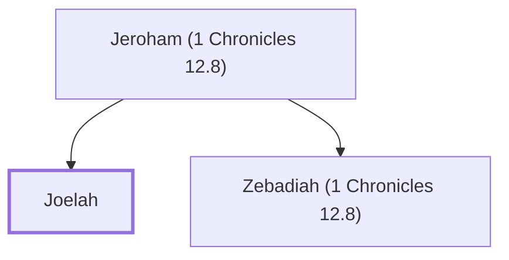

# Joelah

A Benjaminite warrior who joined David at Ziklag

**Original-language names:** יוֹעֵאלָה (H3132)

## Family

- **Father:** [[connections/people/Jeroham (1 Chronicles 12.8)|Jeroham (1 Chronicles 12.8)]]
- **Brothers and sisters:** [[connections/people/Zebadiah (1 Chronicles 12.8)|Zebadiah (1 Chronicles 12.8)]]

**Family group:** [[connections/genealogy/Family of Jeroham (1 Chronicles 12.8)|Family of Jeroham (1 Chronicles 12.8)]], generation 2

## Appears in

[[connections/chapters/13-1-chronicles/1 Chronicles 12|1 Chronicles 12]]

## Appears in the same verse as

[[connections/people/Jeroham (1 Chronicles 12.8)|Jeroham (1 Chronicles 12.8)]] · [[connections/people/Zebadiah (1 Chronicles 12.8)|Zebadiah (1 Chronicles 12.8)]] · [[connections/places/Gedor (Joshua 12.13)|Gedor (Joshua 12.13)]]
