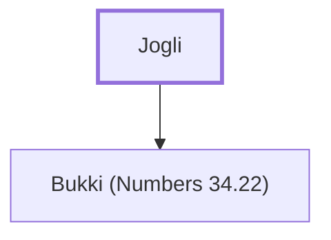

# Jogli

A leader from the tribe of Dan

**Original-language names:** יׇגְלִי (H3020)

## When

- **Placed around:** [[connections/timeline/15th century BC|1452 BC]] *(Ussher: the median date of the passages naming them)*

## Family

- **Children:** [[connections/people/Bukki (Numbers 34.22)|Bukki (Numbers 34.22)]]

**Family group:** [[connections/genealogy/Family of Jogli|Family of Jogli]], generation 1

## Appears in

[[connections/chapters/04-numbers/Numbers 34|Numbers 34]]

## Appears in the same verse as

[[connections/people/Bukki (Numbers 34.22)|Bukki (Numbers 34.22)]] · [[connections/places/Dan|Dan]]
