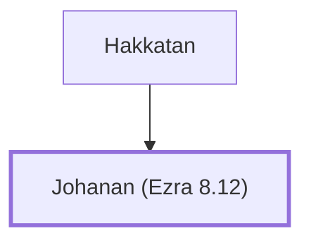

# Johanan (Ezra 8.12)

A leader who returned to Jerusalem with Ezra

**Original-language names:** יוֹחָנָן (H3110)

## When

- **Placed around:** [[connections/timeline/5th century BC|457 BC]] *(Ussher: the median date of the passages naming them)*

## Family

- **Father:** [[connections/people/Hakkatan|Hakkatan]]

**Family group:** [[connections/genealogy/Family of Hakkatan|Family of Hakkatan]], generation 2

## Appears in

[[connections/chapters/15-ezra/Ezra 8|Ezra 8]]

## Appears in the same verse as

[[connections/people/Azgad (Ezra 2.12)|Azgad (Ezra 2.12)]] · [[connections/people/Hakkatan|Hakkatan]]
