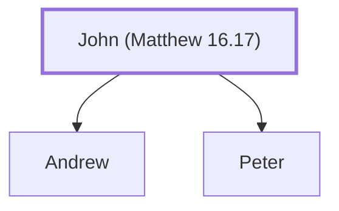

# John (Matthew 16.17)

The father of Simon Peter

**Also called:** Jonah

**Original-language names:** Ἰωάννης (G2491) · Ἰωνᾶς (G2495)

## When

- **Placed around:** [[connections/timeline/1st century AD|AD 33]] *(Ussher: the median date of the passages naming them)*

## Family

- **Children:** [[connections/people/Andrew|Andrew]], [[connections/people/Peter|Peter]]

**Family group:** [[connections/genealogy/Family of John (Matthew 16.17)|Family of John (Matthew 16.17)]], generation 1

## Appears in

[[connections/chapters/40-matthew/Matthew 16|Matthew 16]] · [[connections/chapters/43-john/John 1|John 1]] · [[connections/chapters/43-john/John 21|John 21 (3)]]

## Appears in the same verse as

[[connections/people/Peter|Peter (5)]] · [[connections/people/Jesus|Jesus (4)]]
