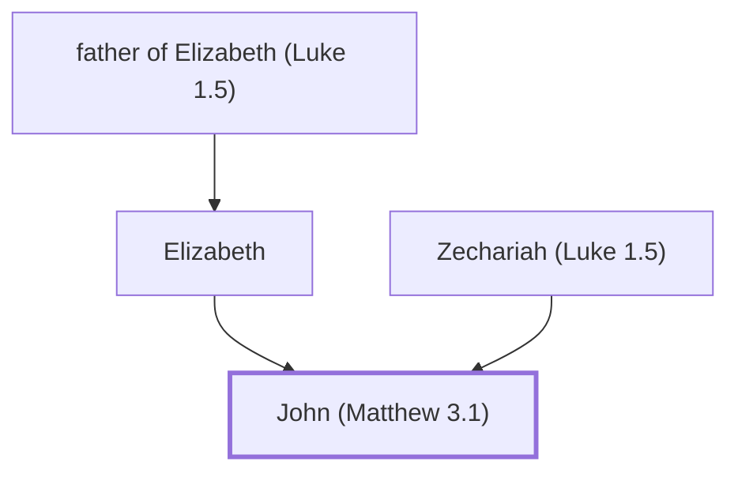

# John (Matthew 3.1)

The Baptist, a prophet who prepared the way for Jesus

**Original-language names:** Ἰωάννης (G2491)

## When

- **Lived:** [[connections/timeline/1st century BC|5 BC]] – ? *(Jones)*
- **Placed around:** [[connections/timeline/1st century AD|AD 31]] *(Ussher: the median date of the passages naming them)*

## Family

- **Father:** [[connections/people/Zechariah (Luke 1.5)|Zechariah (Luke 1.5)]]
- **Mother:** [[connections/people/Elizabeth|Elizabeth]]
- **Tribe or nation:** Tribe of Judah

**Family group:** [[connections/genealogy/Family of Adam|Family of Adam]], generation 3

## Events

- [[connections/timeline/1st century BC|5 BC]] · [[connections/events/Birth of John the Baptist|Birth of John the Baptist]]
- [[connections/timeline/1st century AD|AD 26]] · [[connections/events/John the Baptist Begins Ministry|John the Baptist Begins Ministry]]
- [[connections/timeline/1st century AD|AD 26]] · [[connections/events/John Baptizes Jesus|John Baptizes Jesus]]
- [[connections/timeline/1st century AD|AD 27]] · [[connections/events/John the Baptist Imprisoned|John the Baptist Imprisoned]]
- [[connections/timeline/1st century AD|AD 27]] · [[connections/events/John the Baptist Witnesses|John the Baptist Witnesses]]
- [[connections/timeline/1st century AD|AD 28]] · [[connections/events/Jesus' Message on John the Baptist|Jesus' Message on John the Baptist]]
- [[connections/timeline/1st century AD|AD 29]] · [[connections/events/John Beheaded|John Beheaded]]

## Appears in

[[connections/chapters/40-matthew/Matthew 3|Matthew 3 (4)]] · [[connections/chapters/40-matthew/Matthew 4|Matthew 4]] · [[connections/chapters/40-matthew/Matthew 9|Matthew 9]] · [[connections/chapters/40-matthew/Matthew 11|Matthew 11 (7)]] · [[connections/chapters/40-matthew/Matthew 14|Matthew 14 (5)]] · [[connections/chapters/40-matthew/Matthew 16|Matthew 16]] · [[connections/chapters/40-matthew/Matthew 17|Matthew 17]] · [[connections/chapters/40-matthew/Matthew 21|Matthew 21 (3)]] · [[connections/chapters/41-mark/Mark 1|Mark 1 (4)]] · [[connections/chapters/41-mark/Mark 2|Mark 2]] · [[connections/chapters/41-mark/Mark 6|Mark 6 (7)]] · [[connections/chapters/41-mark/Mark 8|Mark 8]] · [[connections/chapters/41-mark/Mark 11|Mark 11 (2)]] · [[connections/chapters/42-luke/Luke 1|Luke 1 (3)]] · [[connections/chapters/42-luke/Luke 3|Luke 3 (4)]] · [[connections/chapters/42-luke/Luke 5|Luke 5]] · [[connections/chapters/42-luke/Luke 7|Luke 7 (8)]] · [[connections/chapters/42-luke/Luke 9|Luke 9 (3)]] · [[connections/chapters/42-luke/Luke 11|Luke 11]] · [[connections/chapters/42-luke/Luke 16|Luke 16]] · [[connections/chapters/42-luke/Luke 20|Luke 20 (2)]] · [[connections/chapters/43-john/John 1|John 1 (9)]] · [[connections/chapters/43-john/John 3|John 3 (5)]] · [[connections/chapters/43-john/John 4|John 4]] · [[connections/chapters/43-john/John 5|John 5 (2)]] · [[connections/chapters/43-john/John 10|John 10 (2)]] · [[connections/chapters/44-acts/Acts 1|Acts 1 (2)]] · [[connections/chapters/44-acts/Acts 10|Acts 10]] · [[connections/chapters/44-acts/Acts 11|Acts 11]] · [[connections/chapters/44-acts/Acts 13|Acts 13 (2)]] · [[connections/chapters/44-acts/Acts 18|Acts 18]] · [[connections/chapters/44-acts/Acts 19|Acts 19 (2)]]

## Appears in the same verse as

[[connections/people/Jesus|Jesus (13)]] · [[connections/people/Herod (Matthew 14.1)|Herod (Matthew 14.1) (8)]] · [[connections/places/Galilee|Galilee (5)]] · [[connections/places/Jordan|Jordan (5)]] · [[connections/people/Elijah (1 Kings 17.1)|Elijah (1 Kings 17.1) (3)]] · [[connections/people/Herodias|Herodias (2)]] · [[connections/people/Philip (Matthew 14.3)|Philip (Matthew 14.3) (2)]] · [[connections/people/Zechariah (Luke 1.5)|Zechariah (Luke 1.5) (2)]] · [[connections/places/Judea|Judea (2)]] · [[connections/people/Andrew|Andrew]] · [[connections/people/Annas|Annas]] · [[connections/people/Caiaphas|Caiaphas]] · [[connections/people/Elizabeth|Elizabeth]] · [[connections/people/Israel|Israel]] · [[connections/people/Jeremiah (2 Chronicles 35.25)|Jeremiah (2 Chronicles 35.25)]] · [[connections/people/Paul|Paul]] · [[connections/people/Peter|Peter]] · [[connections/places/Aenon|Aenon]] · [[connections/places/Beth-barah|Beth-barah]] · [[connections/places/Jerusalem|Jerusalem]] · [[connections/places/Nazareth|Nazareth]] · [[connections/places/Salim|Salim]]
