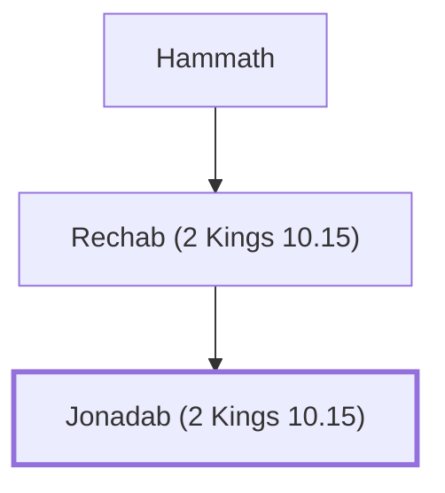

# Jonadab (2 Kings 10.15)

Son of Rechab, who promoted Rechabite lifestyle

**Original-language names:** יְהוֹנָדָב (H3082) · יוֹנָדָב (H3122)

## When

- **Placed around:** [[connections/timeline/7th century BC|607 BC]] *(Ussher: the median date of the passages naming them)*

## Family

- **Father:** [[connections/people/Rechab (2 Kings 10.15)|Rechab (2 Kings 10.15)]]
- **Tribe or nation:** Tribe of Judah

**Line of descent** (3 generations, father to son): [[connections/people/Hammath|Hammath]] → [[connections/people/Rechab (2 Kings 10.15)|Rechab (2 Kings 10.15)]] → **Jonadab (2 Kings 10.15)**

**Family group:** [[connections/genealogy/Family of Hammath|Family of Hammath]], generation 3

## Appears in

[[connections/chapters/12-2-kings/2 Kings 10|2 Kings 10 (2)]] · [[connections/chapters/24-jeremiah/Jeremiah 35|Jeremiah 35 (7)]]

## Appears in the same verse as

[[connections/people/Rechab (2 Kings 10.15)|Rechab (2 Kings 10.15) (7)]] · [[connections/people/Israel|Israel (2)]] · [[connections/people/Jehu (1 Kings 19.16)|Jehu (1 Kings 19.16)]] · [[connections/people/Jeremiah (2 Chronicles 35.25)|Jeremiah (2 Chronicles 35.25)]]
