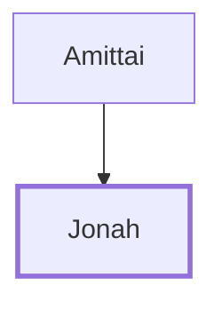

# Jonah

Prophet swallowed by fish, preached to Nineveh

**Original-language names:** יוֹנָה (H3124) · Ἰωνᾶς (G2495)

## When

- **Placed around:** [[connections/timeline/9th century BC|862 BC]] *(Ussher: the median date of the passages naming them)*

## Family

- **Father:** [[connections/people/Amittai|Amittai]]

**Family group:** [[connections/genealogy/Family of Amittai|Family of Amittai]], generation 2

## Events

- [[connections/timeline/9th century BC|825 BC]] · [[connections/events/Prophecies of Jonah|Prophecies of Jonah]]

## Appears in

[[connections/chapters/12-2-kings/2 Kings 14|2 Kings 14]] · [[connections/chapters/32-jonah/Jonah 1|Jonah 1 (5)]] · [[connections/chapters/32-jonah/Jonah 2|Jonah 2 (3)]] · [[connections/chapters/32-jonah/Jonah 3|Jonah 3 (3)]] · [[connections/chapters/32-jonah/Jonah 4|Jonah 4 (5)]] · [[connections/chapters/40-matthew/Matthew 12|Matthew 12 (3)]] · [[connections/chapters/40-matthew/Matthew 16|Matthew 16]] · [[connections/chapters/42-luke/Luke 11|Luke 11 (3)]]

## Appears in the same verse as

[[connections/places/Nineveh|Nineveh (3)]] · [[connections/people/Amittai|Amittai (2)]] · [[connections/people/Israel|Israel]] · [[connections/places/Gath-hepher|Gath-hepher]] · [[connections/places/Hamath|Hamath]] · [[connections/places/Joppa|Joppa]] · [[connections/places/Salt Sea|Salt Sea]] · [[connections/places/Tarshish|Tarshish]]
