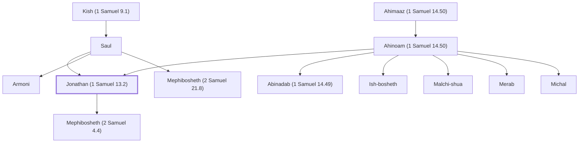

# Jonathan (1 Samuel 13.2)

Eldest son of King Saul and friend of David

**Also called:** Jehonathan

**Original-language names:** יוֹנָתָן (H3129) · יְהוֹנָתָן (H3083)

## When

- **Placed around:** [[connections/timeline/11th century BC|1062 BC]] *(Ussher: the median date of the passages naming them)*

## Family

- **Father:** [[connections/people/Saul|Saul]]
- **Mother:** [[connections/people/Ahinoam (1 Samuel 14.50)|Ahinoam (1 Samuel 14.50)]]
- **Brothers and sisters:** [[connections/people/Abinadab (1 Samuel 14.49)|Abinadab (1 Samuel 14.49)]], [[connections/people/Armoni|Armoni]], [[connections/people/Ish-bosheth|Ish-bosheth]], [[connections/people/Malchi-shua|Malchi-shua]], [[connections/people/Mephibosheth (2 Samuel 21.8)|Mephibosheth (2 Samuel 21.8)]], [[connections/people/Merab|Merab]], [[connections/people/Michal|Michal]]
- **Children:** [[connections/people/Mephibosheth (2 Samuel 4.4)|Mephibosheth (2 Samuel 4.4)]]
- **Tribe or nation:** Tribe of Benjamin

**Line of descent** (7 generations, father to son): [[connections/people/Aphiah|Aphiah]] → [[connections/people/Becorath|Becorath]] → [[connections/people/Zeror|Zeror]] → [[connections/people/Abiel|Abiel]] → [[connections/people/Kish (1 Samuel 9.1)|Kish (1 Samuel 9.1)]] → [[connections/people/Saul|Saul]] → **Jonathan (1 Samuel 13.2)**

**Family group:** [[connections/genealogy/Family of Aphiah|Family of Aphiah]], generation 7

## Appears in

[[connections/chapters/09-1-samuel/1 Samuel 13|1 Samuel 13 (4)]] · [[connections/chapters/09-1-samuel/1 Samuel 14|1 Samuel 14 (20)]] · [[connections/chapters/09-1-samuel/1 Samuel 18|1 Samuel 18 (3)]] · [[connections/chapters/09-1-samuel/1 Samuel 19|1 Samuel 19 (5)]] · [[connections/chapters/09-1-samuel/1 Samuel 20|1 Samuel 20 (24)]] · [[connections/chapters/09-1-samuel/1 Samuel 21|1 Samuel 21]] · [[connections/chapters/09-1-samuel/1 Samuel 23|1 Samuel 23 (2)]] · [[connections/chapters/09-1-samuel/1 Samuel 31|1 Samuel 31]] · [[connections/chapters/10-2-samuel/2 Samuel 1|2 Samuel 1 (8)]] · [[connections/chapters/10-2-samuel/2 Samuel 4|2 Samuel 4]] · [[connections/chapters/10-2-samuel/2 Samuel 9|2 Samuel 9 (4)]] · [[connections/chapters/10-2-samuel/2 Samuel 21|2 Samuel 21 (4)]] · [[connections/chapters/13-1-chronicles/1 Chronicles 8|1 Chronicles 8 (2)]] · [[connections/chapters/13-1-chronicles/1 Chronicles 9|1 Chronicles 9 (2)]] · [[connections/chapters/13-1-chronicles/1 Chronicles 10|1 Chronicles 10]]

## Appears in the same verse as

[[connections/people/Saul|Saul (46)]] · [[connections/people/David|David (34)]] · [[connections/people/Israel|Israel (9)]] · [[connections/people/Abinadab (1 Samuel 14.49)|Abinadab (1 Samuel 14.49) (5)]] · [[connections/people/Malchi-shua|Malchi-shua (5)]] · [[connections/people/Mephibosheth (2 Samuel 4.4)|Mephibosheth (2 Samuel 4.4) (5)]] · [[connections/people/Benjamin (Genesis 35.18)|Benjamin (Genesis 35.18) (3)]] · [[connections/people/Kish (1 Samuel 9.1)|Kish (1 Samuel 9.1) (3)]] · [[connections/people/Abiel|Abiel (2)]] · [[connections/people/Ish-bosheth|Ish-bosheth (2)]] · [[connections/people/Jesse|Jesse (2)]] · [[connections/people/Micah (2 Samuel 9.12)|Micah (2 Samuel 9.12) (2)]] · [[connections/places/Geba|Geba (2)]] · [[connections/places/Horesh|Horesh (2)]] · [[connections/places/Michmash|Michmash (2)]] · [[connections/people/Abner|Abner]] · [[connections/people/Ahimelech (1 Samuel 14.3)|Ahimelech (1 Samuel 14.3)]] · [[connections/people/Ahitub (1 Samuel 14.3)|Ahitub (1 Samuel 14.3)]] · [[connections/people/Eli|Eli]] · [[connections/people/Ichabod|Ichabod]] · [[connections/people/Merab|Merab]] · [[connections/people/Michal|Michal]] · [[connections/people/Phinehas (1 Samuel 1.3)|Phinehas (1 Samuel 1.3)]] · [[connections/people/Ziba|Ziba]] · [[connections/places/Beth-shean|Beth-shean]] · [[connections/places/Bethel (Genesis 12.8)|Bethel (Genesis 12.8)]] · [[connections/places/Bethlehem (Genesis 35.16)|Bethlehem (Genesis 35.16)]] · [[connections/places/Bozez|Bozez]] · [[connections/places/Gibeah (Joshua 18.28)|Gibeah (Joshua 18.28)]] · [[connections/places/Gilboa|Gilboa]] · [[connections/places/Jabesh|Jabesh]] · [[connections/places/Jezreel (2 Samuel 4.4)|Jezreel (2 Samuel 4.4)]] · [[connections/places/Mizpah|Mizpah]] · [[connections/places/Naioth|Naioth]] · [[connections/places/Seneh|Seneh]] · [[connections/places/Shiloh|Shiloh]] · [[connections/places/Zela|Zela]]
