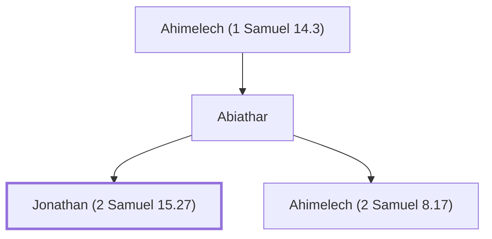

# Jonathan (2 Samuel 15.27)

Son of Abiathar the priest during David's reign

**Also called:** Jehonathan

**Original-language names:** יוֹנָתָן (H3129) · יְהוֹנָתָן (H3083)

## When

- **Placed around:** [[connections/timeline/11th century BC|1021 BC]] *(Ussher: the median date of the passages naming them)*

## Family

- **Father:** [[connections/people/Abiathar|Abiathar]]
- **Brothers and sisters:** [[connections/people/Ahimelech (2 Samuel 8.17)|Ahimelech (2 Samuel 8.17)]]
- **Tribe or nation:** Tribe of Levi

**Line of descent** (6 generations, father to son): [[connections/people/Eli|Eli]] → [[connections/people/Phinehas (1 Samuel 1.3)|Phinehas (1 Samuel 1.3)]] → [[connections/people/Ahitub (1 Samuel 14.3)|Ahitub (1 Samuel 14.3)]] → [[connections/people/Ahimelech (1 Samuel 14.3)|Ahimelech (1 Samuel 14.3)]] → [[connections/people/Abiathar|Abiathar]] → **Jonathan (2 Samuel 15.27)**

**Family group:** [[connections/genealogy/Family of Adam|Family of Adam]], generation 38

## Appears in

[[connections/chapters/10-2-samuel/2 Samuel 15|2 Samuel 15 (2)]] · [[connections/chapters/10-2-samuel/2 Samuel 17|2 Samuel 17 (2)]] · [[connections/chapters/11-1-kings/1 Kings 1|1 Kings 1 (2)]]

## Appears in the same verse as

[[connections/people/Ahimaaz (2 Samuel 15.27)|Ahimaaz (2 Samuel 15.27) (4)]] · [[connections/people/Abiathar|Abiathar (3)]] · [[connections/people/Adonijah (2 Samuel 3.4)|Adonijah (2 Samuel 3.4) (2)]] · [[connections/people/David|David (2)]] · [[connections/people/Zadok (2 Samuel 8.17)|Zadok (2 Samuel 8.17) (2)]] · [[connections/people/Absalom|Absalom]] · [[connections/people/Solomon|Solomon]] · [[connections/places/En-rogel|En-rogel]] · [[connections/places/Jerusalem|Jerusalem]]
