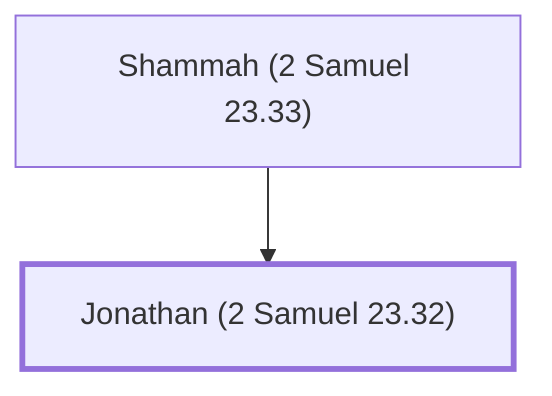

# Jonathan (2 Samuel 23.32)

Son of Shammah the Hararite, one of David's mighty men

**Also called:** Jehonathan

**Original-language names:** יוֹנָתָן (H3129) · יְהוֹנָתָן (H3083)

## When

- **Placed around:** [[connections/timeline/11th century BC|1055 BC]] *(Ussher: the median date of the passages naming them)*

## Family

- **Father:** [[connections/people/Shammah (2 Samuel 23.33)|Shammah (2 Samuel 23.33)]]

**Family group:** [[connections/genealogy/Family of Shammah (2 Samuel 23.33)|Family of Shammah (2 Samuel 23.33)]], generation 2

## Appears in

[[connections/chapters/10-2-samuel/2 Samuel 23|2 Samuel 23]] · [[connections/chapters/13-1-chronicles/1 Chronicles 11|1 Chronicles 11]]

## Appears in the same verse as

[[connections/people/Jashen|Jashen (2)]] · [[connections/people/Eliahba|Eliahba]] · [[connections/people/Shammah (2 Samuel 23.33)|Shammah (2 Samuel 23.33)]]
