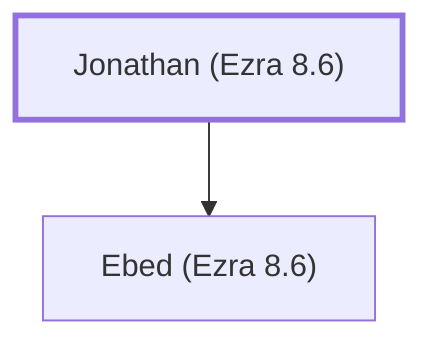

# Jonathan (Ezra 8.6)

Descendant of Adaiah who returned from exile

**Original-language names:** יוֹנָתָן (H3129)

## When

- **Placed around:** [[connections/timeline/5th century BC|457 BC]] *(Ussher: the median date of the passages naming them)*

## Family

- **Children:** [[connections/people/Ebed (Ezra 8.6)|Ebed (Ezra 8.6)]]

**Family group:** [[connections/genealogy/Family of Jonathan (Ezra 8.6)|Family of Jonathan (Ezra 8.6)]], generation 1

## Appears in

[[connections/chapters/15-ezra/Ezra 8|Ezra 8]]

## Appears in the same verse as

[[connections/people/Adin (Ezra 2.15)|Adin (Ezra 2.15)]] · [[connections/people/Ebed (Ezra 8.6)|Ebed (Ezra 8.6)]]
