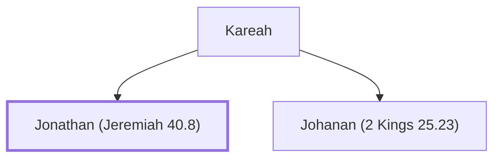

# Jonathan (Jeremiah 40.8)

Son of Kareah, came to Gedaliah at Mizpah

**Original-language names:** יוֹנָתָן (H3129)

## When

- **Placed around:** [[connections/timeline/6th century BC|588 BC]] *(Ussher: the median date of the passages naming them)*

## Family

- **Father:** [[connections/people/Kareah|Kareah]]
- **Brothers and sisters:** [[connections/people/Johanan (2 Kings 25.23)|Johanan (2 Kings 25.23)]]

**Family group:** [[connections/genealogy/Family of Kareah|Family of Kareah]], generation 2

## Appears in

[[connections/chapters/24-jeremiah/Jeremiah 40|Jeremiah 40]]

## Appears in the same verse as

[[connections/people/Ephai|Ephai]] · [[connections/people/Gedaliah (2 Kings 25.22)|Gedaliah (2 Kings 25.22)]] · [[connections/people/Ishmael (2 Kings 25.23)|Ishmael (2 Kings 25.23)]] · [[connections/people/Jezaniah|Jezaniah]] · [[connections/people/Johanan (2 Kings 25.23)|Johanan (2 Kings 25.23)]] · [[connections/people/Kareah|Kareah]] · [[connections/people/Nethaniah (2 Kings 25.23)|Nethaniah (2 Kings 25.23)]] · [[connections/people/Seraiah (2 Kings 25.23)|Seraiah (2 Kings 25.23)]] · [[connections/people/Tanhumeth|Tanhumeth]] · [[connections/places/Mizpah|Mizpah]]
