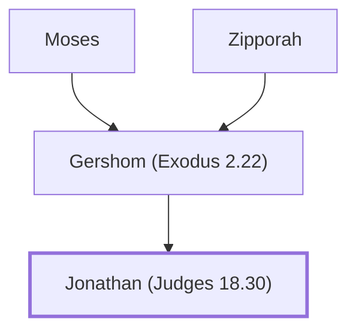

# Jonathan (Judges 18.30)

A Levite who served as a priest for Dan

**Original-language names:** יְהוֹנָתָן (H3083)

## When

- **Placed around:** [[connections/timeline/15th century BC|1406 BC]] *(Ussher: the median date of the passages naming them)*

## Family

- **Father:** [[connections/people/Gershom (Exodus 2.22)|Gershom (Exodus 2.22) (uncertain)]]
- **Tribe or nation:** Tribe of Levi

**Line of descent** (29 generations, father to son): [[connections/people/Adam|Adam]] → [[connections/people/Seth|Seth]] → [[connections/people/Enosh|Enosh]] → [[connections/people/Kenan|Kenan]] → [[connections/people/Mahalalel (Genesis 5.12)|Mahalalel (Genesis 5.12)]] → [[connections/people/Jared|Jared]] → [[connections/people/Enoch (Genesis 5.18)|Enoch (Genesis 5.18)]] → [[connections/people/Methuselah|Methuselah]] → [[connections/people/Lamech (Genesis 5.25)|Lamech (Genesis 5.25)]] → [[connections/people/Noah (Genesis 5.29)|Noah (Genesis 5.29)]] → [[connections/people/Shem|Shem]] → [[connections/people/Arpachshad|Arpachshad]] → [[connections/people/Cainan|Cainan]] → [[connections/people/Shelah (Genesis 10.24)|Shelah (Genesis 10.24)]] → [[connections/people/Eber (Genesis 10.21)|Eber (Genesis 10.21)]] → [[connections/people/Peleg|Peleg]] → [[connections/people/Reu|Reu]] → [[connections/people/Serug|Serug]] → [[connections/people/Nahor (Genesis 11.22)|Nahor (Genesis 11.22)]] → [[connections/people/Terah|Terah]] → [[connections/people/Abraham|Abraham]] → [[connections/people/Isaac|Isaac]] → [[connections/people/Israel|Israel]] → [[connections/people/Levi (Genesis 29.34)|Levi (Genesis 29.34)]] → [[connections/people/Kohath|Kohath]] → [[connections/people/Amram (Exodus 6.18)|Amram (Exodus 6.18)]] → [[connections/people/Moses|Moses]] → [[connections/people/Gershom (Exodus 2.22)|Gershom (Exodus 2.22)]] → **Jonathan (Judges 18.30)**

**Family group:** [[connections/genealogy/Family of Adam|Family of Adam]], generation 29

## Appears in

[[connections/chapters/07-judges/Judges 18|Judges 18]]

## Appears in the same verse as

[[connections/people/Gershom (Exodus 2.22)|Gershom (Exodus 2.22)]] · [[connections/people/Moses|Moses]] · [[connections/places/Dan|Dan]]
