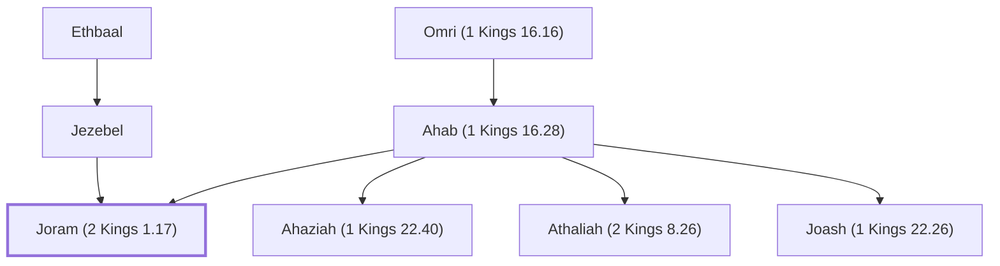

# Joram (2 Kings 1.17)

King of N. Israel, son of Ahab

**Original-language names:** יוֹרָם (H3141) · יְהוֹרָם (H3088)

## When

- **Placed around:** [[connections/timeline/9th century BC|884 BC]] *(Ussher: the median date of the passages naming them)*

## Family

- **Father:** [[connections/people/Ahab (1 Kings 16.28)|Ahab (1 Kings 16.28)]]
- **Mother:** [[connections/people/Jezebel|Jezebel]]
- **Brothers and sisters:** [[connections/people/Ahaziah (1 Kings 22.40)|Ahaziah (1 Kings 22.40)]], [[connections/people/Athaliah (2 Kings 8.26)|Athaliah (2 Kings 8.26)]], [[connections/people/Joash (1 Kings 22.26)|Joash (1 Kings 22.26)]]
- **Tribe or nation:** Israel

**Line of descent** (3 generations, father to son): [[connections/people/Omri (1 Kings 16.16)|Omri (1 Kings 16.16)]] → [[connections/people/Ahab (1 Kings 16.28)|Ahab (1 Kings 16.28)]] → **Joram (2 Kings 1.17)**

**Family group:** [[connections/genealogy/Family of Adam|Family of Adam]], generation 3

## Events

- [[connections/timeline/9th century BC|897 BC]] · [[connections/events/Reign of Joram|Reign of Joram]]

## Appears in

[[connections/chapters/12-2-kings/2 Kings 1|2 Kings 1]] · [[connections/chapters/12-2-kings/2 Kings 3|2 Kings 3 (2)]] · [[connections/chapters/12-2-kings/2 Kings 8|2 Kings 8 (4)]] · [[connections/chapters/12-2-kings/2 Kings 9|2 Kings 9 (9)]] · [[connections/chapters/14-2-chronicles/2 Chronicles 22|2 Chronicles 22 (3)]]

## Appears in the same verse as

[[connections/people/Ahab (1 Kings 16.28)|Ahab (1 Kings 16.28) (9)]] · [[connections/people/Judah (Genesis 29.35)|Judah (Genesis 29.35) (9)]] · [[connections/people/Ahaziah (2 Kings 8.24)|Ahaziah (2 Kings 8.24) (8)]] · [[connections/people/Jehu (1 Kings 19.16)|Jehu (1 Kings 19.16) (8)]] · [[connections/people/Israel|Israel (7)]] · [[connections/people/Hazael|Hazael (6)]] · [[connections/places/Syria|Syria (6)]] · [[connections/people/Jehoram (1 Kings 22.51)|Jehoram (1 Kings 22.51) (5)]] · [[connections/places/Jezreel (Joshua 19.18)|Jezreel (Joshua 19.18) (5)]] · [[connections/places/Ramoth|Ramoth (5)]] · [[connections/people/Jehoshaphat (1 Kings 15.24)|Jehoshaphat (1 Kings 15.24) (3)]] · [[connections/people/Nimshi|Nimshi (2)]] · [[connections/places/Samaria|Samaria (2)]] · [[connections/people/Elijah (1 Kings 17.1)|Elijah (1 Kings 17.1)]] · [[connections/people/Jehoshaphat (2 Kings 9.2)|Jehoshaphat (2 Kings 9.2)]] · [[connections/people/Jezebel|Jezebel]] · [[connections/people/Naboth|Naboth]]
