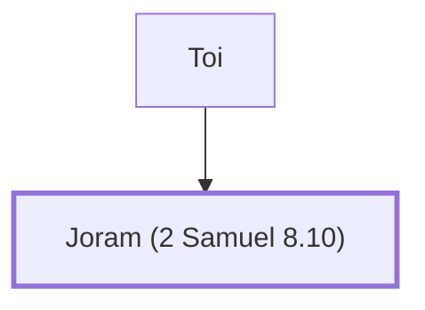

# Joram (2 Samuel 8.10)

Son of King Toi, brought gifts to David

**Also called:** Hadoram

**Original-language names:** יוֹרָם (H3141) · הֲדוֹרָם (H1913a)

## When

- **Placed around:** [[connections/timeline/11th century BC|1040 BC]] *(Ussher: the median date of the passages naming them)*

## Family

- **Father:** [[connections/people/Toi|Toi]]

**Family group:** [[connections/genealogy/Family of Toi|Family of Toi]], generation 2

## Appears in

[[connections/chapters/10-2-samuel/2 Samuel 8|2 Samuel 8]] · [[connections/chapters/13-1-chronicles/1 Chronicles 18|1 Chronicles 18]]

## Appears in the same verse as

[[connections/people/David|David (2)]] · [[connections/people/Hadadezer|Hadadezer (2)]] · [[connections/people/Toi|Toi (2)]]
