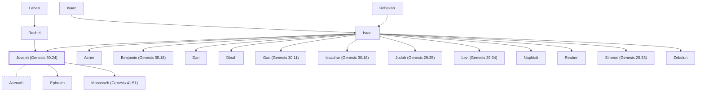

# Joseph (Genesis 30.24)

Son of Jacob, ruler in Egypt

**Also called:** Zaphenath-paneah

**Original-language names:** יוֹסֵף (H3130) · יְהוֹסֵף (H3084) · צָֽפְנַת פַּעְנֵחַ (H6847) · Ἰωσήφ (G2501)

## When

- **Lived:** [[connections/timeline/18th century BC|1745 BC]] – [[connections/timeline/17th century BC|1635 BC]] *(Jones)*
- **Placed around:** [[connections/timeline/18th century BC|1706 BC]] *(Ussher: the median date of the passages naming them)*

## Family

- **Father:** [[connections/people/Israel|Israel]]
- **Mother:** [[connections/people/Rachel|Rachel]]
- **Brothers and sisters:** [[connections/people/Asher|Asher]], [[connections/people/Benjamin (Genesis 35.18)|Benjamin (Genesis 35.18)]], [[connections/people/Dan|Dan]], [[connections/people/Dinah|Dinah]], [[connections/people/Gad (Genesis 30.11)|Gad (Genesis 30.11)]], [[connections/people/Issachar (Genesis 30.18)|Issachar (Genesis 30.18)]], [[connections/people/Judah (Genesis 29.35)|Judah (Genesis 29.35)]], [[connections/people/Levi (Genesis 29.34)|Levi (Genesis 29.34)]], [[connections/people/Naphtali|Naphtali]], [[connections/people/Reuben|Reuben]], [[connections/people/Simeon (Genesis 29.33)|Simeon (Genesis 29.33)]], [[connections/people/Zebulun|Zebulun]]
- **Spouses:** [[connections/people/Asenath|Asenath]]
- **Children:** [[connections/people/Ephraim|Ephraim]], [[connections/people/Manasseh (Genesis 41.51)|Manasseh (Genesis 41.51)]]
- **Tribe or nation:** Early Patriarch

**Line of descent** (24 generations, father to son): [[connections/people/Adam|Adam]] → [[connections/people/Seth|Seth]] → [[connections/people/Enosh|Enosh]] → [[connections/people/Kenan|Kenan]] → [[connections/people/Mahalalel (Genesis 5.12)|Mahalalel (Genesis 5.12)]] → [[connections/people/Jared|Jared]] → [[connections/people/Enoch (Genesis 5.18)|Enoch (Genesis 5.18)]] → [[connections/people/Methuselah|Methuselah]] → [[connections/people/Lamech (Genesis 5.25)|Lamech (Genesis 5.25)]] → [[connections/people/Noah (Genesis 5.29)|Noah (Genesis 5.29)]] → [[connections/people/Shem|Shem]] → [[connections/people/Arpachshad|Arpachshad]] → [[connections/people/Cainan|Cainan]] → [[connections/people/Shelah (Genesis 10.24)|Shelah (Genesis 10.24)]] → [[connections/people/Eber (Genesis 10.21)|Eber (Genesis 10.21)]] → [[connections/people/Peleg|Peleg]] → [[connections/people/Reu|Reu]] → [[connections/people/Serug|Serug]] → [[connections/people/Nahor (Genesis 11.22)|Nahor (Genesis 11.22)]] → [[connections/people/Terah|Terah]] → [[connections/people/Abraham|Abraham]] → [[connections/people/Isaac|Isaac]] → [[connections/people/Israel|Israel]] → **Joseph (Genesis 30.24)**

**Family group:** [[connections/genealogy/Family of Adam|Family of Adam]], generation 24

## Events

- [[connections/timeline/18th century BC|1745 BC]] · [[connections/events/Birth of Joseph|Birth of Joseph]]
- [[connections/timeline/18th century BC|1745 BC]] · [[connections/events/Lifetime of Joseph|Lifetime of Joseph]]
- [[connections/timeline/18th century BC|1728 BC]] · [[connections/events/Joseph sold to Egypt|Joseph sold to Egypt]]
- [[connections/timeline/18th century BC|1718 BC]] · [[connections/events/Joseph imprisoned|Joseph imprisoned]]
- [[connections/timeline/18th century BC|1715 BC]] · [[connections/events/Joseph Promoted in Egypt|Joseph Promoted in Egypt]]
- [[connections/timeline/18th century BC|1715 BC]] · [[connections/events/7 years of plenty|7 years of plenty]]
- [[connections/timeline/18th century BC|1708 BC]] · [[connections/events/7 years of famine|7 years of famine]]
- [[connections/timeline/18th century BC|1706 BC]] · [[connections/events/Joseph's brothers return to Egypt|Joseph's brothers return to Egypt]]
- [[connections/timeline/17th century BC|1635 BC]] · [[connections/events/Death of Joseph|Death of Joseph]]

## Appears in

[[connections/chapters/01-genesis/Genesis 30|Genesis 30 (2)]] · [[connections/chapters/01-genesis/Genesis 33|Genesis 33 (2)]] · [[connections/chapters/01-genesis/Genesis 35|Genesis 35]] · [[connections/chapters/01-genesis/Genesis 37|Genesis 37 (10)]] · [[connections/chapters/01-genesis/Genesis 39|Genesis 39 (10)]] · [[connections/chapters/01-genesis/Genesis 40|Genesis 40 (10)]] · [[connections/chapters/01-genesis/Genesis 41|Genesis 41 (18)]] · [[connections/chapters/01-genesis/Genesis 42|Genesis 42 (11)]] · [[connections/chapters/01-genesis/Genesis 43|Genesis 43 (9)]] · [[connections/chapters/01-genesis/Genesis 44|Genesis 44 (4)]] · [[connections/chapters/01-genesis/Genesis 45|Genesis 45 (10)]] · [[connections/chapters/01-genesis/Genesis 46|Genesis 46 (8)]] · [[connections/chapters/01-genesis/Genesis 47|Genesis 47 (13)]] · [[connections/chapters/01-genesis/Genesis 48|Genesis 48 (12)]] · [[connections/chapters/01-genesis/Genesis 49|Genesis 49 (2)]] · [[connections/chapters/01-genesis/Genesis 50|Genesis 50 (15)]] · [[connections/chapters/02-exodus/Exodus 1|Exodus 1 (3)]] · [[connections/chapters/02-exodus/Exodus 13|Exodus 13]] · [[connections/chapters/04-numbers/Numbers 1|Numbers 1 (2)]] · [[connections/chapters/04-numbers/Numbers 13|Numbers 13]] · [[connections/chapters/04-numbers/Numbers 26|Numbers 26 (2)]] · [[connections/chapters/04-numbers/Numbers 27|Numbers 27]] · [[connections/chapters/04-numbers/Numbers 32|Numbers 32]] · [[connections/chapters/04-numbers/Numbers 34|Numbers 34]] · [[connections/chapters/04-numbers/Numbers 36|Numbers 36 (3)]] · [[connections/chapters/05-deuteronomy/Deuteronomy 27|Deuteronomy 27]] · [[connections/chapters/05-deuteronomy/Deuteronomy 33|Deuteronomy 33 (2)]] · [[connections/chapters/06-joshua/Joshua 14|Joshua 14]] · [[connections/chapters/06-joshua/Joshua 16|Joshua 16 (2)]] · [[connections/chapters/06-joshua/Joshua 17|Joshua 17 (5)]] · [[connections/chapters/06-joshua/Joshua 18|Joshua 18 (2)]] · [[connections/chapters/06-joshua/Joshua 24|Joshua 24]] · [[connections/chapters/07-judges/Judges 1|Judges 1 (3)]] · [[connections/chapters/10-2-samuel/2 Samuel 19|2 Samuel 19]] · [[connections/chapters/11-1-kings/1 Kings 11|1 Kings 11]] · [[connections/chapters/13-1-chronicles/1 Chronicles 2|1 Chronicles 2]] · [[connections/chapters/13-1-chronicles/1 Chronicles 5|1 Chronicles 5 (2)]] · [[connections/chapters/13-1-chronicles/1 Chronicles 7|1 Chronicles 7]] · [[connections/chapters/19-psalms/Psalms 77|Psalms 77]] · [[connections/chapters/19-psalms/Psalms 78|Psalms 78]] · [[connections/chapters/19-psalms/Psalms 80|Psalms 80]] · [[connections/chapters/19-psalms/Psalms 81|Psalms 81]] · [[connections/chapters/19-psalms/Psalms 105|Psalms 105]] · [[connections/chapters/26-ezekiel/Ezekiel 37|Ezekiel 37 (2)]] · [[connections/chapters/26-ezekiel/Ezekiel 47|Ezekiel 47]] · [[connections/chapters/26-ezekiel/Ezekiel 48|Ezekiel 48]] · [[connections/chapters/30-amos/Amos 5|Amos 5 (2)]] · [[connections/chapters/30-amos/Amos 6|Amos 6]] · [[connections/chapters/31-obadiah/Obadiah 1|Obadiah 1]] · [[connections/chapters/38-zechariah/Zechariah 10|Zechariah 10]] · [[connections/chapters/43-john/John 4|John 4]] · [[connections/chapters/44-acts/Acts 7|Acts 7 (4)]] · [[connections/chapters/58-hebrews/Hebrews 11|Hebrews 11 (2)]] · [[connections/chapters/66-revelation/Revelation 7|Revelation 7]]

## Appears in the same verse as

[[connections/people/Israel|Israel (41)]] · [[connections/places/Egypt|Egypt (34)]] · [[connections/people/Pharaoh (Genesis 37.36)|Pharaoh (Genesis 37.36) (28)]] · [[connections/people/Manasseh (Genesis 41.51)|Manasseh (Genesis 41.51) (20)]] · [[connections/people/Ephraim|Ephraim (15)]] · [[connections/people/Benjamin (Genesis 35.18)|Benjamin (Genesis 35.18) (11)]] · [[connections/people/Judah (Genesis 29.35)|Judah (Genesis 29.35) (9)]] · [[connections/places/Canaan|Canaan (7)]] · [[connections/people/Rachel|Rachel (5)]] · [[connections/places/Bethel (Genesis 12.8)|Bethel (Genesis 12.8) (5)]] · [[connections/people/Machir (Genesis 50.23)|Machir (Genesis 50.23) (4)]] · [[connections/people/Moses|Moses (4)]] · [[connections/places/Goshen (Genesis 45.10)|Goshen (Genesis 45.10) (4)]] · [[connections/people/Asenath|Asenath (3)]] · [[connections/people/Potiphera|Potiphera (3)]] · [[connections/people/Reuben|Reuben (3)]] · [[connections/places/On|On (3)]] · [[connections/people/Abraham|Abraham (2)]] · [[connections/people/Gad (Genesis 30.11)|Gad (Genesis 30.11) (2)]] · [[connections/people/Gilead (Numbers 26.29)|Gilead (Numbers 26.29) (2)]] · [[connections/people/Hepher (Numbers 26.32)|Hepher (Numbers 26.32) (2)]] · [[connections/people/Isaac|Isaac (2)]] · [[connections/people/Joshua (Exodus 17.9)|Joshua (Exodus 17.9) (2)]] · [[connections/people/Leah|Leah (2)]] · [[connections/people/Simeon (Genesis 29.33)|Simeon (Genesis 29.33) (2)]] · [[connections/places/Bashan|Bashan (2)]] · [[connections/places/Beth-shean|Beth-shean (2)]] · [[connections/places/Gilead|Gilead (2)]] · [[connections/places/Jordan|Jordan (2)]] · [[connections/places/Shechem|Shechem (2)]] · [[connections/people/Abiezer (Numbers 26.30)|Abiezer (Numbers 26.30)]] · [[connections/people/Ammihud (Numbers 1.10)|Ammihud (Numbers 1.10)]] · [[connections/people/Asher|Asher]] · [[connections/people/Asriel (Numbers 26.31)|Asriel (Numbers 26.31)]] · [[connections/people/Bilhah|Bilhah]] · [[connections/people/Dan|Dan]] · [[connections/people/Elishama (Numbers 1.10)|Elishama (Numbers 1.10)]] · [[connections/people/Ephod|Ephod]] · [[connections/people/Gaddi|Gaddi]] · [[connections/people/Gamaliel (Numbers 1.10)|Gamaliel (Numbers 1.10)]] · [[connections/people/Hamor|Hamor]] · [[connections/people/Hanniel (Numbers 34.23)|Hanniel (Numbers 34.23)]] · [[connections/people/Helek|Helek]] · [[connections/people/Hoglah|Hoglah]] · [[connections/people/Issachar (Genesis 30.18)|Issachar (Genesis 30.18)]] · [[connections/people/Jeroboam (1 Kings 11.26)|Jeroboam (1 Kings 11.26)]] · [[connections/people/Laban|Laban]] · [[connections/people/Levi (Genesis 29.34)|Levi (Genesis 29.34)]] · [[connections/people/Mahlah (Numbers 26.33)|Mahlah (Numbers 26.33)]] · [[connections/people/Milcah (Numbers 26.33)|Milcah (Numbers 26.33)]] · [[connections/people/Naphtali|Naphtali]] · [[connections/people/Noah (Numbers 26.33)|Noah (Numbers 26.33)]] · [[connections/people/Og|Og]] · [[connections/people/Pedahzur|Pedahzur]] · [[connections/people/Potiphar|Potiphar]] · [[connections/people/Shechem (Numbers 26.31)|Shechem (Numbers 26.31)]] · [[connections/people/Shemida|Shemida]] · [[connections/people/Sihon|Sihon]] · [[connections/people/Solomon|Solomon]] · [[connections/people/Susi|Susi]] · [[connections/people/Tirzah|Tirzah]] · [[connections/people/Zebulun|Zebulun]] · [[connections/people/Zelophehad|Zelophehad]] · [[connections/people/Zilpah|Zilpah]] · [[connections/places/Aijalon|Aijalon]] · [[connections/places/Beth-shemesh (Joshua 15.10)|Beth-shemesh (Joshua 15.10)]] · [[connections/places/Dan|Dan]] · [[connections/places/Dor|Dor]] · [[connections/places/Dothan|Dothan]] · [[connections/places/Gerizim Mount|Gerizim Mount]] · [[connections/places/Jericho|Jericho]] · [[connections/places/Jezreel Valley|Jezreel Valley]] · [[connections/places/Megiddo|Megiddo]] · [[connections/places/Nile|Nile]] · [[connections/places/Rameses|Rameses]] · [[connections/places/Samaria|Samaria]] · [[connections/places/Shaalbim|Shaalbim]] · [[connections/places/Sychar|Sychar]] · [[connections/places/Taanach|Taanach]]
