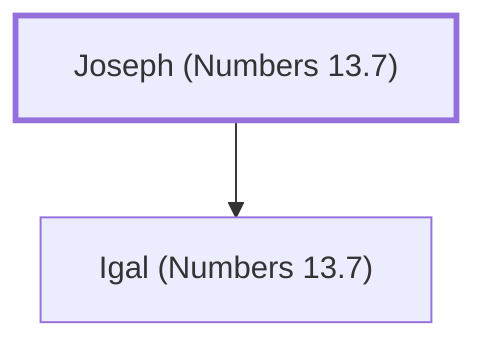

# Joseph (Numbers 13.7)

Representative of Issachar among the spies

**Original-language names:** יוֹסֵף (H3130)

## When

- **Placed around:** [[connections/timeline/15th century BC|1490 BC]] *(Ussher: the median date of the passages naming them)*

## Family

- **Children:** [[connections/people/Igal (Numbers 13.7)|Igal (Numbers 13.7)]]

**Family group:** [[connections/genealogy/Family of Joseph (Numbers 13.7)|Family of Joseph (Numbers 13.7)]], generation 1

## Appears in

[[connections/chapters/04-numbers/Numbers 13|Numbers 13]]

## Appears in the same verse as

[[connections/people/Igal (Numbers 13.7)|Igal (Numbers 13.7)]] · [[connections/people/Issachar (Genesis 30.18)|Issachar (Genesis 30.18)]]
