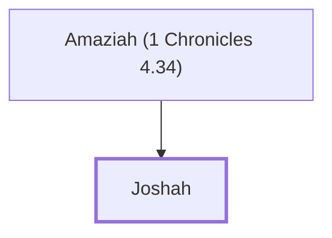

# Joshah

A Simeonite leader during Hezekiah's reign

**Original-language names:** יוֹשָׁה (H3144)

## When

- **Placed around:** [[connections/timeline/18th century BC|1721 BC]] *(Ussher: the median date of the passages naming them)*

## Family

- **Father:** [[connections/people/Amaziah (1 Chronicles 4.34)|Amaziah (1 Chronicles 4.34)]]
- **Tribe or nation:** Tribe of Simeon

**Family group:** [[connections/genealogy/Family of Amaziah (1 Chronicles 4.34)|Family of Amaziah (1 Chronicles 4.34)]], generation 2

## Appears in

[[connections/chapters/13-1-chronicles/1 Chronicles 4|1 Chronicles 4]]

## Appears in the same verse as

[[connections/people/Amaziah (1 Chronicles 4.34)|Amaziah (1 Chronicles 4.34)]] · [[connections/people/Jamlech|Jamlech]] · [[connections/people/Meshobab|Meshobab]]
