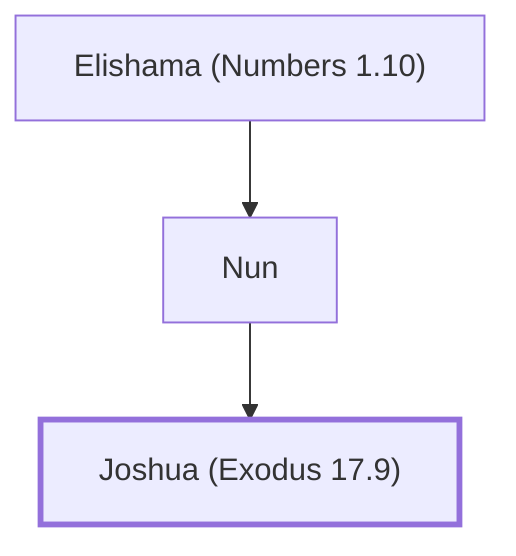

# Joshua (Exodus 17.9)

Moses' assistant who led Israel into Canaan

**Also called:** Hoshea, Jeshua

**Original-language names:** יְהוֹשׁוּעַ (H3091) · הוֹשֵׁעַ (H1954) · יֵשׁוּעַ (H3442) · Ἰησοῦς (G2424)

## When

- **Lived:** ? – [[connections/timeline/15th century BC|1424 BC]] *(Jones)*
- **Placed around:** [[connections/timeline/15th century BC|1451 BC]] *(Ussher: the median date of the passages naming them)*

## Family

- **Father:** [[connections/people/Nun|Nun]]
- **Tribe or nation:** Tribe of Ephraim

**Line of descent** (34 generations, father to son): [[connections/people/Adam|Adam]] → [[connections/people/Seth|Seth]] → [[connections/people/Enosh|Enosh]] → [[connections/people/Kenan|Kenan]] → [[connections/people/Mahalalel (Genesis 5.12)|Mahalalel (Genesis 5.12)]] → [[connections/people/Jared|Jared]] → [[connections/people/Enoch (Genesis 5.18)|Enoch (Genesis 5.18)]] → [[connections/people/Methuselah|Methuselah]] → [[connections/people/Lamech (Genesis 5.25)|Lamech (Genesis 5.25)]] → [[connections/people/Noah (Genesis 5.29)|Noah (Genesis 5.29)]] → [[connections/people/Shem|Shem]] → [[connections/people/Arpachshad|Arpachshad]] → [[connections/people/Cainan|Cainan]] → [[connections/people/Shelah (Genesis 10.24)|Shelah (Genesis 10.24)]] → [[connections/people/Eber (Genesis 10.21)|Eber (Genesis 10.21)]] → [[connections/people/Peleg|Peleg]] → [[connections/people/Reu|Reu]] → [[connections/people/Serug|Serug]] → [[connections/people/Nahor (Genesis 11.22)|Nahor (Genesis 11.22)]] → [[connections/people/Terah|Terah]] → [[connections/people/Abraham|Abraham]] → [[connections/people/Isaac|Isaac]] → [[connections/people/Israel|Israel]] → [[connections/people/Joseph (Genesis 30.24)|Joseph (Genesis 30.24)]] → [[connections/people/Ephraim|Ephraim]] → [[connections/people/Beriah (1 Chronicles 7.23)|Beriah (1 Chronicles 7.23)]] → [[connections/people/Resheph|Resheph]] → [[connections/people/Telah|Telah]] → [[connections/people/Tahan (1 Chronicles 7.25)|Tahan (1 Chronicles 7.25)]] → [[connections/people/Ladan|Ladan]] → [[connections/people/Ammihud (Numbers 1.10)|Ammihud (Numbers 1.10)]] → [[connections/people/Elishama (Numbers 1.10)|Elishama (Numbers 1.10)]] → [[connections/people/Nun|Nun]] → **Joshua (Exodus 17.9)**

**Family group:** [[connections/genealogy/Family of Adam|Family of Adam]], generation 34

## Events

- [[connections/timeline/16th century BC|1521 BC]] · [[connections/events/Lifetime of Joshua|Lifetime of Joshua]]
- [[connections/timeline/15th century BC|1451 BC]] · [[connections/events/Crossing the Jordan into Canaan|Crossing the Jordan into Canaan]]
- [[connections/timeline/15th century BC|1451 BC]] · [[connections/events/War with Canaanites|War with Canaanites]]
- [[connections/timeline/15th century BC|1445 BC]] · [[connections/events/Dividing the land|Dividing the land]]
- [[connections/timeline/15th century BC|1424 BC]] · [[connections/events/Death of Joshua|Death of Joshua]]

## Appears in

[[connections/chapters/02-exodus/Exodus 17|Exodus 17 (4)]] · [[connections/chapters/02-exodus/Exodus 24|Exodus 24]] · [[connections/chapters/02-exodus/Exodus 32|Exodus 32]] · [[connections/chapters/02-exodus/Exodus 33|Exodus 33]] · [[connections/chapters/04-numbers/Numbers 11|Numbers 11]] · [[connections/chapters/04-numbers/Numbers 13|Numbers 13 (2)]] · [[connections/chapters/04-numbers/Numbers 14|Numbers 14 (3)]] · [[connections/chapters/04-numbers/Numbers 26|Numbers 26]] · [[connections/chapters/04-numbers/Numbers 27|Numbers 27 (2)]] · [[connections/chapters/04-numbers/Numbers 32|Numbers 32 (2)]] · [[connections/chapters/04-numbers/Numbers 34|Numbers 34]] · [[connections/chapters/05-deuteronomy/Deuteronomy 1|Deuteronomy 1]] · [[connections/chapters/05-deuteronomy/Deuteronomy 3|Deuteronomy 3 (2)]] · [[connections/chapters/05-deuteronomy/Deuteronomy 31|Deuteronomy 31 (4)]] · [[connections/chapters/05-deuteronomy/Deuteronomy 32|Deuteronomy 32]] · [[connections/chapters/05-deuteronomy/Deuteronomy 34|Deuteronomy 34]] · [[connections/chapters/06-joshua/Joshua 1|Joshua 1 (4)]] · [[connections/chapters/06-joshua/Joshua 2|Joshua 2 (3)]] · [[connections/chapters/06-joshua/Joshua 3|Joshua 3 (6)]] · [[connections/chapters/06-joshua/Joshua 4|Joshua 4 (10)]] · [[connections/chapters/06-joshua/Joshua 5|Joshua 5 (8)]] · [[connections/chapters/06-joshua/Joshua 6|Joshua 6 (10)]] · [[connections/chapters/06-joshua/Joshua 7|Joshua 7 (12)]] · [[connections/chapters/06-joshua/Joshua 8|Joshua 8 (16)]] · [[connections/chapters/06-joshua/Joshua 9|Joshua 9 (8)]] · [[connections/chapters/06-joshua/Joshua 10|Joshua 10 (28)]] · [[connections/chapters/06-joshua/Joshua 11|Joshua 11 (11)]] · [[connections/chapters/06-joshua/Joshua 12|Joshua 12]] · [[connections/chapters/06-joshua/Joshua 13|Joshua 13]] · [[connections/chapters/06-joshua/Joshua 14|Joshua 14 (3)]] · [[connections/chapters/06-joshua/Joshua 15|Joshua 15]] · [[connections/chapters/06-joshua/Joshua 17|Joshua 17 (4)]] · [[connections/chapters/06-joshua/Joshua 18|Joshua 18 (4)]] · [[connections/chapters/06-joshua/Joshua 19|Joshua 19 (2)]] · [[connections/chapters/06-joshua/Joshua 20|Joshua 20]] · [[connections/chapters/06-joshua/Joshua 21|Joshua 21]] · [[connections/chapters/06-joshua/Joshua 22|Joshua 22 (3)]] · [[connections/chapters/06-joshua/Joshua 23|Joshua 23 (2)]] · [[connections/chapters/06-joshua/Joshua 24|Joshua 24 (12)]] · [[connections/chapters/07-judges/Judges 1|Judges 1]] · [[connections/chapters/07-judges/Judges 2|Judges 2 (5)]] · [[connections/chapters/11-1-kings/1 Kings 16|1 Kings 16]] · [[connections/chapters/13-1-chronicles/1 Chronicles 7|1 Chronicles 7]] · [[connections/chapters/16-nehemiah/Nehemiah 8|Nehemiah 8]] · [[connections/chapters/44-acts/Acts 7|Acts 7]] · [[connections/chapters/58-hebrews/Hebrews 4|Hebrews 4]]

## Appears in the same verse as

[[connections/people/Israel|Israel (66)]] · [[connections/people/Nun|Nun (30)]] · [[connections/people/Moses|Moses (27)]] · [[connections/places/Ai (Genesis 12.8)|Ai (Genesis 12.8) (15)]] · [[connections/places/Jordan|Jordan (11)]] · [[connections/places/Gilgal (Deuteronomy 11.30)|Gilgal (Deuteronomy 11.30) (10)]] · [[connections/places/Jericho|Jericho (10)]] · [[connections/people/Caleb (Numbers 13.6)|Caleb (Numbers 13.6) (8)]] · [[connections/people/Jephunneh (Numbers 13.6)|Jephunneh (Numbers 13.6) (8)]] · [[connections/people/Eleazar (Exodus 6.23)|Eleazar (Exodus 6.23) (7)]] · [[connections/places/Gibeon|Gibeon (6)]] · [[connections/people/Judah (Genesis 29.35)|Judah (Genesis 29.35) (4)]] · [[connections/people/Manasseh (Genesis 41.51)|Manasseh (Genesis 41.51) (4)]] · [[connections/places/Amalek|Amalek (4)]] · [[connections/places/Hebron|Hebron (4)]] · [[connections/places/Makkedah|Makkedah (4)]] · [[connections/places/Shiloh|Shiloh (4)]] · [[connections/people/Achan|Achan (3)]] · [[connections/people/Ephraim|Ephraim (3)]] · [[connections/places/Bethel (Genesis 12.8)|Bethel (Genesis 12.8) (3)]] · [[connections/places/Lachish|Lachish (3)]] · [[connections/people/Joseph (Genesis 30.24)|Joseph (Genesis 30.24) (2)]] · [[connections/people/Rahab|Rahab (2)]] · [[connections/places/Debir (Joshua 10.38)|Debir (Joshua 10.38) (2)]] · [[connections/places/Eglon|Eglon (2)]] · [[connections/places/Egypt|Egypt (2)]] · [[connections/places/Goshen (Joshua 10.41)|Goshen (Joshua 10.41) (2)]] · [[connections/places/Hazor (Joshua 11.1)|Hazor (Joshua 11.1) (2)]] · [[connections/places/Kadesh|Kadesh (2)]] · [[connections/places/Libnah (Joshua 10.29)|Libnah (Joshua 10.29) (2)]] · [[connections/places/Negeb|Negeb (2)]] · [[connections/places/Shechem|Shechem (2)]] · [[connections/places/Shephelah|Shephelah (2)]] · [[connections/places/Shittim|Shittim (2)]] · [[connections/people/Aaron|Aaron]] · [[connections/people/Abiram (1 Kings 16.34)|Abiram (1 Kings 16.34)]] · [[connections/people/Abraham|Abraham]] · [[connections/people/Adoni-zedek|Adoni-zedek]] · [[connections/people/Anak|Anak]] · [[connections/people/Arba|Arba]] · [[connections/people/David|David]] · [[connections/people/Hiel|Hiel]] · [[connections/people/Horam|Horam]] · [[connections/people/Hur (Exodus 17.10)|Hur (Exodus 17.10)]] · [[connections/people/Nahor (Genesis 11.22)|Nahor (Genesis 11.22)]] · [[connections/people/Segub (1 Kings 16.34)|Segub (1 Kings 16.34)]] · [[connections/people/Terah|Terah]] · [[connections/people/Zerah (Genesis 38.30)|Zerah (Genesis 38.30)]] · [[connections/places/Achor Valley|Achor Valley]] · [[connections/places/Aijalon|Aijalon]] · [[connections/places/Anab|Anab]] · [[connections/places/Arabah|Arabah]] · [[connections/places/Bashan|Bashan]] · [[connections/places/Beth-aven|Beth-aven]] · [[connections/places/Canaan|Canaan]] · [[connections/places/Ebal Mount|Ebal Mount]] · [[connections/places/Euphrates|Euphrates]] · [[connections/places/Gaza|Gaza]] · [[connections/places/Gezer|Gezer]] · [[connections/places/Halak Mount|Halak Mount]] · [[connections/places/Hermon Mount|Hermon Mount]] · [[connections/places/Jerusalem|Jerusalem]] · [[connections/places/Lebanon Valley|Lebanon Valley]] · [[connections/places/Merom|Merom]] · [[connections/places/Seir|Seir]]
