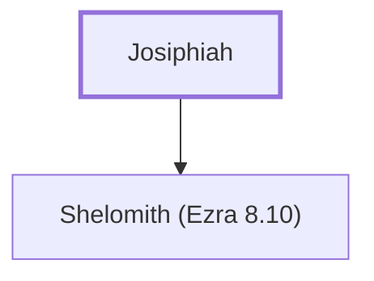

# Josiphiah

Father of Shelomith, a returning exile

**Original-language names:** יוֹסִפְיָה (H3131)

## When

- **Placed around:** [[connections/timeline/5th century BC|457 BC]] *(Ussher: the median date of the passages naming them)*

## Family

- **Children:** [[connections/people/Shelomith (Ezra 8.10)|Shelomith (Ezra 8.10)]]

**Family group:** [[connections/genealogy/Family of Josiphiah|Family of Josiphiah]], generation 1

## Appears in

[[connections/chapters/15-ezra/Ezra 8|Ezra 8]]

## Appears in the same verse as

[[connections/people/Bani (Ezra 2.10)|Bani (Ezra 2.10)]] · [[connections/people/Shelomith (Ezra 8.10)|Shelomith (Ezra 8.10)]]
