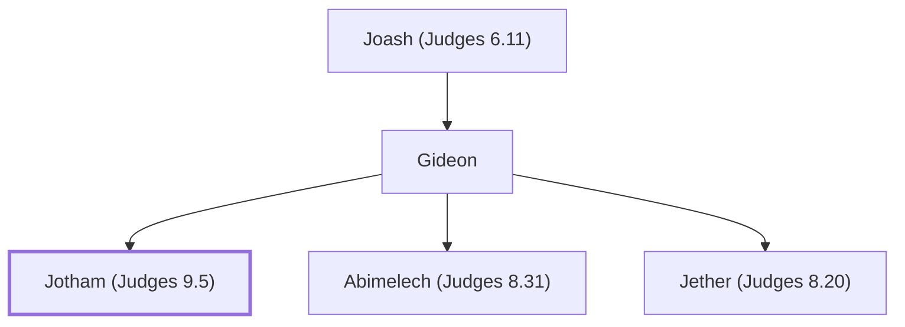

# Jotham (Judges 9.5)

Youngest son of Gideon who escaped Abimelech's massacre

**Original-language names:** יוֹתָם (H3147)

## When

- **Placed around:** [[connections/timeline/13th century BC|1233 BC]] *(Ussher: the median date of the passages naming them)*

## Family

- **Father:** [[connections/people/Gideon|Gideon]]
- **Brothers and sisters:** [[connections/people/Abimelech (Judges 8.31)|Abimelech (Judges 8.31)]], [[connections/people/Jether (Judges 8.20)|Jether (Judges 8.20)]]

**Line of descent** (3 generations, father to son): [[connections/people/Joash (Judges 6.11)|Joash (Judges 6.11)]] → [[connections/people/Gideon|Gideon]] → **Jotham (Judges 9.5)**

**Family group:** [[connections/genealogy/Family of Joash (Judges 6.11)|Family of Joash (Judges 6.11)]], generation 3

## Appears in

[[connections/chapters/07-judges/Judges 9|Judges 9 (4)]]

## Appears in the same verse as

[[connections/people/Gideon|Gideon (2)]] · [[connections/places/Shechem|Shechem (2)]] · [[connections/people/Abimelech (Judges 8.31)|Abimelech (Judges 8.31)]] · [[connections/places/Beeroth|Beeroth]] · [[connections/places/Gerizim Mount|Gerizim Mount]] · [[connections/places/Ophrah (Joshua 19.19)|Ophrah (Joshua 19.19)]]
