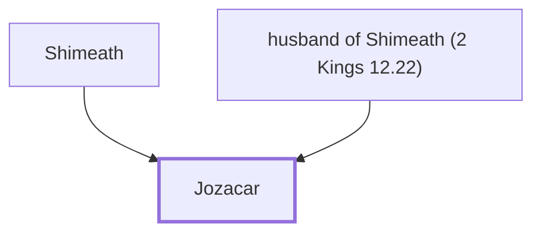

# Jozacar

One of the servants who killed King Joash

**Also called:** Zabad

**Original-language names:** יוֹזָכָר (H3108) · יוֹזָבָד (H3107) · זָבָד (H2066)

## When

- **Placed around:** [[connections/timeline/9th century BC|839 BC]] *(Ussher: the median date of the passages naming them)*

## Family

- **Father:** [[connections/people/husband of Shimeath (2 Kings 12.22)|husband of Shimeath (2 Kings 12.22)]]
- **Mother:** [[connections/people/Shimeath|Shimeath]]
- **Tribe or nation:** Ammon

**Family group:** [[connections/genealogy/Family of Shimeath|Family of Shimeath]], generation 2

## Appears in

[[connections/chapters/12-2-kings/2 Kings 12|2 Kings 12]] · [[connections/chapters/14-2-chronicles/2 Chronicles 24|2 Chronicles 24]]

## Appears in the same verse as

[[connections/people/Jehozabad (2 Kings 12.22)|Jehozabad (2 Kings 12.22) (2)]] · [[connections/people/Shimeath|Shimeath (2)]] · [[connections/people/Shomer (2 Kings 12.22)|Shomer (2 Kings 12.22) (2)]] · [[connections/people/Amaziah (2 Kings 12.22)|Amaziah (2 Kings 12.22)]] · [[connections/people/David|David]] · [[connections/places/Moab|Moab]]
