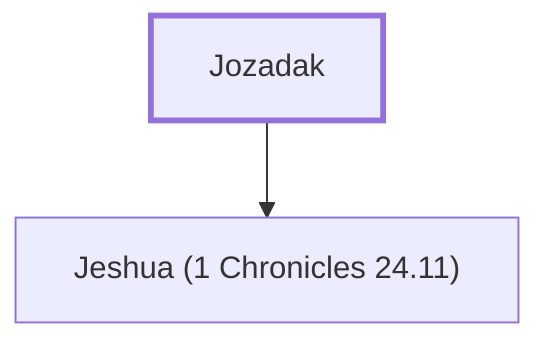

# Jozadak

A priest whose descendants married foreign women

**Original-language names:** יוֹצָדָק (H3136a)

## When

- **Placed around:** [[connections/timeline/5th century BC|456 BC]] *(Ussher: the median date of the passages naming them)*

## Family

- **Children:** [[connections/people/Jeshua (1 Chronicles 24.11)|Jeshua (1 Chronicles 24.11)]]

**Family group:** [[connections/genealogy/Family of Jozadak|Family of Jozadak]], generation 1

## Appears in

[[connections/chapters/15-ezra/Ezra 10|Ezra 10]]

## Appears in the same verse as

[[connections/people/Eliezer (Ezra 10.18)|Eliezer (Ezra 10.18)]] · [[connections/people/Gedaliah (Ezra 10.18)|Gedaliah (Ezra 10.18)]] · [[connections/people/Jarib (Ezra 10.18)|Jarib (Ezra 10.18)]] · [[connections/people/Jeshua (1 Chronicles 24.11)|Jeshua (1 Chronicles 24.11)]] · [[connections/people/Maaseiah (Ezra 10.18)|Maaseiah (Ezra 10.18)]]
