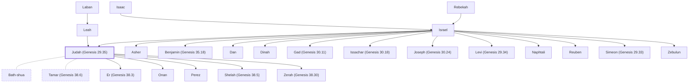

# Judah (Genesis 29.35)

Israelite tribe, kingdom, and province

**Also called:** David, Jews

**Original-language names:** יְהוּדָה (H3063) · דָּוִד (H1732) · יְהוּדַי (H3062) · Ἰουδά (G2448) · Ἰούδας (G2455) · Ἰουδαῖος (G2453) · Ἰουδαΐζω (G2450) · Ἰουδαϊκός (G2451) · Ἰουδαϊκῶς (G2452)

## When

- **Lived:** [[connections/timeline/18th century BC|1755 BC]] – ? *(Jones)*
- **Placed around:** [[connections/timeline/8th century BC|726 BC]] *(Ussher: the median date of the passages naming them)*

## Family

- **Father:** [[connections/people/Israel|Israel]]
- **Mother:** [[connections/people/Leah|Leah]]
- **Brothers and sisters:** [[connections/people/Asher|Asher]], [[connections/people/Benjamin (Genesis 35.18)|Benjamin (Genesis 35.18)]], [[connections/people/Dan|Dan]], [[connections/people/Dinah|Dinah]], [[connections/people/Gad (Genesis 30.11)|Gad (Genesis 30.11)]], [[connections/people/Issachar (Genesis 30.18)|Issachar (Genesis 30.18)]], [[connections/people/Joseph (Genesis 30.24)|Joseph (Genesis 30.24)]], [[connections/people/Levi (Genesis 29.34)|Levi (Genesis 29.34)]], [[connections/people/Naphtali|Naphtali]], [[connections/people/Reuben|Reuben]], [[connections/people/Simeon (Genesis 29.33)|Simeon (Genesis 29.33)]], [[connections/people/Zebulun|Zebulun]]
- **Spouses:** [[connections/people/Bath-shua|Bath-shua]], [[connections/people/Tamar (Genesis 38.6)|Tamar (Genesis 38.6)]]
- **Children:** [[connections/people/Er (Genesis 38.3)|Er (Genesis 38.3)]], [[connections/people/Onan|Onan]], [[connections/people/Perez|Perez]], [[connections/people/Shelah (Genesis 38.5)|Shelah (Genesis 38.5)]], [[connections/people/Zerah (Genesis 38.30)|Zerah (Genesis 38.30)]]
- **Tribe or nation:** Tribe of Judah

**Line of descent** (24 generations, father to son): [[connections/people/Adam|Adam]] → [[connections/people/Seth|Seth]] → [[connections/people/Enosh|Enosh]] → [[connections/people/Kenan|Kenan]] → [[connections/people/Mahalalel (Genesis 5.12)|Mahalalel (Genesis 5.12)]] → [[connections/people/Jared|Jared]] → [[connections/people/Enoch (Genesis 5.18)|Enoch (Genesis 5.18)]] → [[connections/people/Methuselah|Methuselah]] → [[connections/people/Lamech (Genesis 5.25)|Lamech (Genesis 5.25)]] → [[connections/people/Noah (Genesis 5.29)|Noah (Genesis 5.29)]] → [[connections/people/Shem|Shem]] → [[connections/people/Arpachshad|Arpachshad]] → [[connections/people/Cainan|Cainan]] → [[connections/people/Shelah (Genesis 10.24)|Shelah (Genesis 10.24)]] → [[connections/people/Eber (Genesis 10.21)|Eber (Genesis 10.21)]] → [[connections/people/Peleg|Peleg]] → [[connections/people/Reu|Reu]] → [[connections/people/Serug|Serug]] → [[connections/people/Nahor (Genesis 11.22)|Nahor (Genesis 11.22)]] → [[connections/people/Terah|Terah]] → [[connections/people/Abraham|Abraham]] → [[connections/people/Isaac|Isaac]] → [[connections/people/Israel|Israel]] → **Judah (Genesis 29.35)**

**Family group:** [[connections/genealogy/Family of Adam|Family of Adam]], generation 24

## Events

- [[connections/timeline/18th century BC|1755 BC]] · [[connections/events/Birth of Judah|Birth of Judah]]
- [[connections/timeline/18th century BC|1728 BC]] · [[connections/events/Joseph sold to Egypt|Joseph sold to Egypt]]
- [[connections/timeline/18th century BC|1721 BC]] · [[connections/events/Birth of Perez|Birth of Perez]]
- [[connections/timeline/18th century BC|1708 BC]] · [[connections/events/7 years of famine|7 years of famine]]
- [[connections/timeline/18th century BC|1706 BC]] · [[connections/events/Joseph's brothers return to Egypt|Joseph's brothers return to Egypt]]

## Appears in

[[connections/chapters/01-genesis/Genesis 29|Genesis 29]] · [[connections/chapters/01-genesis/Genesis 35|Genesis 35]] · [[connections/chapters/01-genesis/Genesis 37|Genesis 37]] · [[connections/chapters/01-genesis/Genesis 38|Genesis 38 (13)]] · [[connections/chapters/01-genesis/Genesis 43|Genesis 43 (2)]] · [[connections/chapters/01-genesis/Genesis 44|Genesis 44 (3)]] · [[connections/chapters/01-genesis/Genesis 46|Genesis 46 (2)]] · [[connections/chapters/01-genesis/Genesis 49|Genesis 49 (3)]] · [[connections/chapters/02-exodus/Exodus 1|Exodus 1]] · [[connections/chapters/02-exodus/Exodus 31|Exodus 31]] · [[connections/chapters/02-exodus/Exodus 35|Exodus 35]] · [[connections/chapters/02-exodus/Exodus 38|Exodus 38]] · [[connections/chapters/04-numbers/Numbers 1|Numbers 1 (3)]] · [[connections/chapters/04-numbers/Numbers 2|Numbers 2 (2)]] · [[connections/chapters/04-numbers/Numbers 7|Numbers 7]] · [[connections/chapters/04-numbers/Numbers 10|Numbers 10]] · [[connections/chapters/04-numbers/Numbers 13|Numbers 13]] · [[connections/chapters/04-numbers/Numbers 26|Numbers 26 (3)]] · [[connections/chapters/04-numbers/Numbers 34|Numbers 34]] · [[connections/chapters/05-deuteronomy/Deuteronomy 27|Deuteronomy 27]] · [[connections/chapters/05-deuteronomy/Deuteronomy 33|Deuteronomy 33]] · [[connections/chapters/05-deuteronomy/Deuteronomy 34|Deuteronomy 34]] · [[connections/chapters/06-joshua/Joshua 7|Joshua 7 (4)]] · [[connections/chapters/06-joshua/Joshua 11|Joshua 11]] · [[connections/chapters/06-joshua/Joshua 14|Joshua 14]] · [[connections/chapters/06-joshua/Joshua 15|Joshua 15 (6)]] · [[connections/chapters/06-joshua/Joshua 18|Joshua 18 (3)]] · [[connections/chapters/06-joshua/Joshua 19|Joshua 19 (3)]] · [[connections/chapters/06-joshua/Joshua 20|Joshua 20]] · [[connections/chapters/06-joshua/Joshua 21|Joshua 21 (3)]] · [[connections/chapters/07-judges/Judges 1|Judges 1 (10)]] · [[connections/chapters/07-judges/Judges 10|Judges 10]] · [[connections/chapters/07-judges/Judges 15|Judges 15 (3)]] · [[connections/chapters/07-judges/Judges 17|Judges 17 (3)]] · [[connections/chapters/07-judges/Judges 18|Judges 18]] · [[connections/chapters/07-judges/Judges 19|Judges 19 (3)]] · [[connections/chapters/07-judges/Judges 20|Judges 20]] · [[connections/chapters/08-ruth/Ruth 1|Ruth 1 (3)]] · [[connections/chapters/08-ruth/Ruth 4|Ruth 4]] · [[connections/chapters/09-1-samuel/1 Samuel 11|1 Samuel 11]] · [[connections/chapters/09-1-samuel/1 Samuel 15|1 Samuel 15]] · [[connections/chapters/09-1-samuel/1 Samuel 17|1 Samuel 17 (3)]] · [[connections/chapters/09-1-samuel/1 Samuel 18|1 Samuel 18]] · [[connections/chapters/09-1-samuel/1 Samuel 22|1 Samuel 22]] · [[connections/chapters/09-1-samuel/1 Samuel 23|1 Samuel 23 (2)]] · [[connections/chapters/09-1-samuel/1 Samuel 27|1 Samuel 27 (2)]] · [[connections/chapters/09-1-samuel/1 Samuel 30|1 Samuel 30 (3)]] · [[connections/chapters/10-2-samuel/2 Samuel 1|2 Samuel 1]] · [[connections/chapters/10-2-samuel/2 Samuel 2|2 Samuel 2 (5)]] · [[connections/chapters/10-2-samuel/2 Samuel 3|2 Samuel 3 (2)]] · [[connections/chapters/10-2-samuel/2 Samuel 5|2 Samuel 5]] · [[connections/chapters/10-2-samuel/2 Samuel 11|2 Samuel 11]] · [[connections/chapters/10-2-samuel/2 Samuel 12|2 Samuel 12]] · [[connections/chapters/10-2-samuel/2 Samuel 19|2 Samuel 19 (8)]] · [[connections/chapters/10-2-samuel/2 Samuel 20|2 Samuel 20 (3)]] · [[connections/chapters/10-2-samuel/2 Samuel 21|2 Samuel 21]] · [[connections/chapters/10-2-samuel/2 Samuel 24|2 Samuel 24 (3)]] · [[connections/chapters/11-1-kings/1 Kings 1|1 Kings 1 (2)]] · [[connections/chapters/11-1-kings/1 Kings 2|1 Kings 2]] · [[connections/chapters/11-1-kings/1 Kings 4|1 Kings 4]] · [[connections/chapters/11-1-kings/1 Kings 5|1 Kings 5]] · [[connections/chapters/11-1-kings/1 Kings 12|1 Kings 12 (6)]] · [[connections/chapters/11-1-kings/1 Kings 13|1 Kings 13 (4)]] · [[connections/chapters/11-1-kings/1 Kings 14|1 Kings 14 (3)]] · [[connections/chapters/11-1-kings/1 Kings 15|1 Kings 15 (9)]] · [[connections/chapters/11-1-kings/1 Kings 16|1 Kings 16 (5)]] · [[connections/chapters/11-1-kings/1 Kings 19|1 Kings 19]] · [[connections/chapters/11-1-kings/1 Kings 22|1 Kings 22 (6)]] · [[connections/chapters/12-2-kings/2 Kings 1|2 Kings 1]] · [[connections/chapters/12-2-kings/2 Kings 3|2 Kings 3 (4)]] · [[connections/chapters/12-2-kings/2 Kings 8|2 Kings 8 (7)]] · [[connections/chapters/12-2-kings/2 Kings 9|2 Kings 9 (4)]] · [[connections/chapters/12-2-kings/2 Kings 10|2 Kings 10]] · [[connections/chapters/12-2-kings/2 Kings 12|2 Kings 12 (2)]] · [[connections/chapters/12-2-kings/2 Kings 13|2 Kings 13 (3)]] · [[connections/chapters/12-2-kings/2 Kings 14|2 Kings 14 (13)]] · [[connections/chapters/12-2-kings/2 Kings 15|2 Kings 15 (10)]] · [[connections/chapters/12-2-kings/2 Kings 16|2 Kings 16 (2)]] · [[connections/chapters/12-2-kings/2 Kings 17|2 Kings 17 (4)]] · [[connections/chapters/12-2-kings/2 Kings 18|2 Kings 18 (6)]] · [[connections/chapters/12-2-kings/2 Kings 19|2 Kings 19 (2)]] · [[connections/chapters/12-2-kings/2 Kings 20|2 Kings 20]] · [[connections/chapters/12-2-kings/2 Kings 21|2 Kings 21 (5)]] · [[connections/chapters/12-2-kings/2 Kings 22|2 Kings 22 (3)]] · [[connections/chapters/12-2-kings/2 Kings 23|2 Kings 23 (12)]] · [[connections/chapters/12-2-kings/2 Kings 24|2 Kings 24 (5)]] · [[connections/chapters/12-2-kings/2 Kings 25|2 Kings 25 (3)]] · [[connections/chapters/13-1-chronicles/1 Chronicles 2|1 Chronicles 2 (4)]] · [[connections/chapters/13-1-chronicles/1 Chronicles 4|1 Chronicles 4 (4)]] · [[connections/chapters/13-1-chronicles/1 Chronicles 5|1 Chronicles 5 (3)]] · [[connections/chapters/13-1-chronicles/1 Chronicles 6|1 Chronicles 6 (2)]] · [[connections/chapters/13-1-chronicles/1 Chronicles 9|1 Chronicles 9 (3)]] · [[connections/chapters/13-1-chronicles/1 Chronicles 12|1 Chronicles 12 (2)]] · [[connections/chapters/13-1-chronicles/1 Chronicles 13|1 Chronicles 13]] · [[connections/chapters/13-1-chronicles/1 Chronicles 21|1 Chronicles 21]] · [[connections/chapters/13-1-chronicles/1 Chronicles 27|1 Chronicles 27]] · [[connections/chapters/13-1-chronicles/1 Chronicles 28|1 Chronicles 28]] · [[connections/chapters/14-2-chronicles/2 Chronicles 2|2 Chronicles 2]] · [[connections/chapters/14-2-chronicles/2 Chronicles 9|2 Chronicles 9]] · [[connections/chapters/14-2-chronicles/2 Chronicles 10|2 Chronicles 10]] · [[connections/chapters/14-2-chronicles/2 Chronicles 11|2 Chronicles 11 (8)]] · [[connections/chapters/14-2-chronicles/2 Chronicles 12|2 Chronicles 12 (3)]] · [[connections/chapters/14-2-chronicles/2 Chronicles 13|2 Chronicles 13 (6)]] · [[connections/chapters/14-2-chronicles/2 Chronicles 14|2 Chronicles 14 (6)]] · [[connections/chapters/14-2-chronicles/2 Chronicles 15|2 Chronicles 15 (4)]] · [[connections/chapters/14-2-chronicles/2 Chronicles 16|2 Chronicles 16 (4)]] · [[connections/chapters/14-2-chronicles/2 Chronicles 17|2 Chronicles 17 (10)]] · [[connections/chapters/14-2-chronicles/2 Chronicles 18|2 Chronicles 18 (3)]] · [[connections/chapters/14-2-chronicles/2 Chronicles 19|2 Chronicles 19 (3)]] · [[connections/chapters/14-2-chronicles/2 Chronicles 20|2 Chronicles 20 (13)]] · [[connections/chapters/14-2-chronicles/2 Chronicles 21|2 Chronicles 21 (7)]] · [[connections/chapters/14-2-chronicles/2 Chronicles 22|2 Chronicles 22 (4)]] · [[connections/chapters/14-2-chronicles/2 Chronicles 23|2 Chronicles 23 (2)]] · [[connections/chapters/14-2-chronicles/2 Chronicles 24|2 Chronicles 24 (6)]] · [[connections/chapters/14-2-chronicles/2 Chronicles 25|2 Chronicles 25 (13)]] · [[connections/chapters/14-2-chronicles/2 Chronicles 26|2 Chronicles 26 (2)]] · [[connections/chapters/14-2-chronicles/2 Chronicles 27|2 Chronicles 27 (2)]] · [[connections/chapters/14-2-chronicles/2 Chronicles 28|2 Chronicles 28 (8)]] · [[connections/chapters/14-2-chronicles/2 Chronicles 29|2 Chronicles 29 (2)]] · [[connections/chapters/14-2-chronicles/2 Chronicles 30|2 Chronicles 30 (5)]] · [[connections/chapters/14-2-chronicles/2 Chronicles 31|2 Chronicles 31 (3)]] · [[connections/chapters/14-2-chronicles/2 Chronicles 32|2 Chronicles 32 (8)]] · [[connections/chapters/14-2-chronicles/2 Chronicles 33|2 Chronicles 33 (3)]] · [[connections/chapters/14-2-chronicles/2 Chronicles 34|2 Chronicles 34 (9)]] · [[connections/chapters/14-2-chronicles/2 Chronicles 35|2 Chronicles 35 (4)]] · [[connections/chapters/14-2-chronicles/2 Chronicles 36|2 Chronicles 36 (4)]] · [[connections/chapters/15-ezra/Ezra 1|Ezra 1 (4)]] · [[connections/chapters/15-ezra/Ezra 2|Ezra 2]] · [[connections/chapters/15-ezra/Ezra 4|Ezra 4 (5)]] · [[connections/chapters/15-ezra/Ezra 5|Ezra 5 (2)]] · [[connections/chapters/15-ezra/Ezra 6|Ezra 6 (3)]] · [[connections/chapters/15-ezra/Ezra 10|Ezra 10 (2)]] · [[connections/chapters/16-nehemiah/Nehemiah 1|Nehemiah 1]] · [[connections/chapters/16-nehemiah/Nehemiah 2|Nehemiah 2 (2)]] · [[connections/chapters/16-nehemiah/Nehemiah 4|Nehemiah 4 (2)]] · [[connections/chapters/16-nehemiah/Nehemiah 5|Nehemiah 5]] · [[connections/chapters/16-nehemiah/Nehemiah 6|Nehemiah 6 (3)]] · [[connections/chapters/16-nehemiah/Nehemiah 7|Nehemiah 7]] · [[connections/chapters/16-nehemiah/Nehemiah 11|Nehemiah 11 (6)]] · [[connections/chapters/16-nehemiah/Nehemiah 12|Nehemiah 12 (3)]] · [[connections/chapters/16-nehemiah/Nehemiah 13|Nehemiah 13 (4)]] · [[connections/chapters/17-esther/Esther 2|Esther 2]] · [[connections/chapters/19-psalms/Psalms 48|Psalms 48]] · [[connections/chapters/19-psalms/Psalms 60|Psalms 60]] · [[connections/chapters/19-psalms/Psalms 63|Psalms 63]] · [[connections/chapters/19-psalms/Psalms 68|Psalms 68]] · [[connections/chapters/19-psalms/Psalms 69|Psalms 69]] · [[connections/chapters/19-psalms/Psalms 76|Psalms 76]] · [[connections/chapters/19-psalms/Psalms 78|Psalms 78]] · [[connections/chapters/19-psalms/Psalms 97|Psalms 97]] · [[connections/chapters/19-psalms/Psalms 108|Psalms 108]] · [[connections/chapters/19-psalms/Psalms 114|Psalms 114]] · [[connections/chapters/20-proverbs/Proverbs 25|Proverbs 25]] · [[connections/chapters/23-isaiah/Isaiah 1|Isaiah 1]] · [[connections/chapters/23-isaiah/Isaiah 2|Isaiah 2]] · [[connections/chapters/23-isaiah/Isaiah 3|Isaiah 3 (2)]] · [[connections/chapters/23-isaiah/Isaiah 5|Isaiah 5 (2)]] · [[connections/chapters/23-isaiah/Isaiah 7|Isaiah 7 (3)]] · [[connections/chapters/23-isaiah/Isaiah 8|Isaiah 8]] · [[connections/chapters/23-isaiah/Isaiah 9|Isaiah 9]] · [[connections/chapters/23-isaiah/Isaiah 11|Isaiah 11 (2)]] · [[connections/chapters/23-isaiah/Isaiah 19|Isaiah 19]] · [[connections/chapters/23-isaiah/Isaiah 22|Isaiah 22 (2)]] · [[connections/chapters/23-isaiah/Isaiah 26|Isaiah 26]] · [[connections/chapters/23-isaiah/Isaiah 36|Isaiah 36 (2)]] · [[connections/chapters/23-isaiah/Isaiah 37|Isaiah 37 (2)]] · [[connections/chapters/23-isaiah/Isaiah 38|Isaiah 38]] · [[connections/chapters/23-isaiah/Isaiah 40|Isaiah 40]] · [[connections/chapters/23-isaiah/Isaiah 44|Isaiah 44]] · [[connections/chapters/23-isaiah/Isaiah 48|Isaiah 48]] · [[connections/chapters/23-isaiah/Isaiah 65|Isaiah 65]] · [[connections/chapters/24-jeremiah/Jeremiah 1|Jeremiah 1 (4)]] · [[connections/chapters/24-jeremiah/Jeremiah 2|Jeremiah 2]] · [[connections/chapters/24-jeremiah/Jeremiah 3|Jeremiah 3 (5)]] · [[connections/chapters/24-jeremiah/Jeremiah 4|Jeremiah 4 (4)]] · [[connections/chapters/24-jeremiah/Jeremiah 5|Jeremiah 5 (2)]] · [[connections/chapters/24-jeremiah/Jeremiah 7|Jeremiah 7 (4)]] · [[connections/chapters/24-jeremiah/Jeremiah 8|Jeremiah 8]] · [[connections/chapters/24-jeremiah/Jeremiah 9|Jeremiah 9 (2)]] · [[connections/chapters/24-jeremiah/Jeremiah 10|Jeremiah 10]] · [[connections/chapters/24-jeremiah/Jeremiah 11|Jeremiah 11 (7)]] · [[connections/chapters/24-jeremiah/Jeremiah 12|Jeremiah 12]] · [[connections/chapters/24-jeremiah/Jeremiah 13|Jeremiah 13 (3)]] · [[connections/chapters/24-jeremiah/Jeremiah 14|Jeremiah 14 (2)]] · [[connections/chapters/24-jeremiah/Jeremiah 15|Jeremiah 15]] · [[connections/chapters/24-jeremiah/Jeremiah 17|Jeremiah 17 (5)]] · [[connections/chapters/24-jeremiah/Jeremiah 18|Jeremiah 18]] · [[connections/chapters/24-jeremiah/Jeremiah 19|Jeremiah 19 (4)]] · [[connections/chapters/24-jeremiah/Jeremiah 20|Jeremiah 20 (2)]] · [[connections/chapters/24-jeremiah/Jeremiah 21|Jeremiah 21 (2)]] · [[connections/chapters/24-jeremiah/Jeremiah 22|Jeremiah 22 (7)]] · [[connections/chapters/24-jeremiah/Jeremiah 23|Jeremiah 23]] · [[connections/chapters/24-jeremiah/Jeremiah 24|Jeremiah 24 (3)]] · [[connections/chapters/24-jeremiah/Jeremiah 25|Jeremiah 25 (4)]] · [[connections/chapters/24-jeremiah/Jeremiah 26|Jeremiah 26 (5)]] · [[connections/chapters/24-jeremiah/Jeremiah 27|Jeremiah 27 (6)]] · [[connections/chapters/24-jeremiah/Jeremiah 28|Jeremiah 28 (2)]] · [[connections/chapters/24-jeremiah/Jeremiah 29|Jeremiah 29 (3)]] · [[connections/chapters/24-jeremiah/Jeremiah 30|Jeremiah 30 (2)]] · [[connections/chapters/24-jeremiah/Jeremiah 31|Jeremiah 31 (4)]] · [[connections/chapters/24-jeremiah/Jeremiah 32|Jeremiah 32 (8)]] · [[connections/chapters/24-jeremiah/Jeremiah 33|Jeremiah 33 (6)]] · [[connections/chapters/24-jeremiah/Jeremiah 34|Jeremiah 34 (7)]] · [[connections/chapters/24-jeremiah/Jeremiah 35|Jeremiah 35 (3)]] · [[connections/chapters/24-jeremiah/Jeremiah 36|Jeremiah 36 (10)]] · [[connections/chapters/24-jeremiah/Jeremiah 37|Jeremiah 37 (2)]] · [[connections/chapters/24-jeremiah/Jeremiah 38|Jeremiah 38]] · [[connections/chapters/24-jeremiah/Jeremiah 39|Jeremiah 39 (4)]] · [[connections/chapters/24-jeremiah/Jeremiah 40|Jeremiah 40 (5)]] · [[connections/chapters/24-jeremiah/Jeremiah 42|Jeremiah 42 (2)]] · [[connections/chapters/24-jeremiah/Jeremiah 43|Jeremiah 43 (2)]] · [[connections/chapters/24-jeremiah/Jeremiah 44|Jeremiah 44 (14)]] · [[connections/chapters/24-jeremiah/Jeremiah 45|Jeremiah 45]] · [[connections/chapters/24-jeremiah/Jeremiah 46|Jeremiah 46]] · [[connections/chapters/24-jeremiah/Jeremiah 49|Jeremiah 49]] · [[connections/chapters/24-jeremiah/Jeremiah 50|Jeremiah 50 (3)]] · [[connections/chapters/24-jeremiah/Jeremiah 51|Jeremiah 51 (2)]] · [[connections/chapters/24-jeremiah/Jeremiah 52|Jeremiah 52 (4)]] · [[connections/chapters/25-lamentations/Lamentations 1|Lamentations 1 (2)]] · [[connections/chapters/25-lamentations/Lamentations 2|Lamentations 2 (2)]] · [[connections/chapters/25-lamentations/Lamentations 5|Lamentations 5]] · [[connections/chapters/26-ezekiel/Ezekiel 4|Ezekiel 4]] · [[connections/chapters/26-ezekiel/Ezekiel 8|Ezekiel 8 (2)]] · [[connections/chapters/26-ezekiel/Ezekiel 9|Ezekiel 9]] · [[connections/chapters/26-ezekiel/Ezekiel 21|Ezekiel 21]] · [[connections/chapters/26-ezekiel/Ezekiel 25|Ezekiel 25 (3)]] · [[connections/chapters/26-ezekiel/Ezekiel 27|Ezekiel 27]] · [[connections/chapters/26-ezekiel/Ezekiel 37|Ezekiel 37 (2)]] · [[connections/chapters/26-ezekiel/Ezekiel 48|Ezekiel 48 (4)]] · [[connections/chapters/27-daniel/Daniel 1|Daniel 1 (3)]] · [[connections/chapters/27-daniel/Daniel 3|Daniel 3 (2)]] · [[connections/chapters/27-daniel/Daniel 9|Daniel 9]] · [[connections/chapters/28-hosea/Hosea 1|Hosea 1 (2)]] · [[connections/chapters/28-hosea/Hosea 2|Hosea 2]] · [[connections/chapters/28-hosea/Hosea 4|Hosea 4]] · [[connections/chapters/28-hosea/Hosea 5|Hosea 5 (5)]] · [[connections/chapters/28-hosea/Hosea 6|Hosea 6 (2)]] · [[connections/chapters/28-hosea/Hosea 8|Hosea 8]] · [[connections/chapters/28-hosea/Hosea 10|Hosea 10]] · [[connections/chapters/28-hosea/Hosea 12|Hosea 12 (2)]] · [[connections/chapters/29-joel/Joel 4|Joel 4 (6)]] · [[connections/chapters/30-amos/Amos 1|Amos 1]] · [[connections/chapters/30-amos/Amos 2|Amos 2 (2)]] · [[connections/chapters/30-amos/Amos 7|Amos 7]] · [[connections/chapters/31-obadiah/Obadiah 1|Obadiah 1]] · [[connections/chapters/33-micah/Micah 1|Micah 1 (3)]] · [[connections/chapters/33-micah/Micah 5|Micah 5]] · [[connections/chapters/34-nahum/Nahum 2|Nahum 2]] · [[connections/chapters/36-zephaniah/Zephaniah 1|Zephaniah 1 (2)]] · [[connections/chapters/36-zephaniah/Zephaniah 2|Zephaniah 2]] · [[connections/chapters/37-haggai/Haggai 1|Haggai 1 (2)]] · [[connections/chapters/37-haggai/Haggai 2|Haggai 2 (2)]] · [[connections/chapters/38-zechariah/Zechariah 1|Zechariah 1]] · [[connections/chapters/38-zechariah/Zechariah 2|Zechariah 2 (3)]] · [[connections/chapters/38-zechariah/Zechariah 8|Zechariah 8 (3)]] · [[connections/chapters/38-zechariah/Zechariah 9|Zechariah 9 (2)]] · [[connections/chapters/38-zechariah/Zechariah 10|Zechariah 10 (2)]] · [[connections/chapters/38-zechariah/Zechariah 11|Zechariah 11]] · [[connections/chapters/38-zechariah/Zechariah 12|Zechariah 12 (5)]] · [[connections/chapters/38-zechariah/Zechariah 14|Zechariah 14 (3)]] · [[connections/chapters/39-malachi/Malachi 2|Malachi 2]] · [[connections/chapters/39-malachi/Malachi 3|Malachi 3]] · [[connections/chapters/40-matthew/Matthew 1|Matthew 1 (2)]] · [[connections/chapters/40-matthew/Matthew 2|Matthew 2]] · [[connections/chapters/42-luke/Luke 1|Luke 1]] · [[connections/chapters/42-luke/Luke 3|Luke 3]] · [[connections/chapters/44-acts/Acts 2|Acts 2 (2)]] · [[connections/chapters/44-acts/Acts 13|Acts 13]] · [[connections/chapters/44-acts/Acts 24|Acts 24]] · [[connections/chapters/48-galatians/Galatians 2|Galatians 2]] · [[connections/chapters/56-titus/Titus 1|Titus 1]] · [[connections/chapters/58-hebrews/Hebrews 7|Hebrews 7]] · [[connections/chapters/58-hebrews/Hebrews 8|Hebrews 8]] · [[connections/chapters/66-revelation/Revelation 5|Revelation 5]] · [[connections/chapters/66-revelation/Revelation 7|Revelation 7]]

## Appears in the same verse as

[[connections/people/Israel|Israel (204)]] · [[connections/places/Jerusalem|Jerusalem (180)]] · [[connections/places/Babylon|Babylon (45)]] · [[connections/people/David|David (39)]] · [[connections/people/Benjamin (Genesis 35.18)|Benjamin (Genesis 35.18) (33)]] · [[connections/people/Ephraim|Ephraim (29)]] · [[connections/people/Hezekiah (2 Kings 16.20)|Hezekiah (2 Kings 16.20) (29)]] · [[connections/people/Jehoshaphat (1 Kings 15.24)|Jehoshaphat (1 Kings 15.24) (28)]] · [[connections/people/Zedekiah (2 Kings 24.17)|Zedekiah (2 Kings 24.17) (26)]] · [[connections/people/Jehoiakim|Jehoiakim (24)]] · [[connections/people/Asa (1 Kings 15.8)|Asa (1 Kings 15.8) (23)]] · [[connections/people/Amaziah (2 Kings 12.22)|Amaziah (2 Kings 12.22) (21)]] · [[connections/people/Josiah (1 Kings 13.2)|Josiah (1 Kings 13.2) (20)]] · [[connections/places/Samaria|Samaria (18)]] · [[connections/people/Nebuchadnezzar|Nebuchadnezzar (17)]] · [[connections/places/Egypt|Egypt (17)]] · [[connections/people/Ahaziah (2 Kings 8.24)|Ahaziah (2 Kings 8.24) (16)]] · [[connections/people/Joash (2 Kings 13.9)|Joash (2 Kings 13.9) (16)]] · [[connections/people/Uzziah (2 Kings 14.21)|Uzziah (2 Kings 14.21) (15)]] · [[connections/people/Jeremiah (2 Chronicles 35.25)|Jeremiah (2 Chronicles 35.25) (14)]] · [[connections/places/Edom|Edom (14)]] · [[connections/people/Ahab (1 Kings 16.28)|Ahab (1 Kings 16.28) (12)]] · [[connections/people/Jehoiachin|Jehoiachin (12)]] · [[connections/people/Rehoboam|Rehoboam (12)]] · [[connections/people/Simeon (Genesis 29.33)|Simeon (Genesis 29.33) (12)]] · [[connections/people/Jeroboam (1 Kings 11.26)|Jeroboam (1 Kings 11.26) (11)]] · [[connections/places/Assyria|Assyria (11)]] · [[connections/places/Bethlehem (Genesis 35.16)|Bethlehem (Genesis 35.16) (11)]] · [[connections/places/Hebron|Hebron (11)]] · [[connections/places/Negeb|Negeb (11)]] · [[connections/people/Ahaz (2 Kings 15.38)|Ahaz (2 Kings 15.38) (10)]] · [[connections/people/Joash (2 Kings 11.2)|Joash (2 Kings 11.2) (10)]] · [[connections/people/Jehoram (1 Kings 22.51)|Jehoram (1 Kings 22.51) (9)]] · [[connections/people/Joram (2 Kings 1.17)|Joram (2 Kings 1.17) (9)]] · [[connections/people/Joseph (Genesis 30.24)|Joseph (Genesis 30.24) (9)]] · [[connections/people/Jotham (2 Kings 15.5)|Jotham (2 Kings 15.5) (9)]] · [[connections/people/Manasseh (2 Kings 20.21)|Manasseh (2 Kings 20.21) (9)]] · [[connections/people/Manasseh (Genesis 41.51)|Manasseh (Genesis 41.51) (9)]] · [[connections/people/Perez|Perez (9)]] · [[connections/places/Moab|Moab (9)]] · [[connections/people/Saul|Saul (8)]] · [[connections/people/Solomon|Solomon (8)]] · [[connections/places/Ammon|Ammon (8)]] · [[connections/places/Syria|Syria (8)]] · [[connections/people/Baasha|Baasha (7)]] · [[connections/people/Jehu (1 Kings 19.16)|Jehu (1 Kings 19.16) (7)]] · [[connections/people/Jeroboam (2 Kings 13.13)|Jeroboam (2 Kings 13.13) (7)]] · [[connections/people/Moses|Moses (7)]] · [[connections/people/Zerah (Genesis 38.30)|Zerah (Genesis 38.30) (7)]] · [[connections/people/Amminadab (Exodus 6.23)|Amminadab (Exodus 6.23) (6)]] · [[connections/people/Jehoahaz (2 Kings 10.35)|Jehoahaz (2 Kings 10.35) (6)]] · [[connections/people/Pekah|Pekah (6)]] · [[connections/people/Remaliah|Remaliah (6)]] · [[connections/people/Reuben|Reuben (6)]] · [[connections/people/Shelah (Genesis 38.5)|Shelah (Genesis 38.5) (6)]] · [[connections/people/Tamar (Genesis 38.6)|Tamar (Genesis 38.6) (6)]] · [[connections/places/Jordan|Jordan (6)]] · [[connections/people/Caleb (Numbers 13.6)|Caleb (Numbers 13.6) (5)]] · [[connections/people/Er (Genesis 38.3)|Er (Genesis 38.3) (5)]] · [[connections/people/Gedaliah (2 Kings 25.22)|Gedaliah (2 Kings 25.22) (5)]] · [[connections/people/Levi (Genesis 29.34)|Levi (Genesis 29.34) (5)]] · [[connections/people/Nahshon|Nahshon (5)]] · [[connections/people/Zerubbabel (1 Chronicles 3.19)|Zerubbabel (1 Chronicles 3.19) (5)]] · [[connections/places/Beersheba|Beersheba (5)]] · [[connections/places/Beth-shemesh (Joshua 15.10)|Beth-shemesh (Joshua 15.10) (5)]] · [[connections/places/Ramah (Joshua 18.25)|Ramah (Joshua 18.25) (5)]] · [[connections/places/Ramoth|Ramoth (5)]] · [[connections/places/Shephelah|Shephelah (5)]] · [[connections/people/Abijah (1 Kings 14.31)|Abijah (1 Kings 14.31) (4)]] · [[connections/people/Amon (2 Kings 21.18)|Amon (2 Kings 21.18) (4)]] · [[connections/people/Cyrus|Cyrus (4)]] · [[connections/people/Hezron (Genesis 46.12)|Hezron (Genesis 46.12) (4)]] · [[connections/people/Hur (Exodus 17.10)|Hur (Exodus 17.10) (4)]] · [[connections/people/Issachar (Genesis 30.18)|Issachar (Genesis 30.18) (4)]] · [[connections/people/Jehozadak|Jehozadak (4)]] · [[connections/people/Jephunneh (Numbers 13.6)|Jephunneh (Numbers 13.6) (4)]] · [[connections/people/Joshua (Exodus 17.9)|Joshua (Exodus 17.9) (4)]] · [[connections/people/Onan|Onan (4)]] · [[connections/people/Sennacherib|Sennacherib (4)]] · [[connections/people/Shaphan (2 Kings 22.3)|Shaphan (2 Kings 22.3) (4)]] · [[connections/people/Zebulun|Zebulun (4)]] · [[connections/places/Bethel (Genesis 12.8)|Bethel (Genesis 12.8) (4)]] · [[connections/places/Gilgal (Deuteronomy 11.30)|Gilgal (Deuteronomy 11.30) (4)]] · [[connections/places/Jezreel (Joshua 19.18)|Jezreel (Joshua 19.18) (4)]] · [[connections/places/Mizpah|Mizpah (4)]] · [[connections/places/Persia|Persia (4)]] · [[connections/places/Riblah (2 Kings 23.33)|Riblah (2 Kings 23.33) (4)]] · [[connections/places/Tirzah|Tirzah (4)]] · [[connections/people/Ahikam|Ahikam (3)]] · [[connections/people/Amasa (2 Samuel 17.25)|Amasa (2 Samuel 17.25) (3)]] · [[connections/people/Amoz|Amoz (3)]] · [[connections/people/Artaxerxes|Artaxerxes (3)]] · [[connections/people/Bezalel (Exodus 31.2)|Bezalel (Exodus 31.2) (3)]] · [[connections/people/Darius (Ezra 4.5)|Darius (Ezra 4.5) (3)]] · [[connections/people/Haggai|Haggai (3)]] · [[connections/people/Hazael|Hazael (3)]] · [[connections/people/Hilkiah (2 Kings 22.4)|Hilkiah (2 Kings 22.4) (3)]] · [[connections/people/Isaiah|Isaiah (3)]] · [[connections/people/Jehoiada (2 Kings 11.4)|Jehoiada (2 Kings 11.4) (3)]] · [[connections/people/Joab (1 Samuel 26.6)|Joab (1 Samuel 26.6) (3)]] · [[connections/people/Johanan (2 Kings 25.23)|Johanan (2 Kings 25.23) (3)]] · [[connections/people/Joshua (Ezra 2.2)|Joshua (Ezra 2.2) (3)]] · [[connections/people/Kareah|Kareah (3)]] · [[connections/people/Naphtali|Naphtali (3)]] · [[connections/people/Neriah|Neriah (3)]] · [[connections/people/Ram (Ruth 4.19)|Ram (Ruth 4.19) (3)]] · [[connections/people/Shealtiel (1 Chronicles 3.17)|Shealtiel (1 Chronicles 3.17) (3)]] · [[connections/people/Shua (Genesis 38.2)|Shua (Genesis 38.2) (3)]] · [[connections/people/Uri (Exodus 31.2)|Uri (Exodus 31.2) (3)]] · [[connections/people/Zabdi (Joshua 7.1)|Zabdi (Joshua 7.1) (3)]] · [[connections/places/Chaldea|Chaldea (3)]] · [[connections/places/Ekron|Ekron (3)]] · [[connections/places/Euphrates|Euphrates (3)]] · [[connections/places/Geba|Geba (3)]] · [[connections/places/Gilead|Gilead (3)]] · [[connections/places/Hamath|Hamath (3)]] · [[connections/places/Kiriath-jearim|Kiriath-jearim (3)]] · [[connections/places/Lachish|Lachish (3)]] · [[connections/places/Lebanon|Lebanon (3)]] · [[connections/places/Ziklag|Ziklag (3)]] · [[connections/people/Aaron|Aaron (2)]] · [[connections/people/Abner|Abner (2)]] · [[connections/people/Abraham|Abraham (2)]] · [[connections/people/Achan|Achan (2)]] · [[connections/people/Achish|Achish (2)]] · [[connections/people/Ahaziah (1 Kings 22.40)|Ahaziah (1 Kings 22.40) (2)]] · [[connections/people/Amos (Amos 1.1)|Amos (Amos 1.1) (2)]] · [[connections/people/Anak|Anak (2)]] · [[connections/people/Arba|Arba (2)]] · [[connections/people/Azariah (Daniel 1.6)|Azariah (Daniel 1.6) (2)]] · [[connections/people/Baruch (Jeremiah 32.12)|Baruch (Jeremiah 32.12) (2)]] · [[connections/people/Bath-shua|Bath-shua (2)]] · [[connections/people/Carmi (Joshua 7.1)|Carmi (Joshua 7.1) (2)]] · [[connections/people/Elah (2 Kings 15.30)|Elah (2 Kings 15.30) (2)]] · [[connections/people/Elijah (1 Kings 17.1)|Elijah (1 Kings 17.1) (2)]] · [[connections/people/Evil-merodach|Evil-merodach (2)]] · [[connections/people/Hananiah (Daniel 1.6)|Hananiah (Daniel 1.6) (2)]] · [[connections/people/Hirah|Hirah (2)]] · [[connections/people/Hophra|Hophra (2)]] · [[connections/people/Hoshea (2 Kings 15.30)|Hoshea (2 Kings 15.30) (2)]] · [[connections/people/Iddo (Ezra 5.1)|Iddo (Ezra 5.1) (2)]] · [[connections/people/Isaac|Isaac (2)]] · [[connections/people/Ish-bosheth|Ish-bosheth (2)]] · [[connections/people/Menahem|Menahem (2)]] · [[connections/people/Micah (Jeremiah 26.18)|Micah (Jeremiah 26.18) (2)]] · [[connections/people/Micah (Judges 17.1)|Micah (Judges 17.1) (2)]] · [[connections/people/Mishael (Daniel 1.6)|Mishael (Daniel 1.6) (2)]] · [[connections/people/Nebuzaradan|Nebuzaradan (2)]] · [[connections/people/Neco|Neco (2)]] · [[connections/people/Omri (1 Kings 16.16)|Omri (1 Kings 16.16) (2)]] · [[connections/people/Rezin (2 Kings 15.37)|Rezin (2 Kings 15.37) (2)]] · [[connections/people/Samson|Samson (2)]] · [[connections/people/Zechariah (Ezra 5.1)|Zechariah (Ezra 5.1) (2)]] · [[connections/people/Zimri (1 Kings 16.9)|Zimri (1 Kings 16.9) (2)]] · [[connections/places/Aijalon|Aijalon (2)]] · [[connections/places/Ashkelon|Ashkelon (2)]] · [[connections/places/Azekah|Azekah (2)]] · [[connections/places/Beth-horon Lower|Beth-horon Lower (2)]] · [[connections/places/Canaan|Canaan (2)]] · [[connections/places/Corner Gate|Corner Gate (2)]] · [[connections/places/Damascus|Damascus (2)]] · [[connections/places/Dan|Dan (2)]] · [[connections/places/Elath|Elath (2)]] · [[connections/places/Ephraim Gate|Ephraim Gate (2)]] · [[connections/places/Libnah (Joshua 10.29)|Libnah (Joshua 10.29) (2)]] · [[connections/places/Socoh (Joshua 15.35)|Socoh (Joshua 15.35) (2)]] · [[connections/places/Tekoa|Tekoa (2)]] · [[connections/places/Timnah (Genesis 38.12)|Timnah (Genesis 38.12) (2)]] · [[connections/places/Topheth|Topheth (2)]] · [[connections/places/Tyre|Tyre (2)]] · [[connections/people/Abiathar|Abiathar]] · [[connections/people/Adnah (2 Chronicles 17.14)|Adnah (2 Chronicles 17.14)]] · [[connections/people/Adonijah (2 Samuel 3.4)|Adonijah (2 Samuel 3.4)]] · [[connections/people/Ahab (Jeremiah 29.21)|Ahab (Jeremiah 29.21)]] · [[connections/people/Ahasuerus|Ahasuerus]] · [[connections/people/Ahijah (1 Kings 15.27)|Ahijah (1 Kings 15.27)]] · [[connections/people/Ahiman (Numbers 13.22)|Ahiman (Numbers 13.22)]] · [[connections/people/Amariah (2 Chronicles 19.11)|Amariah (2 Chronicles 19.11)]] · [[connections/people/Amariah (Nehemiah 11.4)|Amariah (Nehemiah 11.4)]] · [[connections/people/Amariah (Zephaniah 1.1)|Amariah (Zephaniah 1.1)]] · [[connections/people/Amaziah (Amos 7.10)|Amaziah (Amos 7.10)]] · [[connections/people/Ammihud (1 Chronicles 9.4)|Ammihud (1 Chronicles 9.4)]] · [[connections/people/Arah (Nehemiah 6.18)|Arah (Nehemiah 6.18)]] · [[connections/people/Asher|Asher]] · [[connections/people/Athaiah|Athaiah]] · [[connections/people/Athaliah (2 Kings 8.26)|Athaliah (2 Kings 8.26)]] · [[connections/people/Azubah (1 Kings 22.42)|Azubah (1 Kings 22.42)]] · [[connections/people/Azzur (Jeremiah 28.1)|Azzur (Jeremiah 28.1)]] · [[connections/people/Bani (1 Chronicles 9.4)|Bani (1 Chronicles 9.4)]] · [[connections/people/Beeri (Hosea 1.1)|Beeri (Hosea 1.1)]] · [[connections/people/Ben-hail|Ben-hail]] · [[connections/people/Berechiah (Nehemiah 3.4)|Berechiah (Nehemiah 3.4)]] · [[connections/people/Bichri|Bichri]] · [[connections/people/Caleb (1 Chronicles 2.9)|Caleb (1 Chronicles 2.9)]] · [[connections/people/Chilion|Chilion]] · [[connections/people/Chimham|Chimham]] · [[connections/people/Cushi (Zephaniah 1.1)|Cushi (Zephaniah 1.1)]] · [[connections/people/Daniel (Ezekiel 14.14)|Daniel (Ezekiel 14.14)]] · [[connections/people/Elah (1 Kings 16.6)|Elah (1 Kings 16.6)]] · [[connections/people/Elasah (Jeremiah 29.3)|Elasah (Jeremiah 29.3)]] · [[connections/people/Elihu (1 Chronicles 27.18)|Elihu (1 Chronicles 27.18)]] · [[connections/people/Elimelech|Elimelech]] · [[connections/people/Elisha|Elisha]] · [[connections/people/Er (1 Chronicles 4.21)|Er (1 Chronicles 4.21)]] · [[connections/people/Gad (1 Samuel 22.5)|Gad (1 Samuel 22.5)]] · [[connections/people/Gad (Genesis 30.11)|Gad (Genesis 30.11)]] · [[connections/people/Gadi|Gadi]] · [[connections/people/Gedaliah (Zephaniah 1.1)|Gedaliah (Zephaniah 1.1)]] · [[connections/people/Gemariah (Jeremiah 29.3)|Gemariah (Jeremiah 29.3)]] · [[connections/people/Gera (2 Samuel 16.5)|Gera (2 Samuel 16.5)]] · [[connections/people/Hamul|Hamul]] · [[connections/people/Hanani (1 Kings 16.1)|Hanani (1 Kings 16.1)]] · [[connections/people/Hanani (Nehemiah 1.2)|Hanani (Nehemiah 1.2)]] · [[connections/people/Hananiah (Jeremiah 28.1)|Hananiah (Jeremiah 28.1)]] · [[connections/people/Hezekiah (Zephaniah 1.1)|Hezekiah (Zephaniah 1.1)]] · [[connections/people/Hosea|Hosea]] · [[connections/people/Hoshaiah (Nehemiah 12.32)|Hoshaiah (Nehemiah 12.32)]] · [[connections/people/Imri (1 Chronicles 9.4)|Imri (1 Chronicles 9.4)]] · [[connections/people/Ishmael (2 Chronicles 19.11)|Ishmael (2 Chronicles 19.11)]] · [[connections/people/Ishmael (2 Kings 25.23)|Ishmael (2 Kings 25.23)]] · [[connections/people/Jabesh|Jabesh]] · [[connections/people/Jashar|Jashar]] · [[connections/people/Jehoahaz (2 Kings 23.30)|Jehoahaz (2 Kings 23.30)]] · [[connections/people/Jehohanan (Nehemiah 6.18)|Jehohanan (Nehemiah 6.18)]] · [[connections/people/Jesse|Jesse]] · [[connections/people/Jesus|Jesus]] · [[connections/people/Jether (2 Samuel 17.25)|Jether (2 Samuel 17.25)]] · [[connections/people/Joshua (2 Kings 23.8)|Joshua (2 Kings 23.8)]] · [[connections/people/Laadah|Laadah]] · [[connections/people/Leah|Leah]] · [[connections/people/Lecah|Lecah]] · [[connections/people/Mahalalel (Nehemiah 11.4)|Mahalalel (Nehemiah 11.4)]] · [[connections/people/Mahlon|Mahlon]] · [[connections/people/Mahseiah|Mahseiah]] · [[connections/people/Mareshah (1 Chronicles 4.21)|Mareshah (1 Chronicles 4.21)]] · [[connections/people/Mary (Matthew 1.16)|Mary (Matthew 1.16)]] · [[connections/people/Meshezabel (Nehemiah 11.24)|Meshezabel (Nehemiah 11.24)]] · [[connections/people/Meshullam (Nehemiah 3.4)|Meshullam (Nehemiah 3.4)]] · [[connections/people/Meunites|Meunites]] · [[connections/people/Micaiah (2 Chronicles 17.7)|Micaiah (2 Chronicles 17.7)]] · [[connections/people/Michael (1 Chronicles 27.18)|Michael (1 Chronicles 27.18)]] · [[connections/people/Mithredath (Ezra 1.8)|Mithredath (Ezra 1.8)]] · [[connections/people/Naamah (1 Kings 14.21)|Naamah (1 Kings 14.21)]] · [[connections/people/Naboth|Naboth]] · [[connections/people/Nadab (1 Kings 14.20)|Nadab (1 Kings 14.20)]] · [[connections/people/Naomi|Naomi]] · [[connections/people/Nathan-melech|Nathan-melech]] · [[connections/people/Nebat|Nebat]] · [[connections/people/Ner|Ner]] · [[connections/people/Nethanel (2 Chronicles 17.7)|Nethanel (2 Chronicles 17.7)]] · [[connections/people/Nethaniah (2 Kings 25.23)|Nethaniah (2 Kings 25.23)]] · [[connections/people/Obadiah (2 Chronicles 17.7)|Obadiah (2 Chronicles 17.7)]] · [[connections/people/Oded (2 Chronicles 15.1)|Oded (2 Chronicles 15.1)]] · [[connections/people/Oded (2 Chronicles 28.9)|Oded (2 Chronicles 28.9)]] · [[connections/people/Omri (1 Chronicles 27.18)|Omri (1 Chronicles 27.18)]] · [[connections/people/Omri (1 Chronicles 9.4)|Omri (1 Chronicles 9.4)]] · [[connections/people/Pekahiah|Pekahiah]] · [[connections/people/Peter|Peter]] · [[connections/people/Pethahiah (Nehemiah 11.24)|Pethahiah (Nehemiah 11.24)]] · [[connections/people/Pharaoh (Genesis 37.36)|Pharaoh (Genesis 37.36)]] · [[connections/people/Rehum (Ezra 4.8)|Rehum (Ezra 4.8)]] · [[connections/people/Samuel|Samuel]] · [[connections/people/Seraiah (Jeremiah 51.59)|Seraiah (Jeremiah 51.59)]] · [[connections/people/Shallum (2 Kings 15.10)|Shallum (2 Kings 15.10)]] · [[connections/people/Sheba (2 Samuel 20.1)|Sheba (2 Samuel 20.1)]] · [[connections/people/Shecaniah (Nehemiah 6.18)|Shecaniah (Nehemiah 6.18)]] · [[connections/people/Shemaiah (1 Kings 12.22)|Shemaiah (1 Kings 12.22)]] · [[connections/people/Shephatiah (Nehemiah 11.4)|Shephatiah (Nehemiah 11.4)]] · [[connections/people/Sheshai|Sheshai]] · [[connections/people/Shilhi|Shilhi]] · [[connections/people/Shiloh|Shiloh]] · [[connections/people/Shimei (1 Chronicles 4.26)|Shimei (1 Chronicles 4.26)]] · [[connections/people/Shimei (2 Samuel 16.5)|Shimei (2 Samuel 16.5)]] · [[connections/people/Shimshai|Shimshai]] · [[connections/people/Shishak|Shishak]] · [[connections/people/Shobal (1 Chronicles 2.50)|Shobal (1 Chronicles 2.50)]] · [[connections/people/Tabeal|Tabeal]] · [[connections/people/Talmai (Numbers 13.22)|Talmai (Numbers 13.22)]] · [[connections/people/Tiglath-pileser|Tiglath-pileser]] · [[connections/people/Tobiah (Nehemiah 2.10)|Tobiah (Nehemiah 2.10)]] · [[connections/people/Uriah (2 Samuel 11.3)|Uriah (2 Samuel 11.3)]] · [[connections/people/Uthai (1 Chronicles 9.4)|Uthai (1 Chronicles 9.4)]] · [[connections/people/Uzziah (Nehemiah 11.4)|Uzziah (Nehemiah 11.4)]] · [[connections/people/Zadok (2 Samuel 8.17)|Zadok (2 Samuel 8.17)]] · [[connections/people/Zebadiah (2 Chronicles 19.11)|Zebadiah (2 Chronicles 19.11)]] · [[connections/people/Zechariah (2 Chronicles 17.7)|Zechariah (2 Chronicles 17.7)]] · [[connections/people/Zechariah (2 Kings 14.29)|Zechariah (2 Kings 14.29)]] · [[connections/people/Zechariah (Nehemiah 11.4)|Zechariah (Nehemiah 11.4)]] · [[connections/people/Zedekiah (Jeremiah 29.21)|Zedekiah (Jeremiah 29.21)]] · [[connections/people/Zephaniah (Zephaniah 1.1)|Zephaniah (Zephaniah 1.1)]] · [[connections/places/Anab|Anab]] · [[connections/places/Arabah|Arabah]] · [[connections/places/Arad|Arad]] · [[connections/places/Asia|Asia]] · [[connections/places/Azal|Azal]] · [[connections/places/Aznoth-tabor|Aznoth-tabor]] · [[connections/places/Bahurim|Bahurim]] · [[connections/places/Beth-ashbea|Beth-ashbea]] · [[connections/places/Beth-aven|Beth-aven]] · [[connections/places/Beth-haggan|Beth-haggan]] · [[connections/places/Bezek (1 Samuel 11.8)|Bezek (1 Samuel 11.8)]] · [[connections/places/Bezek (Judges 1.4)|Bezek (Judges 1.4)]] · [[connections/places/Carchemish|Carchemish]] · [[connections/places/Cyrene|Cyrene]] · [[connections/places/Debir (Joshua 10.38)|Debir (Joshua 10.38)]] · [[connections/places/Dibon (Nehemiah 11.25)|Dibon (Nehemiah 11.25)]] · [[connections/places/Dung Gate|Dung Gate]] · [[connections/places/Eder|Eder]] · [[connections/places/Elam|Elam]] · [[connections/places/En-rogel|En-rogel]] · [[connections/places/Ephes-dammim|Ephes-dammim]] · [[connections/places/Etam (Judges 15.8)|Etam (Judges 15.8)]] · [[connections/places/Fish Gate|Fish Gate]] · [[connections/places/Galilee|Galilee]] · [[connections/places/Gath|Gath]] · [[connections/places/Gaza|Gaza]] · [[connections/places/Gederoth|Gederoth]] · [[connections/places/Gerizim Mount|Gerizim Mount]] · [[connections/places/Gibbethon|Gibbethon]] · [[connections/places/Gibeon|Gibeon]] · [[connections/places/Gihon|Gihon]] · [[connections/places/Gimzo|Gimzo]] · [[connections/places/Goshen (Genesis 45.10)|Goshen (Genesis 45.10)]] · [[connections/places/Great Sea|Great Sea]] · [[connections/places/Greece|Greece]] · [[connections/places/Gur|Gur]] · [[connections/places/Hereth|Hereth]] · [[connections/places/Hormah|Hormah]] · [[connections/places/House of the Forest|House of the Forest]] · [[connections/places/Hukkok|Hukkok]] · [[connections/places/Ibleam|Ibleam]] · [[connections/places/Jabesh|Jabesh]] · [[connections/places/Jagur|Jagur]] · [[connections/places/Jekabzeel|Jekabzeel]] · [[connections/places/Jericho|Jericho]] · [[connections/places/Judea|Judea]] · [[connections/places/Kabzeel|Kabzeel]] · [[connections/places/Kadesh|Kadesh]] · [[connections/places/Kedesh|Kedesh]] · [[connections/places/Keilah|Keilah]] · [[connections/places/Kidron|Kidron]] · [[connections/places/Lehi|Lehi]] · [[connections/places/Libya|Libya]] · [[connections/places/Mahaneh-dan|Mahaneh-dan]] · [[connections/places/Megiddo|Megiddo]] · [[connections/places/Minnith|Minnith]] · [[connections/places/New Gate|New Gate]] · [[connections/places/Ophel|Ophel]] · [[connections/places/Pamphylia|Pamphylia]] · [[connections/places/People's Gate|People's Gate]] · [[connections/places/Phrygia|Phrygia]] · [[connections/places/Rome|Rome]] · [[connections/places/Seir|Seir]] · [[connections/places/Seir Mount (Deuteronomy 1.2)|Seir Mount (Deuteronomy 1.2)]] · [[connections/places/Sela|Sela]] · [[connections/places/Shaaraim|Shaaraim]] · [[connections/places/Shechem|Shechem]] · [[connections/places/Shittim Valley|Shittim Valley]] · [[connections/places/Sidon|Sidon]] · [[connections/places/Telaim|Telaim]] · [[connections/places/Zin|Zin]] · [[connections/places/Zorah|Zorah]]
