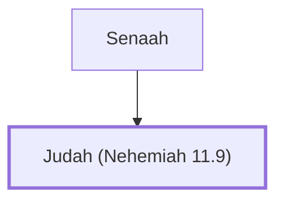

# Judah (Nehemiah 11.9)

Leader of Judahites living in Jerusalem

**Original-language names:** יְהוּדָה (H3063)

## When

- **Placed around:** [[connections/timeline/5th century BC|445 BC]] *(Ussher: the median date of the passages naming them)*

## Family

- **Father:** [[connections/people/Senaah|Senaah (descendants)]]
- **Tribe or nation:** Tribe of Benjamin

**Family group:** [[connections/genealogy/Family of Senaah|Family of Senaah]], generation 2

## Appears in

[[connections/chapters/16-nehemiah/Nehemiah 11|Nehemiah 11]]

## Appears in the same verse as

[[connections/people/Joel (Nehemiah 11.9)|Joel (Nehemiah 11.9)]] · [[connections/people/Senaah|Senaah]] · [[connections/people/Zichri (Nehemiah 11.9)|Zichri (Nehemiah 11.9)]]
