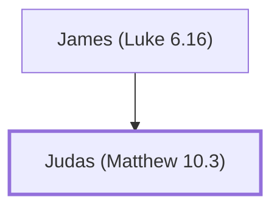

# Judas (Matthew 10.3)

One of the twelve apostles of Jesus

**Also called:** Lebbeus, Thaddeus

**Original-language names:** Ἰούδας (G2455) · Λεββαῖος (G3002) · Θαδδαῖος (G2280)

## When

- **Placed around:** [[connections/timeline/1st century AD|AD 33]] *(Ussher: the median date of the passages naming them)*

## Family

- **Father:** [[connections/people/James (Luke 6.16)|James (Luke 6.16)]]

**Family group:** [[connections/genealogy/Family of James (Luke 6.16)|Family of James (Luke 6.16)]], generation 2

## Events

- [[connections/timeline/1st century AD|AD 28]] · [[connections/events/Apostles Chosen|Apostles Chosen]]
- [[connections/timeline/1st century AD|AD 30]] · [[connections/events/Matthias replaces Judas|Matthias replaces Judas]]

## Appears in

[[connections/chapters/40-matthew/Matthew 10|Matthew 10]] · [[connections/chapters/41-mark/Mark 3|Mark 3]] · [[connections/chapters/42-luke/Luke 6|Luke 6]] · [[connections/chapters/43-john/John 14|John 14]] · [[connections/chapters/44-acts/Acts 1|Acts 1]]

## Appears in the same verse as

[[connections/people/Alphaeus|Alphaeus (3)]] · [[connections/people/Bartholomew|Bartholomew (3)]] · [[connections/people/James (Matthew 10.3)|James (Matthew 10.3) (3)]] · [[connections/people/Matthew|Matthew (3)]] · [[connections/people/Philip (Matthew 10.3)|Philip (Matthew 10.3) (3)]] · [[connections/people/Thomas|Thomas (3)]] · [[connections/people/Andrew|Andrew (2)]] · [[connections/people/James (Luke 6.16)|James (Luke 6.16) (2)]] · [[connections/people/Judas (Matthew 10.4)|Judas (Matthew 10.4) (2)]] · [[connections/people/Simon (Matthew 10.4)|Simon (Matthew 10.4) (2)]] · [[connections/people/James (Matthew 4.21)|James (Matthew 4.21)]] · [[connections/people/John (Matthew 4.21)|John (Matthew 4.21)]] · [[connections/people/Peter|Peter]]
