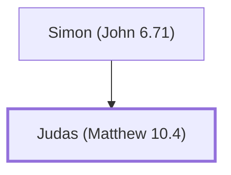

# Judas (Matthew 10.4)

The apostle who betrayed Jesus

**Also called:** Iscariot

**Original-language names:** Ἰούδας (G2455) · Ἰσκαριώτης, Ἰσκαριώθ (G2469)

## When

- **Placed around:** [[connections/timeline/1st century AD|AD 33]] *(Ussher: the median date of the passages naming them)*

## Family

- **Father:** [[connections/people/Simon (John 6.71)|Simon (John 6.71)]]

**Family group:** [[connections/genealogy/Family of Simon (John 6.71)|Family of Simon (John 6.71)]], generation 2

## Events

- [[connections/timeline/1st century AD|AD 28]] · [[connections/events/Apostles Chosen|Apostles Chosen]]
- [[connections/timeline/1st century AD|AD 30]] · [[connections/events/Judas Plans Betrayal|Judas Plans Betrayal]]
- [[connections/timeline/1st century AD|AD 30]] · [[connections/events/Prayer and Betrayal in Gethsemane|Prayer and Betrayal in Gethsemane]]
- [[connections/timeline/1st century AD|AD 30]] · [[connections/events/Judas' Suicide|Judas' Suicide]]

## Appears in

[[connections/chapters/40-matthew/Matthew 10|Matthew 10]] · [[connections/chapters/40-matthew/Matthew 26|Matthew 26 (3)]] · [[connections/chapters/40-matthew/Matthew 27|Matthew 27]] · [[connections/chapters/41-mark/Mark 3|Mark 3]] · [[connections/chapters/41-mark/Mark 14|Mark 14 (2)]] · [[connections/chapters/42-luke/Luke 6|Luke 6]] · [[connections/chapters/42-luke/Luke 22|Luke 22 (3)]] · [[connections/chapters/43-john/John 6|John 6]] · [[connections/chapters/43-john/John 12|John 12]] · [[connections/chapters/43-john/John 13|John 13 (3)]] · [[connections/chapters/43-john/John 14|John 14]] · [[connections/chapters/43-john/John 18|John 18 (3)]] · [[connections/chapters/44-acts/Acts 1|Acts 1 (2)]]

## Appears in the same verse as

[[connections/people/Jesus|Jesus (7)]] · [[connections/people/Simon (John 6.71)|Simon (John 6.71) (4)]] · [[connections/people/Judas (Matthew 10.3)|Judas (Matthew 10.3) (2)]] · [[connections/people/David|David]] · [[connections/people/James (Luke 6.16)|James (Luke 6.16)]] · [[connections/people/Simon (Matthew 10.4)|Simon (Matthew 10.4)]] · [[connections/places/Nazareth|Nazareth]]
