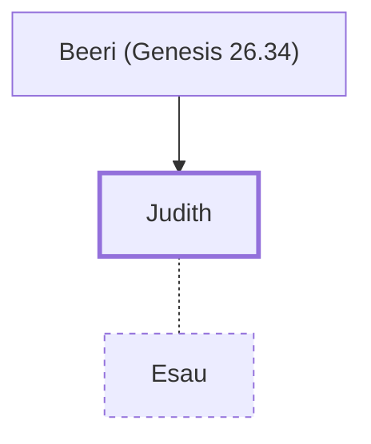

# Judith

A Hittite woman who married Esau

**Original-language names:** יְהוּדִית (H3067)

## When

- **Placed around:** [[connections/timeline/18th century BC|1796 BC]] *(Ussher: the median date of the passages naming them)*

## Family

- **Father:** [[connections/people/Beeri (Genesis 26.34)|Beeri (Genesis 26.34)]]
- **Spouses:** [[connections/people/Esau|Esau]]
- **Tribe or nation:** Edom

**Family group:** [[connections/genealogy/Family of Beeri (Genesis 26.34)|Family of Beeri (Genesis 26.34)]], generation 2

## Appears in

[[connections/chapters/01-genesis/Genesis 26|Genesis 26]]

## Appears in the same verse as

[[connections/people/Adah (Genesis 26.34)|Adah (Genesis 26.34)]] · [[connections/people/Beeri (Genesis 26.34)|Beeri (Genesis 26.34)]] · [[connections/people/Elon (Genesis 26.34)|Elon (Genesis 26.34)]] · [[connections/people/Esau|Esau]]
