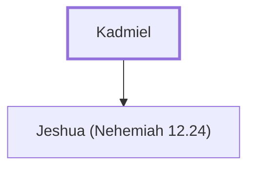

# Kadmiel

A Levite who returned from Babylonian exile

**Original-language names:** קַדְמִיאֵל (H6934)

## When

- **Placed around:** [[connections/timeline/5th century BC|445 BC]] *(Ussher: the median date of the passages naming them)*

## Family

- **Children:** [[connections/people/Jeshua (Nehemiah 12.24)|Jeshua (Nehemiah 12.24)]]

**Family group:** [[connections/genealogy/Family of Kadmiel|Family of Kadmiel]], generation 1

## Appears in

[[connections/chapters/15-ezra/Ezra 2|Ezra 2]] · [[connections/chapters/15-ezra/Ezra 3|Ezra 3]] · [[connections/chapters/16-nehemiah/Nehemiah 7|Nehemiah 7]] · [[connections/chapters/16-nehemiah/Nehemiah 9|Nehemiah 9 (2)]] · [[connections/chapters/16-nehemiah/Nehemiah 10|Nehemiah 10]] · [[connections/chapters/16-nehemiah/Nehemiah 12|Nehemiah 12 (2)]]

## Appears in the same verse as

[[connections/people/Jeshua (Ezra 2.40)|Jeshua (Ezra 2.40) (7)]] · [[connections/people/Bani (Nehemiah 8.7)|Bani (Nehemiah 8.7) (4)]] · [[connections/people/Hodaviah (Ezra 2.40)|Hodaviah (Ezra 2.40) (3)]] · [[connections/people/Henadad (Ezra 3.9)|Henadad (Ezra 3.9) (2)]] · [[connections/people/Hodiah (Nehemiah 8.7)|Hodiah (Nehemiah 8.7) (2)]] · [[connections/people/Shebaniah (Nehemiah 9.4)|Shebaniah (Nehemiah 9.4) (2)]] · [[connections/people/Sherebiah (Ezra 8.18)|Sherebiah (Ezra 8.18) (2)]] · [[connections/people/Sherebiah (Nehemiah 10.13)|Sherebiah (Nehemiah 10.13) (2)]] · [[connections/people/Azaniah|Azaniah]] · [[connections/people/Bani (Nehemiah 9.4)|Bani (Nehemiah 9.4)]] · [[connections/people/Bunni (Nehemiah 9.4)|Bunni (Nehemiah 9.4)]] · [[connections/people/Chenani|Chenani]] · [[connections/people/David|David]] · [[connections/people/Hashabiah (Ezra 8.19)|Hashabiah (Ezra 8.19)]] · [[connections/people/Hashabneiah (Nehemiah 9.5)|Hashabneiah (Nehemiah 9.5)]] · [[connections/people/Jeshua (Nehemiah 12.24)|Jeshua (Nehemiah 12.24)]] · [[connections/people/Mattaniah (1 Chronicles 9.15)|Mattaniah (1 Chronicles 9.15)]] · [[connections/people/Pethahiah (Nehemiah 9.5)|Pethahiah (Nehemiah 9.5)]]
