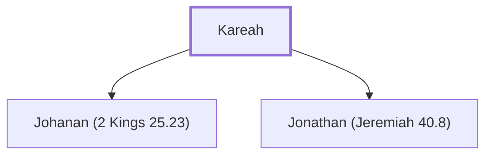

# Kareah

Father of Johanan and Jonathan

**Original-language names:** קָרֵחַ (H7143)

## When

- **Placed around:** [[connections/timeline/6th century BC|588 BC]] *(Ussher: the median date of the passages naming them)*

## Family

- **Children:** [[connections/people/Johanan (2 Kings 25.23)|Johanan (2 Kings 25.23)]], [[connections/people/Jonathan (Jeremiah 40.8)|Jonathan (Jeremiah 40.8)]]

**Family group:** [[connections/genealogy/Family of Kareah|Family of Kareah]], generation 1

## Appears in

[[connections/chapters/12-2-kings/2 Kings 25|2 Kings 25]] · [[connections/chapters/24-jeremiah/Jeremiah 40|Jeremiah 40 (4)]] · [[connections/chapters/24-jeremiah/Jeremiah 41|Jeremiah 41 (4)]] · [[connections/chapters/24-jeremiah/Jeremiah 42|Jeremiah 42 (2)]] · [[connections/chapters/24-jeremiah/Jeremiah 43|Jeremiah 43 (3)]]

## Appears in the same verse as

[[connections/people/Johanan (2 Kings 25.23)|Johanan (2 Kings 25.23) (14)]] · [[connections/people/Ishmael (2 Kings 25.23)|Ishmael (2 Kings 25.23) (8)]] · [[connections/people/Gedaliah (2 Kings 25.22)|Gedaliah (2 Kings 25.22) (6)]] · [[connections/places/Mizpah|Mizpah (6)]] · [[connections/people/Nethaniah (2 Kings 25.23)|Nethaniah (2 Kings 25.23) (5)]] · [[connections/people/Jezaniah|Jezaniah (4)]] · [[connections/people/Judah (Genesis 29.35)|Judah (Genesis 29.35) (3)]] · [[connections/people/Ahikam|Ahikam (2)]] · [[connections/people/Hoshaiah (Jeremiah 42.1)|Hoshaiah (Jeremiah 42.1) (2)]] · [[connections/people/Seraiah (2 Kings 25.23)|Seraiah (2 Kings 25.23) (2)]] · [[connections/people/Tanhumeth|Tanhumeth (2)]] · [[connections/people/Ephai|Ephai]] · [[connections/people/Jeremiah (2 Chronicles 35.25)|Jeremiah (2 Chronicles 35.25)]] · [[connections/people/Jonathan (Jeremiah 40.8)|Jonathan (Jeremiah 40.8)]] · [[connections/places/Babylon|Babylon]] · [[connections/places/Egypt|Egypt]] · [[connections/places/Gibeon|Gibeon]]
