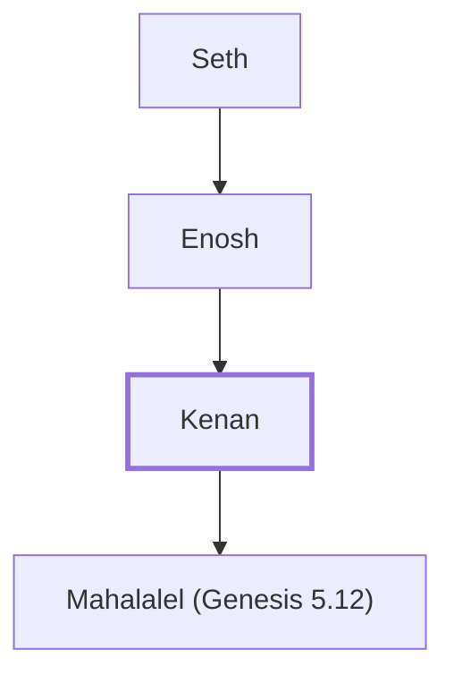

# Kenan

Son of Enosh, descendant of Seth

**Also called:** Cainan

**Original-language names:** קֵינָן (H7018) · Καϊνάν, Καϊνάμ (G2536)

## When

- **Lived:** [[connections/timeline/37th century BC|3679 BC]] – [[connections/timeline/28th century BC|2769 BC]] *(Jones)*
- **Placed around:** [[connections/timeline/37th century BC|3609 BC]] *(Ussher: the median date of the passages naming them)*

## Family

- **Father:** [[connections/people/Enosh|Enosh]]
- **Children:** [[connections/people/Mahalalel (Genesis 5.12)|Mahalalel (Genesis 5.12)]]
- **Tribe or nation:** Early Patriarch

**Line of descent** (4 generations, father to son): [[connections/people/Adam|Adam]] → [[connections/people/Seth|Seth]] → [[connections/people/Enosh|Enosh]] → **Kenan**

**Family group:** [[connections/genealogy/Family of Adam|Family of Adam]], generation 4

## Events

- [[connections/timeline/37th century BC|3679 BC]] · [[connections/events/Birth of Cainan|Birth of Cainan]]
- [[connections/timeline/37th century BC|3679 BC]] · [[connections/events/Lifetime of Cainan|Lifetime of Cainan]]
- [[connections/timeline/37th century BC|3609 BC]] · [[connections/events/Birth of Mahlaleel|Birth of Mahlaleel]]
- [[connections/timeline/28th century BC|2769 BC]] · [[connections/events/Death of Cainan|Death of Cainan]]

## Appears in

[[connections/chapters/01-genesis/Genesis 5|Genesis 5 (5)]] · [[connections/chapters/13-1-chronicles/1 Chronicles 1|1 Chronicles 1]] · [[connections/chapters/42-luke/Luke 3|Luke 3]]

## Appears in the same verse as

[[connections/people/Mahalalel (Genesis 5.12)|Mahalalel (Genesis 5.12) (4)]] · [[connections/people/Enosh|Enosh (2)]] · [[connections/people/Jared|Jared (2)]] · [[connections/people/Enoch (Genesis 5.18)|Enoch (Genesis 5.18)]] · [[connections/people/Methuselah|Methuselah]]
