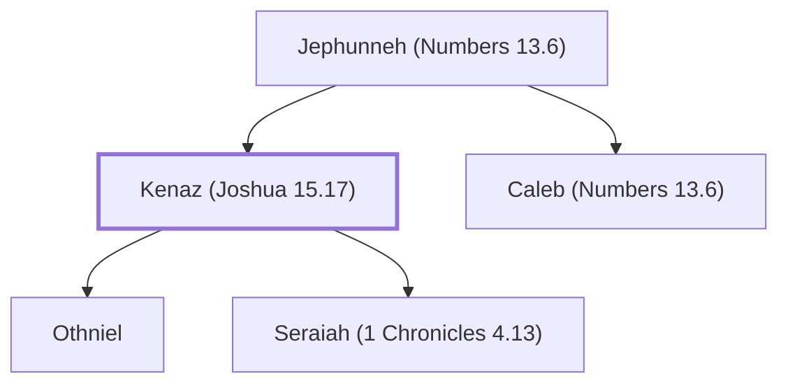

# Kenaz (Joshua 15.17)

Father of Othniel, a judge of Israel

**Original-language names:** קְנַז (H7073)

## When

- **Placed around:** [[connections/timeline/15th century BC|1405 BC]] *(Ussher: the median date of the passages naming them)*

## Family

- **Father:** [[connections/people/Jephunneh (Numbers 13.6)|Jephunneh (Numbers 13.6)]]
- **Brothers and sisters:** [[connections/people/Caleb (Numbers 13.6)|Caleb (Numbers 13.6)]]
- **Children:** [[connections/people/Othniel|Othniel]], [[connections/people/Seraiah (1 Chronicles 4.13)|Seraiah (1 Chronicles 4.13)]]

**Family group:** [[connections/genealogy/Family of Jephunneh (Numbers 13.6)|Family of Jephunneh (Numbers 13.6)]], generation 2

## Appears in

[[connections/chapters/06-joshua/Joshua 15|Joshua 15]] · [[connections/chapters/07-judges/Judges 1|Judges 1]] · [[connections/chapters/07-judges/Judges 3|Judges 3 (2)]] · [[connections/chapters/13-1-chronicles/1 Chronicles 4|1 Chronicles 4]]

## Appears in the same verse as

[[connections/people/Othniel|Othniel (5)]] · [[connections/people/Caleb (Numbers 13.6)|Caleb (Numbers 13.6) (3)]] · [[connections/people/Achsah (Joshua 15.16)|Achsah (Joshua 15.16) (2)]] · [[connections/people/Hathath|Hathath]] · [[connections/people/Israel|Israel]] · [[connections/people/Seraiah (1 Chronicles 4.13)|Seraiah (1 Chronicles 4.13)]]
