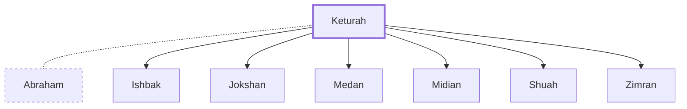

# Keturah

Abraham's concubine after Sarah's death

**Original-language names:** קְטוּרָה (H6989)

## When

- **Placed around:** [[connections/timeline/19th century BC|1853 BC]] *(Ussher: the median date of the passages naming them)*

## Family

- **Spouses:** [[connections/people/Abraham|Abraham]]
- **Children:** [[connections/people/Ishbak|Ishbak]], [[connections/people/Jokshan|Jokshan]], [[connections/people/Medan|Medan]], [[connections/people/Midian|Midian]], [[connections/people/Shuah|Shuah]], [[connections/people/Zimran|Zimran]]

**Family group:** [[connections/genealogy/Family of Adam|Family of Adam]], generation 21

## Appears in

[[connections/chapters/01-genesis/Genesis 25|Genesis 25 (2)]] · [[connections/chapters/13-1-chronicles/1 Chronicles 1|1 Chronicles 1 (2)]]

## Appears in the same verse as

[[connections/people/Midian|Midian (3)]] · [[connections/people/Abida|Abida (2)]] · [[connections/people/Abraham|Abraham (2)]] · [[connections/people/Eldaah|Eldaah (2)]] · [[connections/people/Ephah (Genesis 25.4)|Ephah (Genesis 25.4) (2)]] · [[connections/people/Epher (Genesis 25.4)|Epher (Genesis 25.4) (2)]] · [[connections/people/Hanoch (Genesis 25.4)|Hanoch (Genesis 25.4) (2)]] · [[connections/people/Dedan (Genesis 25.3)|Dedan (Genesis 25.3)]] · [[connections/people/Ishbak|Ishbak]] · [[connections/people/Jokshan|Jokshan]] · [[connections/people/Medan|Medan]] · [[connections/people/Sheba (Genesis 25.3)|Sheba (Genesis 25.3)]] · [[connections/people/Shuah|Shuah]] · [[connections/people/Zimran|Zimran]]
