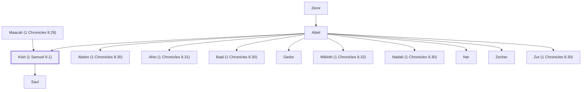

# Kish (1 Samuel 9.1)

Father of Saul, the first king of Israel

**Original-language names:** קִישׁ (H7027) · Κίς (G2797)

## When

- **Placed around:** [[connections/timeline/11th century BC|1095 BC]] *(Ussher: the median date of the passages naming them)*

## Family

- **Father:** [[connections/people/Abiel|Abiel]]
- **Mother:** [[connections/people/Maacah (1 Chronicles 8.29)|Maacah (1 Chronicles 8.29)]]
- **Brothers and sisters:** [[connections/people/Abdon (1 Chronicles 8.30)|Abdon (1 Chronicles 8.30)]], [[connections/people/Ahio (1 Chronicles 8.31)|Ahio (1 Chronicles 8.31)]], [[connections/people/Baal (1 Chronicles 8.30)|Baal (1 Chronicles 8.30)]], [[connections/people/Gedor|Gedor]], [[connections/people/Mikloth (1 Chronicles 8.32)|Mikloth (1 Chronicles 8.32)]], [[connections/people/Nadab (1 Chronicles 8.30)|Nadab (1 Chronicles 8.30)]], [[connections/people/Ner|Ner]], [[connections/people/Zecher|Zecher]], [[connections/people/Zur (1 Chronicles 8.30)|Zur (1 Chronicles 8.30)]]
- **Children:** [[connections/people/Saul|Saul]]
- **Tribe or nation:** Tribe of Benjamin

**Line of descent** (5 generations, father to son): [[connections/people/Aphiah|Aphiah]] → [[connections/people/Becorath|Becorath]] → [[connections/people/Zeror|Zeror]] → [[connections/people/Abiel|Abiel]] → **Kish (1 Samuel 9.1)**

**Family group:** [[connections/genealogy/Family of Aphiah|Family of Aphiah]], generation 5

## Appears in

[[connections/chapters/09-1-samuel/1 Samuel 9|1 Samuel 9 (2)]] · [[connections/chapters/09-1-samuel/1 Samuel 10|1 Samuel 10 (2)]] · [[connections/chapters/09-1-samuel/1 Samuel 14|1 Samuel 14]] · [[connections/chapters/10-2-samuel/2 Samuel 21|2 Samuel 21]] · [[connections/chapters/13-1-chronicles/1 Chronicles 8|1 Chronicles 8 (2)]] · [[connections/chapters/13-1-chronicles/1 Chronicles 9|1 Chronicles 9 (2)]] · [[connections/chapters/13-1-chronicles/1 Chronicles 12|1 Chronicles 12]] · [[connections/chapters/13-1-chronicles/1 Chronicles 26|1 Chronicles 26]] · [[connections/chapters/44-acts/Acts 13|Acts 13]]

## Appears in the same verse as

[[connections/people/Saul|Saul (10)]] · [[connections/people/Abiel|Abiel (4)]] · [[connections/people/Benjamin (Genesis 35.18)|Benjamin (Genesis 35.18) (4)]] · [[connections/people/Jonathan (1 Samuel 13.2)|Jonathan (1 Samuel 13.2) (3)]] · [[connections/people/Ner|Ner (3)]] · [[connections/people/Abdon (1 Chronicles 8.30)|Abdon (1 Chronicles 8.30) (2)]] · [[connections/people/Abinadab (1 Samuel 14.49)|Abinadab (1 Samuel 14.49) (2)]] · [[connections/people/Abner|Abner (2)]] · [[connections/people/Baal (1 Chronicles 8.30)|Baal (1 Chronicles 8.30) (2)]] · [[connections/people/Ish-bosheth|Ish-bosheth (2)]] · [[connections/people/Malchi-shua|Malchi-shua (2)]] · [[connections/people/Nadab (1 Chronicles 8.30)|Nadab (1 Chronicles 8.30) (2)]] · [[connections/people/Zur (1 Chronicles 8.30)|Zur (1 Chronicles 8.30) (2)]] · [[connections/people/Aphiah|Aphiah]] · [[connections/people/Becorath|Becorath]] · [[connections/people/David|David]] · [[connections/people/Joab (1 Samuel 26.6)|Joab (1 Samuel 26.6)]] · [[connections/people/Matri|Matri]] · [[connections/people/Samuel|Samuel]] · [[connections/people/Shelomoth (1 Chronicles 26.25)|Shelomoth (1 Chronicles 26.25)]] · [[connections/people/Zeror|Zeror]] · [[connections/people/Zeruiah|Zeruiah]] · [[connections/places/Zela|Zela]] · [[connections/places/Ziklag|Ziklag]]
