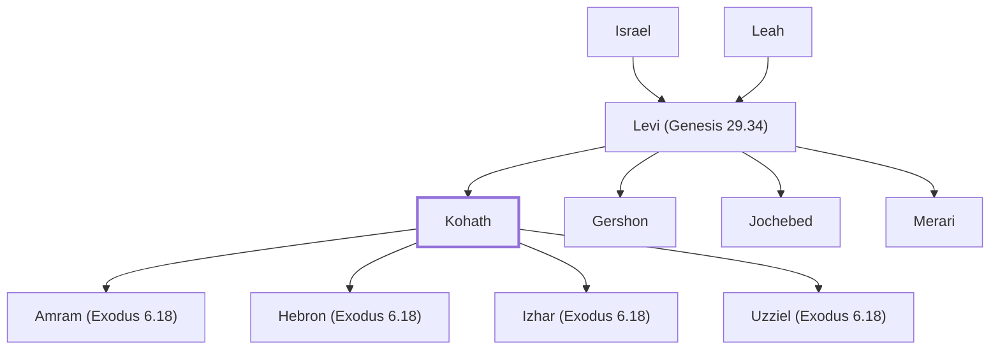

# Kohath

Son of Levi; Levite clan ancestor

**Original-language names:** קְהָת (H6955)

## When

- **Placed around:** [[connections/timeline/15th century BC|1490 BC]] *(Ussher: the median date of the passages naming them)*

## Family

- **Father:** [[connections/people/Levi (Genesis 29.34)|Levi (Genesis 29.34)]]
- **Brothers and sisters:** [[connections/people/Gershon|Gershon]], [[connections/people/Jochebed|Jochebed]], [[connections/people/Merari|Merari]]
- **Children:** [[connections/people/Amram (Exodus 6.18)|Amram (Exodus 6.18)]], [[connections/people/Hebron (Exodus 6.18)|Hebron (Exodus 6.18)]], [[connections/people/Izhar (Exodus 6.18)|Izhar (Exodus 6.18)]], [[connections/people/Uzziel (Exodus 6.18)|Uzziel (Exodus 6.18)]]
- **Tribe or nation:** Tribe of Levi

**Line of descent** (25 generations, father to son): [[connections/people/Adam|Adam]] → [[connections/people/Seth|Seth]] → [[connections/people/Enosh|Enosh]] → [[connections/people/Kenan|Kenan]] → [[connections/people/Mahalalel (Genesis 5.12)|Mahalalel (Genesis 5.12)]] → [[connections/people/Jared|Jared]] → [[connections/people/Enoch (Genesis 5.18)|Enoch (Genesis 5.18)]] → [[connections/people/Methuselah|Methuselah]] → [[connections/people/Lamech (Genesis 5.25)|Lamech (Genesis 5.25)]] → [[connections/people/Noah (Genesis 5.29)|Noah (Genesis 5.29)]] → [[connections/people/Shem|Shem]] → [[connections/people/Arpachshad|Arpachshad]] → [[connections/people/Cainan|Cainan]] → [[connections/people/Shelah (Genesis 10.24)|Shelah (Genesis 10.24)]] → [[connections/people/Eber (Genesis 10.21)|Eber (Genesis 10.21)]] → [[connections/people/Peleg|Peleg]] → [[connections/people/Reu|Reu]] → [[connections/people/Serug|Serug]] → [[connections/people/Nahor (Genesis 11.22)|Nahor (Genesis 11.22)]] → [[connections/people/Terah|Terah]] → [[connections/people/Abraham|Abraham]] → [[connections/people/Isaac|Isaac]] → [[connections/people/Israel|Israel]] → [[connections/people/Levi (Genesis 29.34)|Levi (Genesis 29.34)]] → **Kohath**

**Family group:** [[connections/genealogy/Family of Adam|Family of Adam]], generation 25

## Appears in

[[connections/chapters/01-genesis/Genesis 46|Genesis 46]] · [[connections/chapters/02-exodus/Exodus 6|Exodus 6 (2)]] · [[connections/chapters/04-numbers/Numbers 3|Numbers 3 (4)]] · [[connections/chapters/04-numbers/Numbers 4|Numbers 4 (3)]] · [[connections/chapters/04-numbers/Numbers 7|Numbers 7]] · [[connections/chapters/04-numbers/Numbers 16|Numbers 16]] · [[connections/chapters/04-numbers/Numbers 26|Numbers 26 (2)]] · [[connections/chapters/06-joshua/Joshua 21|Joshua 21 (3)]] · [[connections/chapters/13-1-chronicles/1 Chronicles 5|1 Chronicles 5 (2)]] · [[connections/chapters/13-1-chronicles/1 Chronicles 6|1 Chronicles 6 (7)]] · [[connections/chapters/13-1-chronicles/1 Chronicles 15|1 Chronicles 15]] · [[connections/chapters/13-1-chronicles/1 Chronicles 23|1 Chronicles 23 (2)]]

## Appears in the same verse as

[[connections/people/Levi (Genesis 29.34)|Levi (Genesis 29.34) (10)]] · [[connections/people/Izhar (Exodus 6.18)|Izhar (Exodus 6.18) (8)]] · [[connections/people/Gershon|Gershon (7)]] · [[connections/people/Merari|Merari (7)]] · [[connections/people/Amram (Exodus 6.18)|Amram (Exodus 6.18) (6)]] · [[connections/people/Hebron (Exodus 6.18)|Hebron (Exodus 6.18) (5)]] · [[connections/people/Uzziel (Exodus 6.18)|Uzziel (Exodus 6.18) (5)]] · [[connections/people/Ephraim|Ephraim (3)]] · [[connections/people/Manasseh (Genesis 41.51)|Manasseh (Genesis 41.51) (3)]] · [[connections/people/Korah (Exodus 6.21)|Korah (Exodus 6.21) (2)]] · [[connections/people/Aaron|Aaron]] · [[connections/people/Abiram (Numbers 16.1)|Abiram (Numbers 16.1)]] · [[connections/people/Assir (Exodus 6.24)|Assir (Exodus 6.24)]] · [[connections/people/Dathan|Dathan]] · [[connections/people/David|David]] · [[connections/people/Eliab (Numbers 16.1)|Eliab (Numbers 16.1)]] · [[connections/people/Israel|Israel]] · [[connections/people/On|On]] · [[connections/people/Peleth (Numbers 16.1)|Peleth (Numbers 16.1)]] · [[connections/people/Reuben|Reuben]] · [[connections/people/Uriel (1 Chronicles 15.5)|Uriel (1 Chronicles 15.5)]] · [[connections/places/Dan|Dan]] · [[connections/places/Ibleam|Ibleam]] · [[connections/places/Taanach|Taanach]]
