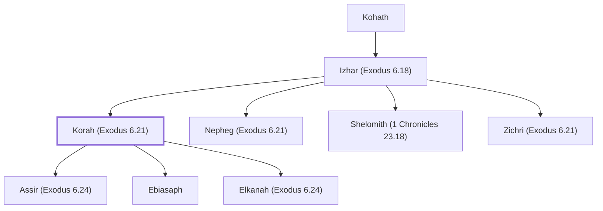

# Korah (Exodus 6.21)

Levite rebel leader; his descendants became temple servants

**Original-language names:** קֹ֫רַח (H7141) · Κορέ (G2879)

## When

- **Placed around:** [[connections/timeline/15th century BC|1471 BC]] *(Ussher: the median date of the passages naming them)*

## Family

- **Father:** [[connections/people/Izhar (Exodus 6.18)|Izhar (Exodus 6.18)]]
- **Brothers and sisters:** [[connections/people/Nepheg (Exodus 6.21)|Nepheg (Exodus 6.21)]], [[connections/people/Shelomith (1 Chronicles 23.18)|Shelomith (1 Chronicles 23.18)]], [[connections/people/Zichri (Exodus 6.21)|Zichri (Exodus 6.21)]]
- **Children:** [[connections/people/Assir (Exodus 6.24)|Assir (Exodus 6.24)]], [[connections/people/Ebiasaph|Ebiasaph]], [[connections/people/Elkanah (Exodus 6.24)|Elkanah (Exodus 6.24)]]
- **Tribe or nation:** Tribe of Levi

**Line of descent** (27 generations, father to son): [[connections/people/Adam|Adam]] → [[connections/people/Seth|Seth]] → [[connections/people/Enosh|Enosh]] → [[connections/people/Kenan|Kenan]] → [[connections/people/Mahalalel (Genesis 5.12)|Mahalalel (Genesis 5.12)]] → [[connections/people/Jared|Jared]] → [[connections/people/Enoch (Genesis 5.18)|Enoch (Genesis 5.18)]] → [[connections/people/Methuselah|Methuselah]] → [[connections/people/Lamech (Genesis 5.25)|Lamech (Genesis 5.25)]] → [[connections/people/Noah (Genesis 5.29)|Noah (Genesis 5.29)]] → [[connections/people/Shem|Shem]] → [[connections/people/Arpachshad|Arpachshad]] → [[connections/people/Cainan|Cainan]] → [[connections/people/Shelah (Genesis 10.24)|Shelah (Genesis 10.24)]] → [[connections/people/Eber (Genesis 10.21)|Eber (Genesis 10.21)]] → [[connections/people/Peleg|Peleg]] → [[connections/people/Reu|Reu]] → [[connections/people/Serug|Serug]] → [[connections/people/Nahor (Genesis 11.22)|Nahor (Genesis 11.22)]] → [[connections/people/Terah|Terah]] → [[connections/people/Abraham|Abraham]] → [[connections/people/Isaac|Isaac]] → [[connections/people/Israel|Israel]] → [[connections/people/Levi (Genesis 29.34)|Levi (Genesis 29.34)]] → [[connections/people/Kohath|Kohath]] → [[connections/people/Izhar (Exodus 6.18)|Izhar (Exodus 6.18)]] → **Korah (Exodus 6.21)**

**Family group:** [[connections/genealogy/Family of Adam|Family of Adam]], generation 27

## Appears in

[[connections/chapters/02-exodus/Exodus 6|Exodus 6 (2)]] · [[connections/chapters/04-numbers/Numbers 16|Numbers 16 (9)]] · [[connections/chapters/04-numbers/Numbers 17|Numbers 17 (2)]] · [[connections/chapters/04-numbers/Numbers 26|Numbers 26 (3)]] · [[connections/chapters/04-numbers/Numbers 27|Numbers 27]] · [[connections/chapters/13-1-chronicles/1 Chronicles 6|1 Chronicles 6 (2)]] · [[connections/chapters/13-1-chronicles/1 Chronicles 9|1 Chronicles 9]] · [[connections/chapters/19-psalms/Psalms 42|Psalms 42]] · [[connections/chapters/19-psalms/Psalms 44|Psalms 44]] · [[connections/chapters/19-psalms/Psalms 45|Psalms 45]] · [[connections/chapters/19-psalms/Psalms 46|Psalms 46]] · [[connections/chapters/19-psalms/Psalms 47|Psalms 47]] · [[connections/chapters/19-psalms/Psalms 48|Psalms 48]] · [[connections/chapters/19-psalms/Psalms 49|Psalms 49]] · [[connections/chapters/19-psalms/Psalms 84|Psalms 84]] · [[connections/chapters/19-psalms/Psalms 85|Psalms 85]] · [[connections/chapters/19-psalms/Psalms 87|Psalms 87]] · [[connections/chapters/19-psalms/Psalms 88|Psalms 88]] · [[connections/chapters/65-jude/Jude 1|Jude 1]]

## Appears in the same verse as

[[connections/people/Abiram (Numbers 16.1)|Abiram (Numbers 16.1) (4)]] · [[connections/people/Dathan|Dathan (4)]] · [[connections/people/Moses|Moses (4)]] · [[connections/people/Aaron|Aaron (3)]] · [[connections/people/Ebiasaph|Ebiasaph (3)]] · [[connections/people/Izhar (Exodus 6.18)|Izhar (Exodus 6.18) (3)]] · [[connections/people/Assir (Exodus 6.24)|Assir (Exodus 6.24) (2)]] · [[connections/people/Eliab (Numbers 16.1)|Eliab (Numbers 16.1) (2)]] · [[connections/people/Kohath|Kohath (2)]] · [[connections/people/Levi (Genesis 29.34)|Levi (Genesis 29.34) (2)]] · [[connections/people/Assir (1 Chronicles 6.8)|Assir (1 Chronicles 6.8)]] · [[connections/people/Balaam|Balaam]] · [[connections/people/Cain|Cain]] · [[connections/people/Elkanah (Exodus 6.24)|Elkanah (Exodus 6.24)]] · [[connections/people/Heman (1 Kings 5.11)|Heman (1 Kings 5.11)]] · [[connections/people/Israel|Israel]] · [[connections/people/Kore (1 Chronicles 9.19)|Kore (1 Chronicles 9.19)]] · [[connections/people/Nemuel|Nemuel]] · [[connections/people/Nepheg (Exodus 6.21)|Nepheg (Exodus 6.21)]] · [[connections/people/On|On]] · [[connections/people/Peleth (Numbers 16.1)|Peleth (Numbers 16.1)]] · [[connections/people/Reuben|Reuben]] · [[connections/people/Shallum (1 Chronicles 9.17)|Shallum (1 Chronicles 9.17)]] · [[connections/people/Tahath (1 Chronicles 6.9)|Tahath (1 Chronicles 6.9)]] · [[connections/people/Zichri (Exodus 6.21)|Zichri (Exodus 6.21)]]
