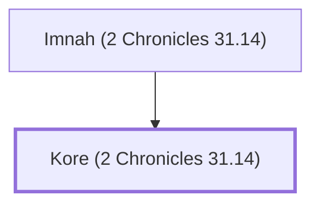

# Kore (2 Chronicles 31.14)

Levite in charge of freewill offerings

**Original-language names:** קוֹרֵא (H6981)

## When

- **Placed around:** [[connections/timeline/8th century BC|726 BC]] *(Ussher: the median date of the passages naming them)*

## Family

- **Father:** [[connections/people/Imnah (2 Chronicles 31.14)|Imnah (2 Chronicles 31.14)]]

**Family group:** [[connections/genealogy/Family of Imnah (2 Chronicles 31.14)|Family of Imnah (2 Chronicles 31.14)]], generation 2

## Appears in

[[connections/chapters/14-2-chronicles/2 Chronicles 31|2 Chronicles 31]]

## Appears in the same verse as

[[connections/people/Imnah (2 Chronicles 31.14)|Imnah (2 Chronicles 31.14)]]
