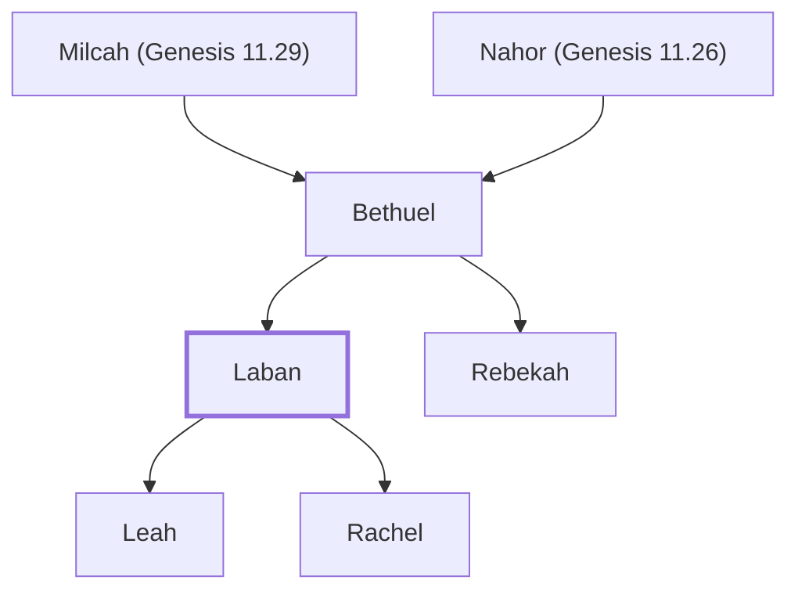

# Laban

Brother of Rebekah; father of Leah and Rachel

**Original-language names:** לָבָן (H3837a)

## When

- **Placed around:** [[connections/timeline/18th century BC|1739 BC]] *(Ussher: the median date of the passages naming them)*

## Family

- **Father:** [[connections/people/Bethuel|Bethuel]]
- **Brothers and sisters:** [[connections/people/Rebekah|Rebekah]]
- **Children:** [[connections/people/Leah|Leah]], [[connections/people/Rachel|Rachel]]
- **Tribe or nation:** Early Patriarch

**Line of descent** (23 generations, father to son): [[connections/people/Adam|Adam]] → [[connections/people/Seth|Seth]] → [[connections/people/Enosh|Enosh]] → [[connections/people/Kenan|Kenan]] → [[connections/people/Mahalalel (Genesis 5.12)|Mahalalel (Genesis 5.12)]] → [[connections/people/Jared|Jared]] → [[connections/people/Enoch (Genesis 5.18)|Enoch (Genesis 5.18)]] → [[connections/people/Methuselah|Methuselah]] → [[connections/people/Lamech (Genesis 5.25)|Lamech (Genesis 5.25)]] → [[connections/people/Noah (Genesis 5.29)|Noah (Genesis 5.29)]] → [[connections/people/Shem|Shem]] → [[connections/people/Arpachshad|Arpachshad]] → [[connections/people/Cainan|Cainan]] → [[connections/people/Shelah (Genesis 10.24)|Shelah (Genesis 10.24)]] → [[connections/people/Eber (Genesis 10.21)|Eber (Genesis 10.21)]] → [[connections/people/Peleg|Peleg]] → [[connections/people/Reu|Reu]] → [[connections/people/Serug|Serug]] → [[connections/people/Nahor (Genesis 11.22)|Nahor (Genesis 11.22)]] → [[connections/people/Terah|Terah]] → [[connections/people/Nahor (Genesis 11.26)|Nahor (Genesis 11.26)]] → [[connections/people/Bethuel|Bethuel]] → **Laban**

**Family group:** [[connections/genealogy/Family of Adam|Family of Adam]], generation 23

## Appears in

[[connections/chapters/01-genesis/Genesis 24|Genesis 24 (2)]] · [[connections/chapters/01-genesis/Genesis 25|Genesis 25]] · [[connections/chapters/01-genesis/Genesis 27|Genesis 27]] · [[connections/chapters/01-genesis/Genesis 28|Genesis 28 (2)]] · [[connections/chapters/01-genesis/Genesis 29|Genesis 29 (13)]] · [[connections/chapters/01-genesis/Genesis 30|Genesis 30 (6)]] · [[connections/chapters/01-genesis/Genesis 31|Genesis 31 (17)]] · [[connections/chapters/01-genesis/Genesis 32|Genesis 32 (2)]] · [[connections/chapters/01-genesis/Genesis 46|Genesis 46 (2)]]

## Appears in the same verse as

[[connections/people/Israel|Israel (25)]] · [[connections/people/Rachel|Rachel (9)]] · [[connections/people/Leah|Leah (5)]] · [[connections/people/Bethuel|Bethuel (4)]] · [[connections/people/Rebekah|Rebekah (3)]] · [[connections/places/Paddan|Paddan (3)]] · [[connections/people/Bilhah|Bilhah (2)]] · [[connections/people/Esau|Esau (2)]] · [[connections/people/Isaac|Isaac (2)]] · [[connections/people/Zilpah|Zilpah (2)]] · [[connections/places/Ramoth|Ramoth (2)]] · [[connections/people/Joseph (Genesis 30.24)|Joseph (Genesis 30.24)]] · [[connections/people/Nahor (Genesis 11.26)|Nahor (Genesis 11.26)]] · [[connections/places/Gilead|Gilead]] · [[connections/places/Haran|Haran]]
