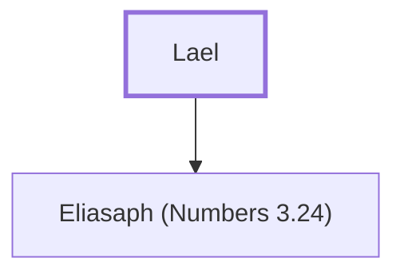

# Lael

Father of Eliasaph, a Gershonite Levite

**Original-language names:** לָאֵל (H3815)

## When

- **Placed around:** [[connections/timeline/15th century BC|1490 BC]] *(Ussher: the median date of the passages naming them)*

## Family

- **Children:** [[connections/people/Eliasaph (Numbers 3.24)|Eliasaph (Numbers 3.24)]]

**Family group:** [[connections/genealogy/Family of Lael|Family of Lael]], generation 1

## Appears in

[[connections/chapters/04-numbers/Numbers 3|Numbers 3]]

## Appears in the same verse as

[[connections/people/Eliasaph (Numbers 3.24)|Eliasaph (Numbers 3.24)]]
