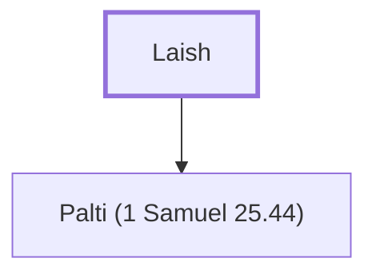

# Laish

Father of Michal's husband Palti (or 'Paltiel')

**Original-language names:** לַ֫יִשׁ (H3919b) · לוּשׁ (H3889)

## When

- **Placed around:** [[connections/timeline/11th century BC|1048 BC]] *(Ussher: the median date of the passages naming them)*

## Family

- **Children:** [[connections/people/Palti (1 Samuel 25.44)|Palti (1 Samuel 25.44)]]

**Family group:** [[connections/genealogy/Family of Laish|Family of Laish]], generation 1

## Appears in

[[connections/chapters/09-1-samuel/1 Samuel 25|1 Samuel 25]] · [[connections/chapters/10-2-samuel/2 Samuel 3|2 Samuel 3]]

## Appears in the same verse as

[[connections/people/Palti (1 Samuel 25.44)|Palti (1 Samuel 25.44) (2)]] · [[connections/people/David|David]] · [[connections/people/Ish-bosheth|Ish-bosheth]] · [[connections/people/Michal|Michal]] · [[connections/people/Saul|Saul]] · [[connections/places/Gallim|Gallim]]
