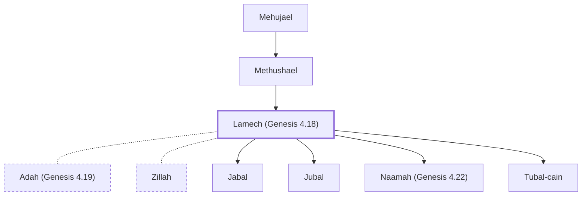

# Lamech (Genesis 4.18)

Descendant of Cain; first polygamist mentioned in the Bible

**Original-language names:** לֶ֫מֶךְ (H3929)

## When

- **Placed around:** [[connections/timeline/41st century BC|4003 BC]] *(Ussher: the median date of the passages naming them)*

## Family

- **Father:** [[connections/people/Methushael|Methushael]]
- **Spouses:** [[connections/people/Adah (Genesis 4.19)|Adah (Genesis 4.19)]], [[connections/people/Zillah|Zillah]]
- **Children:** [[connections/people/Jabal|Jabal]], [[connections/people/Jubal|Jubal]], [[connections/people/Naamah (Genesis 4.22)|Naamah (Genesis 4.22)]], [[connections/people/Tubal-cain|Tubal-cain]]
- **Tribe or nation:** Early Patriarch

**Line of descent** (7 generations, father to son): [[connections/people/Adam|Adam]] → [[connections/people/Cain|Cain]] → [[connections/people/Enoch (Genesis 4.17)|Enoch (Genesis 4.17)]] → [[connections/people/Irad|Irad]] → [[connections/people/Mehujael|Mehujael]] → [[connections/people/Methushael|Methushael]] → **Lamech (Genesis 4.18)**

**Family group:** [[connections/genealogy/Family of Adam|Family of Adam]], generation 7

## Appears in

[[connections/chapters/01-genesis/Genesis 4|Genesis 4 (4)]]

## Appears in the same verse as

[[connections/people/Adah (Genesis 4.19)|Adah (Genesis 4.19) (2)]] · [[connections/people/Zillah|Zillah (2)]] · [[connections/people/Cain|Cain]] · [[connections/people/Enoch (Genesis 4.17)|Enoch (Genesis 4.17)]] · [[connections/people/Irad|Irad]] · [[connections/people/Mehujael|Mehujael]] · [[connections/people/Methushael|Methushael]]
