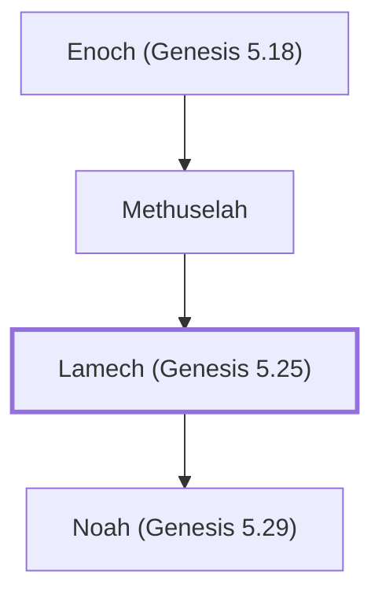

# Lamech (Genesis 5.25)

Father of Noah; lived 777 years

**Original-language names:** לֶ֫מֶךְ (H3929) · Λάμεχ (G2984)

## When

- **Lived:** [[connections/timeline/32nd century BC|3130 BC]] – [[connections/timeline/24th century BC|2353 BC]] *(Jones)*
- **Placed around:** [[connections/timeline/30th century BC|2948 BC]] *(Ussher: the median date of the passages naming them)*

## Family

- **Father:** [[connections/people/Methuselah|Methuselah]]
- **Children:** [[connections/people/Noah (Genesis 5.29)|Noah (Genesis 5.29)]]
- **Tribe or nation:** Early Patriarch

**Line of descent** (9 generations, father to son): [[connections/people/Adam|Adam]] → [[connections/people/Seth|Seth]] → [[connections/people/Enosh|Enosh]] → [[connections/people/Kenan|Kenan]] → [[connections/people/Mahalalel (Genesis 5.12)|Mahalalel (Genesis 5.12)]] → [[connections/people/Jared|Jared]] → [[connections/people/Enoch (Genesis 5.18)|Enoch (Genesis 5.18)]] → [[connections/people/Methuselah|Methuselah]] → **Lamech (Genesis 5.25)**

**Family group:** [[connections/genealogy/Family of Adam|Family of Adam]], generation 9

## Events

- [[connections/timeline/32nd century BC|3130 BC]] · [[connections/events/Birth of Lamech|Birth of Lamech]]
- [[connections/timeline/32nd century BC|3130 BC]] · [[connections/events/Lifetime of Lamech|Lifetime of Lamech]]
- [[connections/timeline/30th century BC|2948 BC]] · [[connections/events/Birth of Noah|Birth of Noah]]
- [[connections/timeline/24th century BC|2353 BC]] · [[connections/events/Death of Lamech|Death of Lamech]]

## Appears in

[[connections/chapters/01-genesis/Genesis 5|Genesis 5 (5)]] · [[connections/chapters/13-1-chronicles/1 Chronicles 1|1 Chronicles 1]] · [[connections/chapters/42-luke/Luke 3|Luke 3]]

## Appears in the same verse as

[[connections/people/Methuselah|Methuselah (3)]] · [[connections/people/Noah (Genesis 5.29)|Noah (Genesis 5.29) (2)]] · [[connections/people/Arpachshad|Arpachshad]] · [[connections/people/Cainan|Cainan]] · [[connections/people/Enoch (Genesis 5.18)|Enoch (Genesis 5.18)]] · [[connections/people/Shem|Shem]]
