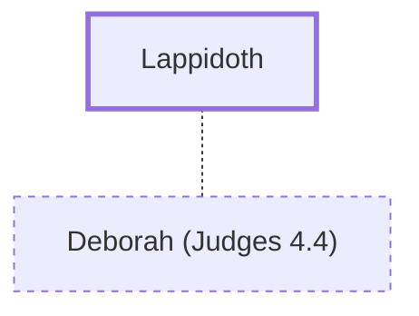

# Lappidoth

Husband of Deborah the prophetess and judge

**Original-language names:** לַפִּידוֹת (H3941)

## When

- **Placed around:** [[connections/timeline/13th century BC|1285 BC]] *(Ussher: the median date of the passages naming them)*

## Family

- **Spouses:** [[connections/people/Deborah (Judges 4.4)|Deborah (Judges 4.4)]]

## Appears in

[[connections/chapters/07-judges/Judges 4|Judges 4]]

## Appears in the same verse as

[[connections/people/Deborah (Judges 4.4)|Deborah (Judges 4.4)]] · [[connections/people/Israel|Israel]]
