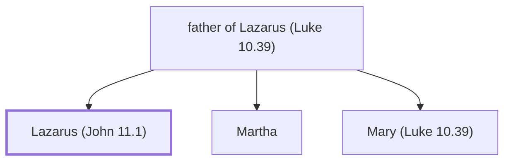

# Lazarus (John 11.1)

Brother of Mary and Martha; raised from the dead

**Original-language names:** Λάζαρος (G2976)

## When

- **Placed around:** [[connections/timeline/1st century AD|AD 33]] *(Ussher: the median date of the passages naming them)*

## Family

- **Father:** [[connections/people/father of Lazarus (Luke 10.39)|father of Lazarus (Luke 10.39)]]
- **Brothers and sisters:** [[connections/people/Martha|Martha]], [[connections/people/Mary (Luke 10.39)|Mary (Luke 10.39)]]

**Family group:** [[connections/genealogy/Family of father of Lazarus (Luke 10.39)|Family of father of Lazarus (Luke 10.39)]], generation 2

## Events

- [[connections/timeline/1st century AD|AD 30]] · [[connections/events/Lazarus Raised form the Dead|Lazarus Raised form the Dead]]
- [[connections/timeline/1st century AD|AD 30]] · [[connections/events/Mary Anoints Jesus|Mary Anoints Jesus]]

## Appears in

[[connections/chapters/43-john/John 11|John 11 (6)]] · [[connections/chapters/43-john/John 12|John 12 (5)]]

## Appears in the same verse as

[[connections/people/Jesus|Jesus (4)]] · [[connections/people/Martha|Martha (3)]] · [[connections/people/Mary (Luke 10.39)|Mary (Luke 10.39) (2)]] · [[connections/places/Bethany|Bethany (2)]]
