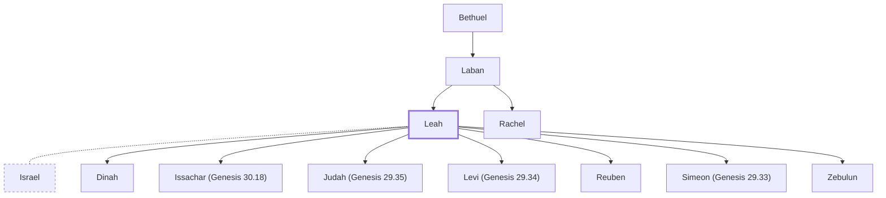

# Leah

Wife of Jacob; mother of six sons and Dinah

**Original-language names:** לֵאָה (H3812)

## When

- **Placed around:** [[connections/timeline/18th century BC|1747 BC]] *(Ussher: the median date of the passages naming them)*

## Family

- **Father:** [[connections/people/Laban|Laban]]
- **Brothers and sisters:** [[connections/people/Rachel|Rachel]]
- **Spouses:** [[connections/people/Israel|Israel]]
- **Children:** [[connections/people/Dinah|Dinah]], [[connections/people/Issachar (Genesis 30.18)|Issachar (Genesis 30.18)]], [[connections/people/Judah (Genesis 29.35)|Judah (Genesis 29.35)]], [[connections/people/Levi (Genesis 29.34)|Levi (Genesis 29.34)]], [[connections/people/Reuben|Reuben]], [[connections/people/Simeon (Genesis 29.33)|Simeon (Genesis 29.33)]], [[connections/people/Zebulun|Zebulun]]
- **Tribe or nation:** Early Patriarch

**Line of descent** (24 generations, father to son): [[connections/people/Adam|Adam]] → [[connections/people/Seth|Seth]] → [[connections/people/Enosh|Enosh]] → [[connections/people/Kenan|Kenan]] → [[connections/people/Mahalalel (Genesis 5.12)|Mahalalel (Genesis 5.12)]] → [[connections/people/Jared|Jared]] → [[connections/people/Enoch (Genesis 5.18)|Enoch (Genesis 5.18)]] → [[connections/people/Methuselah|Methuselah]] → [[connections/people/Lamech (Genesis 5.25)|Lamech (Genesis 5.25)]] → [[connections/people/Noah (Genesis 5.29)|Noah (Genesis 5.29)]] → [[connections/people/Shem|Shem]] → [[connections/people/Arpachshad|Arpachshad]] → [[connections/people/Cainan|Cainan]] → [[connections/people/Shelah (Genesis 10.24)|Shelah (Genesis 10.24)]] → [[connections/people/Eber (Genesis 10.21)|Eber (Genesis 10.21)]] → [[connections/people/Peleg|Peleg]] → [[connections/people/Reu|Reu]] → [[connections/people/Serug|Serug]] → [[connections/people/Nahor (Genesis 11.22)|Nahor (Genesis 11.22)]] → [[connections/people/Terah|Terah]] → [[connections/people/Nahor (Genesis 11.26)|Nahor (Genesis 11.26)]] → [[connections/people/Bethuel|Bethuel]] → [[connections/people/Laban|Laban]] → **Leah**

**Family group:** [[connections/genealogy/Family of Adam|Family of Adam]], generation 24

## Events

- [[connections/timeline/18th century BC|1758 BC]] · [[connections/events/Birth of Reuben|Birth of Reuben]]
- [[connections/timeline/18th century BC|1757 BC]] · [[connections/events/Birth of Simeon|Birth of Simeon]]
- [[connections/timeline/18th century BC|1756 BC]] · [[connections/events/Birth of Levi|Birth of Levi]]
- [[connections/timeline/18th century BC|1755 BC]] · [[connections/events/Birth of Judah|Birth of Judah]]
- [[connections/timeline/18th century BC|1752 BC]] · [[connections/events/Birth of Issachar|Birth of Issachar]]
- [[connections/timeline/18th century BC|1751 BC]] · [[connections/events/Birth of Zebulon|Birth of Zebulon]]
- [[connections/timeline/18th century BC|1750 BC]] · [[connections/events/Birth of Dinah|Birth of Dinah]]

## Appears in

[[connections/chapters/01-genesis/Genesis 29|Genesis 29 (8)]] · [[connections/chapters/01-genesis/Genesis 30|Genesis 30 (11)]] · [[connections/chapters/01-genesis/Genesis 31|Genesis 31 (3)]] · [[connections/chapters/01-genesis/Genesis 33|Genesis 33 (3)]] · [[connections/chapters/01-genesis/Genesis 34|Genesis 34]] · [[connections/chapters/01-genesis/Genesis 35|Genesis 35 (2)]] · [[connections/chapters/01-genesis/Genesis 46|Genesis 46 (2)]] · [[connections/chapters/01-genesis/Genesis 49|Genesis 49]] · [[connections/chapters/08-ruth/Ruth 4|Ruth 4]]

## Appears in the same verse as

[[connections/people/Israel|Israel (15)]] · [[connections/people/Rachel|Rachel (13)]] · [[connections/people/Zilpah|Zilpah (6)]] · [[connections/people/Laban|Laban (5)]] · [[connections/people/Reuben|Reuben (3)]] · [[connections/people/Asher|Asher (2)]] · [[connections/people/Dinah|Dinah (2)]] · [[connections/people/Gad (Genesis 30.11)|Gad (Genesis 30.11) (2)]] · [[connections/people/Issachar (Genesis 30.18)|Issachar (Genesis 30.18) (2)]] · [[connections/people/Joseph (Genesis 30.24)|Joseph (Genesis 30.24) (2)]] · [[connections/people/Zebulun|Zebulun (2)]] · [[connections/places/Paddan|Paddan (2)]] · [[connections/people/Abraham|Abraham]] · [[connections/people/Esau|Esau]] · [[connections/people/Isaac|Isaac]] · [[connections/people/Judah (Genesis 29.35)|Judah (Genesis 29.35)]] · [[connections/people/Levi (Genesis 29.34)|Levi (Genesis 29.34)]] · [[connections/people/Rebekah|Rebekah]] · [[connections/people/Sarah|Sarah]] · [[connections/people/Simeon (Genesis 29.33)|Simeon (Genesis 29.33)]] · [[connections/places/Bethlehem (Genesis 35.16)|Bethlehem (Genesis 35.16)]]
