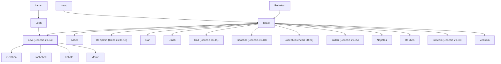

# Levi (Genesis 29.34)

Son of Jacob; progenitor of the Levites

**Original-language names:** לֵוִי (H3878) · לֵוָי (H3879) · Λευΐ (G3017)

## When

- **Lived:** [[connections/timeline/18th century BC|1756 BC]] – ? *(Jones)*
- **Placed around:** [[connections/timeline/15th century BC|1451 BC]] *(Ussher: the median date of the passages naming them)*

## Family

- **Father:** [[connections/people/Israel|Israel]]
- **Mother:** [[connections/people/Leah|Leah]]
- **Brothers and sisters:** [[connections/people/Asher|Asher]], [[connections/people/Benjamin (Genesis 35.18)|Benjamin (Genesis 35.18)]], [[connections/people/Dan|Dan]], [[connections/people/Dinah|Dinah]], [[connections/people/Gad (Genesis 30.11)|Gad (Genesis 30.11)]], [[connections/people/Issachar (Genesis 30.18)|Issachar (Genesis 30.18)]], [[connections/people/Joseph (Genesis 30.24)|Joseph (Genesis 30.24)]], [[connections/people/Judah (Genesis 29.35)|Judah (Genesis 29.35)]], [[connections/people/Naphtali|Naphtali]], [[connections/people/Reuben|Reuben]], [[connections/people/Simeon (Genesis 29.33)|Simeon (Genesis 29.33)]], [[connections/people/Zebulun|Zebulun]]
- **Children:** [[connections/people/Gershon|Gershon]], [[connections/people/Jochebed|Jochebed]], [[connections/people/Kohath|Kohath]], [[connections/people/Merari|Merari]]
- **Tribe or nation:** Tribe of Levi

**Line of descent** (24 generations, father to son): [[connections/people/Adam|Adam]] → [[connections/people/Seth|Seth]] → [[connections/people/Enosh|Enosh]] → [[connections/people/Kenan|Kenan]] → [[connections/people/Mahalalel (Genesis 5.12)|Mahalalel (Genesis 5.12)]] → [[connections/people/Jared|Jared]] → [[connections/people/Enoch (Genesis 5.18)|Enoch (Genesis 5.18)]] → [[connections/people/Methuselah|Methuselah]] → [[connections/people/Lamech (Genesis 5.25)|Lamech (Genesis 5.25)]] → [[connections/people/Noah (Genesis 5.29)|Noah (Genesis 5.29)]] → [[connections/people/Shem|Shem]] → [[connections/people/Arpachshad|Arpachshad]] → [[connections/people/Cainan|Cainan]] → [[connections/people/Shelah (Genesis 10.24)|Shelah (Genesis 10.24)]] → [[connections/people/Eber (Genesis 10.21)|Eber (Genesis 10.21)]] → [[connections/people/Peleg|Peleg]] → [[connections/people/Reu|Reu]] → [[connections/people/Serug|Serug]] → [[connections/people/Nahor (Genesis 11.22)|Nahor (Genesis 11.22)]] → [[connections/people/Terah|Terah]] → [[connections/people/Abraham|Abraham]] → [[connections/people/Isaac|Isaac]] → [[connections/people/Israel|Israel]] → **Levi (Genesis 29.34)**

**Family group:** [[connections/genealogy/Family of Adam|Family of Adam]], generation 24

## Events

- [[connections/timeline/18th century BC|1756 BC]] · [[connections/events/Birth of Levi|Birth of Levi]]
- [[connections/timeline/18th century BC|1728 BC]] · [[connections/events/Joseph sold to Egypt|Joseph sold to Egypt]]
- [[connections/timeline/18th century BC|1708 BC]] · [[connections/events/7 years of famine|7 years of famine]]
- [[connections/timeline/18th century BC|1706 BC]] · [[connections/events/Joseph's brothers return to Egypt|Joseph's brothers return to Egypt]]

## Appears in

[[connections/chapters/01-genesis/Genesis 29|Genesis 29]] · [[connections/chapters/01-genesis/Genesis 34|Genesis 34 (2)]] · [[connections/chapters/01-genesis/Genesis 35|Genesis 35]] · [[connections/chapters/01-genesis/Genesis 46|Genesis 46]] · [[connections/chapters/01-genesis/Genesis 49|Genesis 49]] · [[connections/chapters/02-exodus/Exodus 1|Exodus 1]] · [[connections/chapters/02-exodus/Exodus 2|Exodus 2]] · [[connections/chapters/02-exodus/Exodus 6|Exodus 6 (2)]] · [[connections/chapters/02-exodus/Exodus 32|Exodus 32 (2)]] · [[connections/chapters/04-numbers/Numbers 1|Numbers 1]] · [[connections/chapters/04-numbers/Numbers 3|Numbers 3 (3)]] · [[connections/chapters/04-numbers/Numbers 4|Numbers 4]] · [[connections/chapters/04-numbers/Numbers 16|Numbers 16 (4)]] · [[connections/chapters/04-numbers/Numbers 17|Numbers 17 (2)]] · [[connections/chapters/04-numbers/Numbers 18|Numbers 18 (2)]] · [[connections/chapters/04-numbers/Numbers 26|Numbers 26 (2)]] · [[connections/chapters/05-deuteronomy/Deuteronomy 10|Deuteronomy 10 (2)]] · [[connections/chapters/05-deuteronomy/Deuteronomy 18|Deuteronomy 18]] · [[connections/chapters/05-deuteronomy/Deuteronomy 21|Deuteronomy 21]] · [[connections/chapters/05-deuteronomy/Deuteronomy 27|Deuteronomy 27]] · [[connections/chapters/05-deuteronomy/Deuteronomy 31|Deuteronomy 31]] · [[connections/chapters/05-deuteronomy/Deuteronomy 33|Deuteronomy 33]] · [[connections/chapters/06-joshua/Joshua 13|Joshua 13 (2)]] · [[connections/chapters/06-joshua/Joshua 21|Joshua 21]] · [[connections/chapters/11-1-kings/1 Kings 12|1 Kings 12]] · [[connections/chapters/13-1-chronicles/1 Chronicles 2|1 Chronicles 2]] · [[connections/chapters/13-1-chronicles/1 Chronicles 5|1 Chronicles 5]] · [[connections/chapters/13-1-chronicles/1 Chronicles 6|1 Chronicles 6 (4)]] · [[connections/chapters/13-1-chronicles/1 Chronicles 9|1 Chronicles 9]] · [[connections/chapters/13-1-chronicles/1 Chronicles 12|1 Chronicles 12]] · [[connections/chapters/13-1-chronicles/1 Chronicles 21|1 Chronicles 21]] · [[connections/chapters/13-1-chronicles/1 Chronicles 23|1 Chronicles 23 (4)]] · [[connections/chapters/13-1-chronicles/1 Chronicles 24|1 Chronicles 24]] · [[connections/chapters/13-1-chronicles/1 Chronicles 27|1 Chronicles 27]] · [[connections/chapters/15-ezra/Ezra 6|Ezra 6 (2)]] · [[connections/chapters/15-ezra/Ezra 7|Ezra 7 (2)]] · [[connections/chapters/15-ezra/Ezra 8|Ezra 8 (2)]] · [[connections/chapters/16-nehemiah/Nehemiah 10|Nehemiah 10]] · [[connections/chapters/16-nehemiah/Nehemiah 12|Nehemiah 12]] · [[connections/chapters/19-psalms/Psalms 135|Psalms 135]] · [[connections/chapters/26-ezekiel/Ezekiel 40|Ezekiel 40]] · [[connections/chapters/26-ezekiel/Ezekiel 48|Ezekiel 48]] · [[connections/chapters/38-zechariah/Zechariah 12|Zechariah 12]] · [[connections/chapters/39-malachi/Malachi 2|Malachi 2 (2)]] · [[connections/chapters/39-malachi/Malachi 3|Malachi 3]] · [[connections/chapters/58-hebrews/Hebrews 7|Hebrews 7 (2)]] · [[connections/chapters/66-revelation/Revelation 7|Revelation 7]]

## Appears in the same verse as

[[connections/people/Israel|Israel (16)]] · [[connections/people/Kohath|Kohath (10)]] · [[connections/people/Moses|Moses (9)]] · [[connections/people/Merari|Merari (8)]] · [[connections/people/Simeon (Genesis 29.33)|Simeon (Genesis 29.33) (8)]] · [[connections/people/Gershon|Gershon (7)]] · [[connections/people/Aaron|Aaron (6)]] · [[connections/people/Judah (Genesis 29.35)|Judah (Genesis 29.35) (5)]] · [[connections/people/Reuben|Reuben (5)]] · [[connections/people/Issachar (Genesis 30.18)|Issachar (Genesis 30.18) (4)]] · [[connections/people/Amram (Exodus 6.18)|Amram (Exodus 6.18) (3)]] · [[connections/people/Abraham|Abraham (2)]] · [[connections/people/Benjamin (Genesis 35.18)|Benjamin (Genesis 35.18) (2)]] · [[connections/people/David|David (2)]] · [[connections/people/Izhar (Exodus 6.18)|Izhar (Exodus 6.18) (2)]] · [[connections/people/Korah (Exodus 6.21)|Korah (Exodus 6.21) (2)]] · [[connections/people/Mahli (Exodus 6.19)|Mahli (Exodus 6.19) (2)]] · [[connections/people/Mushi|Mushi (2)]] · [[connections/people/Zadok (2 Samuel 8.17)|Zadok (2 Samuel 8.17) (2)]] · [[connections/people/Zebulun|Zebulun (2)]] · [[connections/places/Jerusalem|Jerusalem (2)]] · [[connections/people/Abiram (Numbers 16.1)|Abiram (Numbers 16.1)]] · [[connections/people/Dathan|Dathan]] · [[connections/people/Dinah|Dinah]] · [[connections/people/Eliab (Numbers 16.1)|Eliab (Numbers 16.1)]] · [[connections/people/Eliashib (Nehemiah 12.10)|Eliashib (Nehemiah 12.10)]] · [[connections/people/Hashabiah (1 Chronicles 27.17)|Hashabiah (1 Chronicles 27.17)]] · [[connections/people/Jehdeiah (1 Chronicles 24.20)|Jehdeiah (1 Chronicles 24.20)]] · [[connections/people/Jehiel (1 Chronicles 6.5)|Jehiel (1 Chronicles 6.5)]] · [[connections/people/Joab (1 Samuel 26.6)|Joab (1 Samuel 26.6)]] · [[connections/people/Jochebed|Jochebed]] · [[connections/people/Johanan (Nehemiah 12.11)|Johanan (Nehemiah 12.11)]] · [[connections/people/Joseph (Genesis 30.24)|Joseph (Genesis 30.24)]] · [[connections/people/Kemuel (1 Chronicles 27.17)|Kemuel (1 Chronicles 27.17)]] · [[connections/people/Leah|Leah]] · [[connections/people/Mahli (1 Chronicles 6.32)|Mahli (1 Chronicles 6.32)]] · [[connections/people/Miriam (Exodus 15.20)|Miriam (Exodus 15.20)]] · [[connections/people/On|On]] · [[connections/people/Peleth (Numbers 16.1)|Peleth (Numbers 16.1)]] · [[connections/people/Shebuel (1 Chronicles 23.16)|Shebuel (1 Chronicles 23.16)]] · [[connections/people/Sherebiah (Ezra 8.18)|Sherebiah (Ezra 8.18)]] · [[connections/places/Ahava|Ahava]] · [[connections/places/Egypt|Egypt]] · [[connections/places/Gerizim Mount|Gerizim Mount]] · [[connections/places/Jordan|Jordan]] · [[connections/places/Massah|Massah]] · [[connections/places/Meribah (Exodus 17.7)|Meribah (Exodus 17.7)]]
