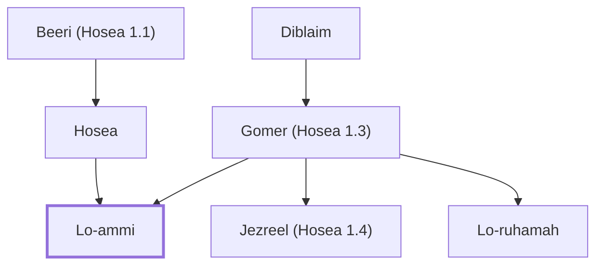

# Lo-ammi

Symbolic name of Hosea's son; represents God's rejection of Israel

**Original-language names:** לֹא עַמִּי (H3818)

## When

- **Placed around:** [[connections/timeline/8th century BC|785 BC]] *(Ussher: the median date of the passages naming them)*

## Family

- **Father:** [[connections/people/Hosea|Hosea]]
- **Mother:** [[connections/people/Gomer (Hosea 1.3)|Gomer (Hosea 1.3)]]
- **Brothers and sisters:** [[connections/people/Jezreel (Hosea 1.4)|Jezreel (Hosea 1.4)]], [[connections/people/Lo-ruhamah|Lo-ruhamah]]

**Line of descent** (3 generations, father to son): [[connections/people/Beeri (Hosea 1.1)|Beeri (Hosea 1.1)]] → [[connections/people/Hosea|Hosea]] → **Lo-ammi**

**Family group:** [[connections/genealogy/Family of Beeri (Hosea 1.1)|Family of Beeri (Hosea 1.1)]], generation 3

## Appears in

[[connections/chapters/28-hosea/Hosea 1|Hosea 1]]
