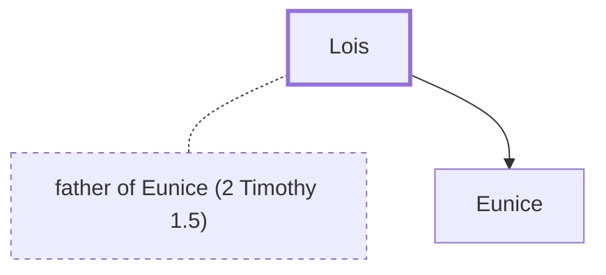

# Lois

Grandmother of Timothy; commended for her faith

**Original-language names:** Λωΐς (G3090)

## When

- **Placed around:** [[connections/timeline/1st century AD|AD 66]] *(Ussher: the median date of the passages naming them)*

## Family

- **Spouses:** [[connections/people/father of Eunice (2 Timothy 1.5)|father of Eunice (2 Timothy 1.5)]]
- **Children:** [[connections/people/Eunice|Eunice]]

**Family group:** [[connections/genealogy/Family of Lois|Family of Lois]], generation 1

## Appears in

[[connections/chapters/55-2-timothy/2 Timothy 1|2 Timothy 1]]

## Appears in the same verse as

[[connections/people/Eunice|Eunice]]
