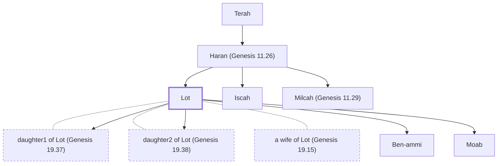

# Lot

Abraham's nephew; rescued from Sodom's destruction

**Original-language names:** לוֹט (H3876) · Λώτ (G3091)

## When

- **Placed around:** [[connections/timeline/20th century BC|1917 BC]] *(Ussher: the median date of the passages naming them)*

## Family

- **Father:** [[connections/people/Haran (Genesis 11.26)|Haran (Genesis 11.26)]]
- **Brothers and sisters:** [[connections/people/Iscah|Iscah]], [[connections/people/Milcah (Genesis 11.29)|Milcah (Genesis 11.29)]]
- **Spouses:** [[connections/people/daughter1 of Lot (Genesis 19.37)|daughter1 of Lot (Genesis 19.37)]], [[connections/people/daughter2 of Lot (Genesis 19.38)|daughter2 of Lot (Genesis 19.38)]], [[connections/people/a wife of Lot (Genesis 19.15)|a wife of Lot (Genesis 19.15)]]
- **Children:** [[connections/people/Ben-ammi|Ben-ammi]], [[connections/people/Moab|Moab]], [[connections/people/daughter1 of Lot (Genesis 19.37)|daughter1 of Lot (Genesis 19.37)]], [[connections/people/daughter2 of Lot (Genesis 19.38)|daughter2 of Lot (Genesis 19.38)]]
- **Tribe or nation:** Early Patriarch

**Line of descent** (22 generations, father to son): [[connections/people/Adam|Adam]] → [[connections/people/Seth|Seth]] → [[connections/people/Enosh|Enosh]] → [[connections/people/Kenan|Kenan]] → [[connections/people/Mahalalel (Genesis 5.12)|Mahalalel (Genesis 5.12)]] → [[connections/people/Jared|Jared]] → [[connections/people/Enoch (Genesis 5.18)|Enoch (Genesis 5.18)]] → [[connections/people/Methuselah|Methuselah]] → [[connections/people/Lamech (Genesis 5.25)|Lamech (Genesis 5.25)]] → [[connections/people/Noah (Genesis 5.29)|Noah (Genesis 5.29)]] → [[connections/people/Shem|Shem]] → [[connections/people/Arpachshad|Arpachshad]] → [[connections/people/Cainan|Cainan]] → [[connections/people/Shelah (Genesis 10.24)|Shelah (Genesis 10.24)]] → [[connections/people/Eber (Genesis 10.21)|Eber (Genesis 10.21)]] → [[connections/people/Peleg|Peleg]] → [[connections/people/Reu|Reu]] → [[connections/people/Serug|Serug]] → [[connections/people/Nahor (Genesis 11.22)|Nahor (Genesis 11.22)]] → [[connections/people/Terah|Terah]] → [[connections/people/Haran (Genesis 11.26)|Haran (Genesis 11.26)]] → **Lot**

**Family group:** [[connections/genealogy/Family of Adam|Family of Adam]], generation 22

## Events

- [[connections/timeline/20th century BC|1921 BC]] · [[connections/events/Abraham enters Canaan|Abraham enters Canaan]]
- [[connections/timeline/20th century BC|1921 BC]] · [[connections/events/Sojourn in Canaan and Egypt|Sojourn in Canaan and Egypt]]
- [[connections/timeline/20th century BC|1920 BC]] · [[connections/events/Abraham and Lot Separate|Abraham and Lot Separate]]
- [[connections/timeline/19th century BC|1897 BC]] · [[connections/events/Sodom Destroyed|Sodom Destroyed]]

## Appears in

[[connections/chapters/01-genesis/Genesis 11|Genesis 11 (2)]] · [[connections/chapters/01-genesis/Genesis 12|Genesis 12 (2)]] · [[connections/chapters/01-genesis/Genesis 13|Genesis 13 (8)]] · [[connections/chapters/01-genesis/Genesis 14|Genesis 14 (2)]] · [[connections/chapters/01-genesis/Genesis 19|Genesis 19 (13)]] · [[connections/chapters/05-deuteronomy/Deuteronomy 2|Deuteronomy 2 (2)]] · [[connections/chapters/19-psalms/Psalms 83|Psalms 83]] · [[connections/chapters/42-luke/Luke 17|Luke 17 (3)]] · [[connections/chapters/61-2-peter/2 Peter 2|2 Peter 2]]

## Appears in the same verse as

[[connections/people/Abraham|Abraham (12)]] · [[connections/places/Sodom|Sodom (5)]] · [[connections/places/Canaan|Canaan (3)]] · [[connections/places/Haran|Haran (3)]] · [[connections/places/Zoar|Zoar (3)]] · [[connections/people/Haran (Genesis 11.26)|Haran (Genesis 11.26) (2)]] · [[connections/people/Sarah|Sarah (2)]] · [[connections/people/Terah|Terah (2)]] · [[connections/places/Egypt|Egypt (2)]] · [[connections/places/Jordan|Jordan (2)]] · [[connections/people/Nahor (Genesis 11.26)|Nahor (Genesis 11.26)]] · [[connections/places/Ammon|Ammon]] · [[connections/places/Ar|Ar]] · [[connections/places/Assyria|Assyria]] · [[connections/places/Chaldea|Chaldea]] · [[connections/places/Gomorrah|Gomorrah]] · [[connections/places/Moab|Moab]] · [[connections/places/Negeb|Negeb]] · [[connections/places/Ur|Ur]]
