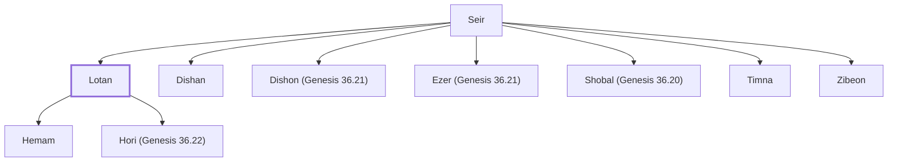

# Lotan

Son of Seir the Horite; chief of Edom

**Original-language names:** לוֹטָן (H3877)

## When

- **Placed around:** [[connections/timeline/19th century BC|1806 BC]] *(Ussher: the median date of the passages naming them)*

## Family

- **Father:** [[connections/people/Seir|Seir]]
- **Brothers and sisters:** [[connections/people/Dishan|Dishan]], [[connections/people/Dishon (Genesis 36.21)|Dishon (Genesis 36.21)]], [[connections/people/Ezer (Genesis 36.21)|Ezer (Genesis 36.21)]], [[connections/people/Shobal (Genesis 36.20)|Shobal (Genesis 36.20)]], [[connections/people/Timna|Timna]], [[connections/people/Zibeon|Zibeon]]
- **Children:** [[connections/people/Hemam|Hemam]], [[connections/people/Hori (Genesis 36.22)|Hori (Genesis 36.22)]]
- **Tribe or nation:** Edom

**Family group:** [[connections/genealogy/Family of Adam|Family of Adam]], generation 2

## Appears in

[[connections/chapters/01-genesis/Genesis 36|Genesis 36 (3)]] · [[connections/chapters/13-1-chronicles/1 Chronicles 1|1 Chronicles 1 (2)]]

## Appears in the same verse as

[[connections/people/Anah|Anah (3)]] · [[connections/people/Shobal (Genesis 36.20)|Shobal (Genesis 36.20) (3)]] · [[connections/people/Hemam|Hemam (2)]] · [[connections/people/Hori (Genesis 36.22)|Hori (Genesis 36.22) (2)]] · [[connections/people/Seir|Seir (2)]] · [[connections/people/Timna|Timna (2)]] · [[connections/people/Dishan|Dishan]] · [[connections/people/Dishon (Genesis 36.21)|Dishon (Genesis 36.21)]] · [[connections/people/Ezer (Genesis 36.21)|Ezer (Genesis 36.21)]]
